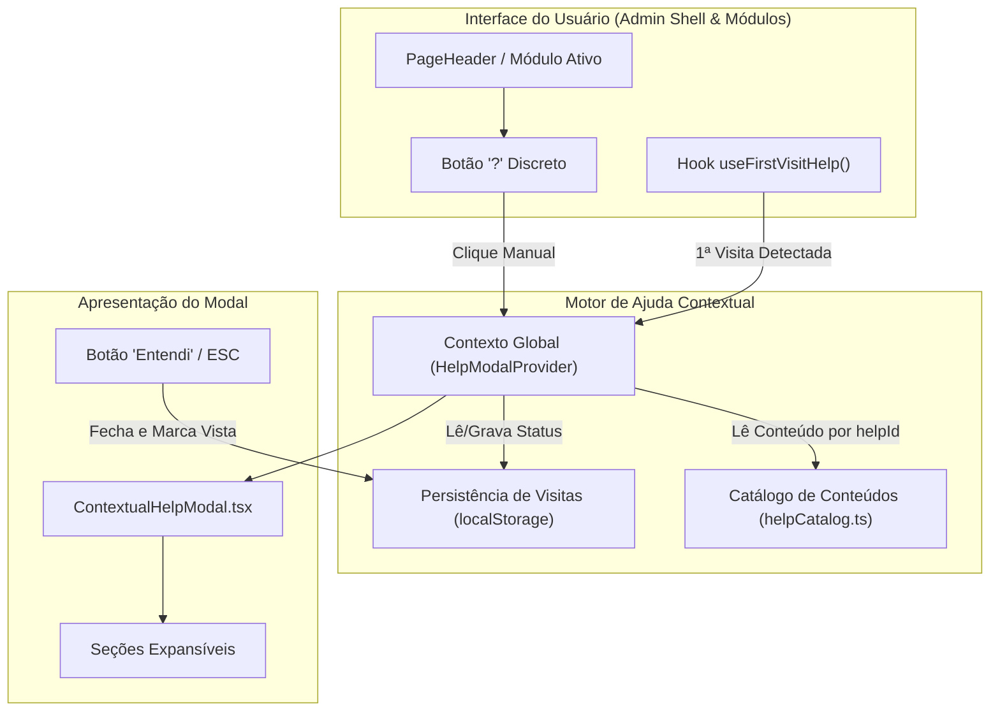

# DOSSIÊ DE AUDITORIA EXAUSTIVA — SISTEMA DE AJUDA CONTEXTUAL PREMIUM
## PLATAFORMA DIGITAL & CMS NUA BORGES

**Data da Auditoria:** 14 de Novembro de 2026  
**Especialidade:** UX Research, UX Writing, Product Education, Arquitetura da Informação e Engenharia de Software  
**Status do Repositório:** **ZERO ALTERAÇÕES DE CÓDIGO** (Auditoria, Mapeamento e Especificação Técnica 100% Declarativa)  
**Entregável:** Especificação Funcional, Mapeamento de Interfaces, Catálogo de Dúvidas, Textos Finais de Modais e Arquitetura do Sistema de Ajuda Contextual  
**Arquivo Canônico:** `DOSSIE_AUDITORIA_AJUDA_CONTEXTUAL_NUA.md`  

---

## 1. RESUMO EXECUTIVO

### 1.1 Objetivo e Contexto
A plataforma digital da **Nua Borges** é um ecossistema autoral de alto luxo estético (*Luxury Editorial Dark SaaS*), desenvolvido sob medida para a criadora de conteúdo, educadora sexual e sexóloga em formação **Nayara (Nua Borges)** e sua equipe de assessoria.

A operação do negócio abrange três frentes comerciais simultâneas:
1. **Monetização Direta via Conteúdos Digitais:** Catálogo de Packs de fotos e vídeos em 4K com entrega imediata em cofre criptografado.
2. **Serviços Sob Medida:** Fila de pedidos personalizados com calculadora dinâmica de precificação, regras de consentimento e entrega privativa.
3. **Atendimento Exclusivo em Tempo Real:** Chamadas VIP de vídeo com controle de agenda, modalidades de 15 a 60 minutos, links de salas protegidas e bloqueio de folgas.
4. **Presença Editorial e Autoridade de Marca:** Curadoria da vitrine pública (capa cinematográfica, galeria em esteira contínua, manifesto bio/afetivo, central de plataformas externas OnlyFans/Privacy/Instagram e assessoria de imprensa).
5. **Infraestrutura e Retaguarda:** Gestão financeira consolidada (Stripe), controle de mensalidade e contrato de desenvolvimento (Mercado Pago / 10x R$ 200), cofre de credenciais e diagnóstico de serviços.

### 1.2 Por Que um Sistema de Ajuda Contextual é Mandatório?
A cliente é uma artista e empreendedora sem formação técnica em programação, bancos de dados ou infraestrutura de nuvem. Embora o painel administrativo (`/admin`) apresente uma interface escura sofisticada (tons `#0c0d12`, bordas ultra-finas e acentos em rosa suave `#f4a7b9`), o uso diário expõe a usuária a conceitos intrincados:
- **Rascunho Local vs. Publicação no Ar:** O CMS funciona em duas fases — edições em textos, capas e galerias são armazenadas em rascunho seguro e exigem o clique em "Publicar Alterações", enquanto produtos, senhas e status de pedidos são gravados imediatamente no banco de dados.
- **Ecossistema de Mídias e Armazenamento:** A diferença entre fotos públicas da vitrine, fotos da biblioteca central (Backblaze B2), amostras gratuitas de packs e mídias ultrassecretas do cofre fechado.
- **Impacto em Tempo Real das Mudanças:** Como a edição de um preço na calculadora reflete instantaneamente para o fã que está simulando uma encomenda no site.

### 1.3 Por Que Tours Tradicionais Foram Rejeitados?
Tours tradicionais (estilo *Intro.js*, *Shepherd* ou *Driver.js* com setas piscando, escurecimento forçado de tela e passos obrigatórios "1 de 7", "2 de 7") são considerados invasivos, frustrantes e ineficazes para este perfil de usuária:
- Bloqueiam a produtividade quando a criadora quer apenas cumprir uma tarefa rápida no iPhone.
- Forçam a leitura de explicações que ela talvez não precise naquele momento.
- Tornam-se impossíveis de consultar novamente quando surge uma dúvida pontual dias depois.

### 1.4 A Solução Aprovada: Ajuda Contextual Sob Demanda
Seguindo a imagem de referência aprovada (`docs/referencia-visual-cms.jpg`), o sistema será constituído por:
1. **Modal Automático de Primeira Visita:** Ao entrar em uma aba ou sub-aba pela primeira vez, uma janela elegante surge suavemente no centro da tela explicando em linguagem humana, acolhedora e direta tudo o que aquela interface faz.
2. **Botão `?` Permanente e Discreto:** Em todas as telas, cabeçalhos de abas e modais secundários, um botão de ajuda fica sempre acessível ao lado do título para reabrir a explicação completa com 1 clique a qualquer momento.
3. **Estrutura Escaneável em Acordeões Elegantes:** O modal não é um bloco maciço de texto; ele possui introdução direta, seções expansíveis com ícones editoriais e um botão conclusivo de fechamento *"Entendi, começar"*.
4. **Persistência Inteligente:** O sistema memoriza localmente (`localStorage`) quais abas a cliente já conheceu, garantindo que o modal nunca apareça de forma intrusiva após ter sido visualizado ou dispensado.

---

## 2. SKILLS E FERRAMENTAS UTILIZADAS NA AUDITORIA

A execução desta auditoria mobilizou um conjunto rigoroso de competências multidisciplinares:

1. **UX Research & Heurísticas de Usabilidade (`ui-ux-pro-max`, `ui-review`):**
   - Aplicação das 10 Heurísticas de Nielsen (com foco em Reconhecimento em vez de Memorização, Prevenção de Erros e Correspondência com o Mundo Real).
   - Análise de carga cognitiva (Lei de Hick) em telas densas como *Preços & Calculadora*, *Editor de Packs* e *Hero*.
   - Mapeamento de *Mental Models* da criadora de conteúdo independente.
2. **UX Writing & Product Education:**
   - Criação de microcópia empática, elegante e autoral alinhada à voz da marca ("Deixa de vergonha ♡", acolhimento, sofisticação sem frieza corporativa).
   - Eliminação de jargões de engenharia (`Payload`, `Slug`, `IDOR`, `B2 Bucket`, `Webhook`, `KV/D1`, `Honeypot`, `Time-Trap`, `ISO 8601`) e substituição por analogias claras de negócios.
3. **Engenharia de Software & Arquitetura Next.js/React (`frontend-developer`, `clean-code`):**
   - Análise estática minuciosa do App Router (`app/admin/`), árvore de componentes (`components/nua/admin/`), gerenciamento de estado (`useAdminShell`, `useLibraryManager`, `useAppointmentsData`, `usePersonalizadosData`) e esquemas de dados (`lib/types.ts`).
   - Identificação dos fluxos de persistência (`localStorage`, `Supabase`, `Backblaze B2`, `Stripe API`).
4. **Browser Automation (`browser-automation`, Playwright MCP):**
   - Navegação direta na instância em execução (`http://localhost:3000/admin`), aferindo responsividade em Desktop (`1536×900`) e Mobile iPhone (`390×844`), acionamento de modais, drawers, popovers e controles interativos.
5. **Acessibilidade e Ergonomia Digital (`accessibility-compliance-accessibility-audit`, `ui-a11y`, WCAG 2.2 AA):**
   - Planejamento de armadilha de foco (*focus trap*), navegação por teclado (`Tab`, `Shift+Tab`, `Esc`), contraste de cor sobre fundo preto (`#0c0d12` vs `#f4a7b9` com ratio ≥ 4.5:1) e atributos `aria-expanded`, `aria-controls` e `role="dialog"`.

---

## 3. INVENTÁRIO COMPLETO E ATUALIZADO DO CMS (APÓS REORGANIZAÇÃO)

Abaixo está o mapa hierárquico exato do painel administrativo da NUA Borges, considerando a estrutura consolidada de 4 grupos principais e 1 grupo beta isolado:

```text
CMS NUA BORGES (/admin) — ARQUITETURA HIERÁRQUICA COMPLETA
├── 0. SHELL GLOBAL & NAVEGAÇÃO
│   ├── 0.1 Header Global (Breadcrumb, Indicador de Rascunho, Busca ⌘K, Selo Mensalidade, Ver Site, Sino de Pedidos, Avatar)
│   ├── 0.2 Modal de Busca Global / Spotlight (⌘K)
│   ├── 0.3 Sidebar Lateral Desktop (Grupos, Indicadores, Modo Expandido/Recolhido)
│   └── 0.4 Drawer Mobile (Menu gaveta para iPhone 390×844)
│
├── GRUPO 1: VISÃO GERAL
│   ├── 1. Dashboard Executiva (/admin/dashboard e /admin)
│   │   ├── 1.1 Banner de Saudação & Status de Operação
│   │   ├── 1.2 Cartões de Indicadores Vitais (Receita Mês, Packs Ativos, Pedidos Fila, Chamadas Próximas)
│   │   ├── 1.3 Grade de Ações Rápidas (Criar Pack, Enviar Mídias, Editar Site, Consultar Pedidos, Gerenciar Agenda)
│   │   ├── 1.4 Bloco "Atenção Necessária" (Alertas Críticos, Faturas Pendentes, Chamadas de Hoje)
│   │   └── 1.5 Bloco "Atividade Recente" (Feed Cronológico de Movimentações Comerciais)
│   └── 2. Pedidos e Alertas (/admin/alertas — AlertasSistemaModule)
│       ├── 2.1 Filtros de Categoria (Todos, Personalizados, Chamadas VIP, Packs Avulsos)
│       ├── 2.2 Feed Unificado de Pedidos & Ações Rápidas ("Acessar Registro", "Marcar como Lido")
│       └── 2.3 Estado Vazio Operacional (Atalhos de Trabalho quando zerado)
│
├── GRUPO 2: VENDAS E ATENDIMENTO
│   ├── 3. Conteúdos & Packs (/admin/conteudos — ConteudosPacksModule)
│   │   ├── 3.1 Sub-visão: Catálogo de Produtos à Venda (AvulsosEditor)
│   │   │   ├── 3.1.1 Acordeão: Configurações da Seção & Textos da Vitrine (AvulsoHeaderSettings)
│   │   │   ├── 3.1.2 Métricas de Catálogo (Total, Publicados, Em Destaque, Amostras)
│   │   │   ├── 3.1.3 Barra de Busca, Filtros (Todos, Ativos, Ocultos) e Botão "+ Criar Novo Pack"
│   │   │   └── 3.1.4 Grade de Cards de Packs (Capa, Preço, Badge, Visibilidade, Ações Editar/Excluir)
│   │   └── 3.2 Sub-visão: Editor Completo de Pack (PackEditorPage)
│   │       ├── 3.2.1 Barra Superior Fixa (Voltar, Excluir, Status, Salvar Pack)
│   │       ├── 3.2.2 Etapa 1: Dados & Precificação (Título, Preço, Selo, Sinopse, Capa, Proporção, Opções Avançadas)
│   │       ├── 3.2.3 Etapa 2: Amostras Gratuitas (Grade de Prévia Pública, Multi-seleção da Biblioteca, Upload)
│   │       └── 3.2.4 Etapa 3: Cofre Protegido (Galeria Exclusiva, Vídeos 4K com Biblioteca, Áudios Extras, Mensagem VIP)
│   ├── 4. Pedidos Personalizados (/admin/personalizados — PersonalizadosModule)
│   │   ├── 4.1 Aba 1: Fila de Pedidos (PersonalizadosOrdersTab — PADRÃO)
│   │   │   ├── 4.1.1 Métricas da Fila (Aguardando Pagamento, Em Produção, Prontos, Entregues)
│   │   │   ├── 4.1.2 Filtros de Status, Busca por Cliente/Código
│   │   │   └── 4.1.3 Cards de Encomendas (Briefing, Falar Nome, Entrega Expressa, Prazo, Status, Anexar ao Cofre)
│   │   ├── 4.2 Subpágina: Detalhes e Entrega do Pedido (PersonalizadoOrderPage)
│   │   │   ├── 4.2.1 Ficha do Cliente, Contato e Preferência de Entrega (Telegram / Cofre Privativo)
│   │   │   └── 4.2.2 Central de Upload & Anexo de Arquivos Finais com Notificação
│   │   └── 4.3 Aba 2: Preços e Regras da Calculadora (PersonalizadosSettingsTab)
│   │       ├── 4.3.1 Bloco Precificação de Fotos (Ativar, Preço Unitário, Mínimo/Máximo, Pedido Mínimo)
│   │       ├── 4.3.2 Bloco Produção de Vídeos (Ativar, Faixas de Duração 1 a 15 min, Preços Individuais)
│   │       ├── 4.3.3 Bloco Adicionais Especiais (Falar Nome do Fã, Entrega Expressa 24h, Desconto Progressivo)
│   │       ├── 4.3.4 Bloco Prazos, Canais de Entrega & Limites Éticos (Diretrizes do que não grava)
│   │       ├── 4.3.5 Bloco Textos da Vitrine Pública (/personalizados)
│   │       └── 4.3.6 Simulador em Tempo Real (Prévia de Cálculo idêntica à do cliente)
│   ├── 5. Chamadas VIP (/admin/chamadas — ChamadasModule / AppointmentsEditor)
│   │   ├── 5.1 Aba 1: Fila de Chamadas (AppointmentsQueueTab)
│   │   │   ├── 5.1.1 Indicadores da Fila (Hoje, Pendentes, Confirmadas, Concluídas, Faturamento Previsto)
│   │   │   ├── 5.1.2 Filtros de Status e Lista de Agendamentos
│   │   │   └── 5.1.3 Ações Operacionais ("Inserir Link da Sala", "Confirmar Pagamento", "Reagendar", "Cancelar")
│   │   ├── 5.2 Aba 2: Calendário Visual & Folgas (AppointmentsCalendarTab)
│   │   │   ├── 5.2.1 Grade Mensal com Indicadores de Chamadas Agendadas
│   │   │   └── 5.2.2 Painel Lateral do Dia Selecionado com Botão "Bloquear Data / Folga"
│   │   ├── 5.3 Aba 3: Modalidades & Preços (AppointmentsModalitiesTab)
│   │   │   ├── 5.3.1 Cards dos Pacotes de Tempo (15 min, 30 min, 60 min, Preços, Regras, Ativar/Pausar)
│   │   │   └── 5.3.2 Acordeão: Textos da Página Pública (/chamadas)
│   │   ├── 5.4 Aba 4: Horários & Agenda Semanal (AppointmentsSettingsTab)
│   │   │   ├── 5.4.1 Regras Gerais (Fuso Horário, Antecedência Mínima, Intervalo de Descanso entre Sessões)
│   │   │   ├── 5.4.2 Grade Semanal de Atendimento (Segunda a Domingo: Turnos de Início e Término)
│   │   │   └── 5.4.3 Lista de Férias e Folgas Bloqueadas (com Remoção em 1 Clique)
│   │   └── 5.5 Modais Operacionais de Chamada (AppointmentsModals)
│   │       ├── 5.5.1 Modal Inserir Link da Videochamada (Google Meet / Whereby / WhatsApp + Orientações)
│   │       ├── 5.5.2 Modal Cancelar Agendamento (Motivo formal e notificação)
│   │       └── 5.5.3 Modal Criar / Editar Modalidade de Sessão
│   └── 6. Financeiro (/admin/financeiro — CommercialFinanceEditor)
│       ├── 6.1 Barra de Período (Mês Atual, 30 Dias, 90 Dias, Histórico Total)
│       ├── 6.2 Cartões de Indicadores Consolidados (Receita Bruta, Líquida, Taxas Stripe, Vendas, Ticket Médio)
│       ├── 6.3 Receita por Canal de Venda (Packs Avulsos, Encomendas Personalizadas, Chamadas VIP)
│       ├── 6.4 Gráfico de Evolução de Faturamento Diário/Semanal
│       └── 6.5 Tabela de Transações Individuais (Cliente, E-mail, Produto, Valor, Status, Identificador de Cobrança)
│
├── GRUPO 3: MEU SITE
│   ├── 7. Biblioteca de Mídias (/admin/midias — LibraryEditor — MÓDULO PRÓPRIO)
│   │   ├── 7.1 Cabeçalho Executivo de Armazenamento (Total de Mídias, Fotos, Vídeos, Espaço Utilizado no B2)
│   │   ├── 7.2 Zona de Upload Inteligente (Arrastar arquivos, compressão automática WebP)
│   │   ├── 7.3 Barra de Álbuns & Pastas de Trabalho (Todas, Favoritas, Sem Álbum, Álbuns Criados)
│   │   ├── 7.4 Barra de Ferramentas (Filtros Foto/Vídeo, Busca por Nome, Ordenação Recentes/Antigas, Mosaico/Lista)
│   │   ├── 7.5 Grade Visual de Mídias (com Badges de Uso: "Na Capa", "Na Galeria", "No Sobre")
│   │   ├── 7.6 Barra Flutuante de Seleção em Lote (Mover para Álbum, Favoritar, Excluir em Massa)
│   │   ├── 7.7 Modal Criar / Editar Álbum (AlbumCreateModal com Seletor de Capa e Mídias)
│   │   ├── 7.8 Modal Adicionar Mídias ao Álbum (AlbumMediaSelectorModal)
│   │   └── 7.9 Modal Visualizador Lightbox de Mídia (MediaViewerModal + Menu "Usar no Site")
│   ├── 8. Editar Meu Site (/admin/vitrine — VitrineCapaModule)
│   │   ├── 8.1 Aba 1: Foto e Textos da Capa (HeroEditor)
│   │   │   ├── 8.1.1 Bloco Superior: Fotos da Capa (4) com Ordenação, Substituição e Prévia
│   │   │   ├── 8.1.2 Bloco de Textos da Capa (Chapéu, Título Principal, Slogan, Descrição, Botão de Ação CTA)
│   │   │   └── 8.1.3 Opções de Apresentação (Usar Logotipo PNG ou Texto Editorial)
│   │   ├── 8.2 Aba 2: Galeria de Fotos Pública (GalleryEditor)
│   │   │   ├── 8.2.1 Acordeão: Textos e Títulos da Seção de Galeria
│   │   │   ├── 8.2.2 Botão "+ Adicionar da Biblioteca" (Multi-seleção de Fotos)
│   │   │   ├── 8.2.3 Filtros de Exibição (Todos, Fotos, Vídeos)
│   │   │   └── 8.2.4 Grade de Mídia da Esteira Pública (Posição, Desfoque VIP Sensível, Visibilidade, Editar Legenda)
│   │   ├── 8.3 Aba 3: Sobre Mim & Manifesto (AboutEditor)
│   │   │   ├── 8.3.1 Retrato Fotográfico Autoral de Perfil
│   │   │   ├── 8.3.2 Identidade e Posicionamento (Chapéu, Título, Titulação Profissional, Frase de Destaque)
│   │   │   ├── 8.3.3 Texto do Manifesto / Biografia (Parágrafos 1 e 2 com Contadores de Caracteres)
│   │   │   └── 8.3.4 Assinatura Artística Cursiva com Prévia em Fonte Manuscrita ("Deixa de vergonha ♡")
│   │   └── 8.4 Aba 4: Topo e Rodapé (HeaderFooterEditor / HeroHeaderForm)
│   │       ├── 8.4.1 Menu Superior do Site (Nome da Marca, Monograma 'NB', Botão VIP de Acesso Externo)
│   │       └── 8.4.2 Mensagem do Rodapé (Direitos Autorais e Frase de Assinatura Final)
│   ├── 9. Divulgação e Google (/admin/seo — DivulgacaoSeoModule)
│   │   ├── 9.1 Aba 1: Divulgação & Google (SeoEditor)
│   │   │   ├── 9.1.1 Título da Página nos Buscadores (SEO Title com contador ideal de 60 caracteres)
│   │   │   ├── 9.1.2 Descrição de Resumo (Meta Description com contador de 160 caracteres)
│   │   │   ├── 9.1.3 Palavras-chave Estratégicas (Tags de indexação)
│   │   │   ├── 9.1.4 Imagem de Compartilhamento Social (Open Graph Image 1200×630 px)
│   │   │   ├── 9.1.5 Simulador em Tempo Real: Cartão de Compartilhamento no WhatsApp
│   │   │   └── 9.1.6 Simulador em Tempo Real: Resultado de Busca Orgânica no Google
│   │   └── 9.2 Aba 2: Páginas Legais & Termos (InstitutionalEditor)
│   │       ├── 9.2.1 Coluna Institucional do Rodapé (Título e Descrição)
│   │       ├── 9.2.2 Links de Navegação Legal (Termos de Uso, Política de Privacidade)
│   │       ├── 9.2.3 Aviso de Maioridade Obrigatório (+18 Anos / Proteção de Menores)
│   │       └── 9.2.4 Resumos Legais Obrigatórios exibidos no Checkout de Compra
│   └── 10. Redes e Contato (/admin/conexoes — ConexoesContatoModule)
│       ├── 10.1 Aba 1: Redes Sociais e Plataformas (ChannelsEditor)
│       │   ├── 10.1.1 Textos e Título da Seção no Site
│       │   └── 10.1.2 Cards de Plataformas Externas (OnlyFans, Privacy, CloseFans, Instagram Oficial)
│       └── 10.2 Aba 2: Contato Comercial & Assessoria (ContactEditor)
│           ├── 10.2.1 Banner de Chamada para Imprensa & Negócios no Site
│           ├── 10.2.2 Endereço de E-mail Corporativo Oficial (com Validação RFC-5322)
│           ├── 10.2.3 Selo de Proteção Ativa Anti-Spam (Filtro Automático de Robôs)
│           ├── 10.2.4 Textos da Janela de Contato (Título e Mensagem de Acolhimento)
│           └── 10.2.5 Assuntos Pré-configurados (Imprensa, Palestras, Parcerias Comerciais)
│
├── GRUPO 4: CONTA E SISTEMA
│   ├── 11. Mensalidade e Contrato (/admin/mensalidade e /admin/contratos — MensalidadeContratoModule)
│   │   ├── 11.1 Aba 1: Mensalidade & Parcelas (SiteSubscriptionEditor)
│   │   │   ├── 11.1.1 Banner da Próxima Fatura (Vencimento, Valor R$ 200,00, Botão "Pagar via Pix")
│   │   │   ├── 11.1.2 Indicadores Financeiros do Contrato (Total R$ 2.000, Total Quitado, Saldo, Progresso)
│   │   │   ├── 11.1.3 Cronograma Completo das 10 Parcelas (Status Quitado, Vencido, Em Aberto, Data)
│   │   │   ├── 11.1.4 Modal de Pagamento Pix com QR Code & Copia-e-Cola (PaymentModal)
│   │   │   └── 11.1.5 Modal de Comprovante de Pagamento Oficial com Download PDF (ReceiptModal)
│   │   └── 11.2 Aba 2: Contrato & Assinaturas (ContratosModule)
│   │       ├── 11.2.1 Banner de Validade Jurídica e Botão "Baixar Contrato Integral (PDF)"
│   │       ├── 11.2.2 Ficha Cadastral das Partes (Contratante, Desenvolvedor, Valor, Foro)
│   │       ├── 11.2.3 Visualizador das 20 Cláusulas Canônicas e Memorial Técnico
│   │       └── 11.2.4 Bloco de Assinaturas Digitais com Hash de Autenticidade
│   ├── 12. Acessos e Senhas (/admin/cofre — CofreCredenciaisModule)
│   │   ├── 12.1 Selo de Proteção Criptográfica AES-256 e Botão "+ Cadastrar Credencial"
│   │   ├── 12.2 Atalhos Rápidos por Serviço (Hostinger, Yahoo Mail, Painel Admin, Stripe, Cloudflare)
│   │   ├── 12.3 Filtros por Categoria e Busca Textual por Usuário/Serviço
│   │   ├── 12.4 Lista de Cartões de Credenciais (Ver/Ocultar Senha, Copiar E-mail, Copiar Senha, Editar, Excluir)
│   │   └── 12.5 Modal Cadastrar / Editar Credencial (CredentialFormModal com Gerador de Senhas Fortes)
│   └── 13. Configurações (/admin/configuracoes — ConfiguracoesModule)
│       ├── 13.1 Aba 1: Alertas e Notificações (Som de Vendas, Aba Piscante, Notificações da Central Windows)
│       ├── 13.2 Aba 2: Saúde das Conexões (Status Operacional do Site, Banco de Dados, Mídias e Stripe)
│       └── 13.3 Aba 3: Rascunhos e Memória Local (Limpar Cache Local, Restaurar Fábrica, Logout Seguro)
│
├── GRUPO 5: FERRAMENTAS BETA (VISÍVEIS APENAS EM AMBIENTE LOCAL / DEV)
│   ├── 14. Player de Áudio DEV (/admin/beta_player — MusicEditor)
│   │   ├── 14.1 Aba 1: Biblioteca de Faixas (Upload MP3, Ordem, Volume, Autoplay, Título e Artista)
│   │   └── 14.2 Aba 2: Preview do Player Interativo (Simulador da cápsula flutuante e modo expandido)
│   └── 15. Assistente Nua IA DEV (/admin/beta_ia — BetaIaModule + Widget Flutuante)
│       ├── 15.1 Pilares de IA (Triagem de Personalizados, Assistente de Copywriting, Privacidade)
│       └── 15.2 Widget Flutuante de Chat da Nua IA (Presente no canto inferior direito)
│
└── MODAIS TRANSVERSAIS (SISTÊMICOS)
    ├── M.1 Seletor Universal de Mídias (ImagePickerModal — Seleção simples ou múltipla, álbuns, favoritos e upload)
    ├── M.2 Modal de Confirmação de Ações Irreversíveis (ConfirmModal — Exclusões de packs, mídias e pedidos)
    └── M.3 Visualizador de Mídia em Alta Resolução (MediaViewerModal — Ações rápidas de vinculação ao site)
```

---

## 4. MATRIZ COMPLETA DE COBERTURA DA AUDITORIA

A tabela abaixo comprova a inspeção de cada uma das interfaces, seu respectivo arquivo-fonte, a rota no App Router e o identificador padronizado de ajuda contextual (`helpId`) que receberá o modal dedicado:

| # | Interface / Contexto de Ajuda | `helpId` Estável | Rota / Localização | Componente / Arquivo Principal | Método de Inspeção |
| :-: | :--- | :--- | :--- | :--- | :--- |
| **01** | Header Global & Publicação | `shell_header` | Shell Global (Topo) | `app/admin/components/AdminHeader.tsx` | Playwright + Código |
| **02** | Menu Lateral & Navegação | `shell_sidebar` | Shell Global (Lateral) | `components/nua/admin/AdminSidebar.tsx` | Playwright + Código |
| **03** | Busca Rápida Spotlight | `spotlight_search` | Modal Global (`⌘K`) | `components/nua/admin/AdminSpotlightModal.tsx` | Playwright + Código |
| **04** | Dashboard Executiva | `dashboard_geral` | `/admin` e `/admin/dashboard` | `components/nua/admin/DashboardModule.tsx` | Playwright + Código |
| **05** | Pedidos e Alertas | `alertas_sistema` | `/admin/alertas` | `components/nua/admin/AlertasSistemaModule.tsx` | Playwright + Código |
| **06** | Catálogo de Packs à Venda | `conteudos_catalogo` | `/admin/conteudos` (Catálogo) | `components/nua/admin/AvulsosEditor.tsx` | Playwright + Código |
| **07** | Textos da Loja de Packs | `conteudos_secao` | `/admin/conteudos` (Acordeão) | `components/nua/admin/avulsos/AvulsoHeaderSettings.tsx` | Playwright + Código |
| **08** | Editor de Pack: 1. Dados & Preço | `pack_editor_info` | `/admin/conteudos` (Editor Etapa 1) | `components/nua/admin/packs/PackInfoTab.tsx` | Playwright + Código |
| **09** | Editor de Pack: 2. Amostras Grátis | `pack_editor_previews` | `/admin/conteudos` (Editor Etapa 2) | `components/nua/admin/packs/PackPreviewsTab.tsx` | Playwright + Código |
| **10** | Editor de Pack: 3. Cofre Protegido | `pack_editor_vault` | `/admin/conteudos` (Editor Etapa 3) | `components/nua/admin/packs/PackVaultTab.tsx` | Playwright + Código |
| **11** | Biblioteca de Mídias (Geral) | `midias_acervo` | `/admin/midias` | `components/nua/admin/LibraryEditor.tsx` | Playwright + Código |
| **12** | Gestão de Álbuns de Mídia | `midias_albuns` | `/admin/midias` (Barra e Modal) | `components/nua/admin/AlbumCreateModal.tsx` | Playwright + Código |
| **13** | Visualizador Lightbox de Mídia | `midias_visualizador` | Modal na Biblioteca/Vitrine | `components/nua/admin/MediaViewerModal.tsx` | Playwright + Código |
| **14** | Personalizados: Fila de Pedidos | `personalizados_pedidos` | `/admin/personalizados` (Aba 1) | `components/nua/admin/personalizados/PersonalizadosOrdersTab.tsx` | Playwright + Código |
| **15** | Personalizados: Ficha de Entrega | `personalizados_entrega` | Subpágina de Pedido | `components/nua/admin/PersonalizadoOrderPage.tsx` | Playwright + Código |
| **16** | Personalizados: Calculadora | `personalizados_regras` | `/admin/personalizados` (Aba 2) | `components/nua/admin/personalizados/PersonalizadosSettingsTab.tsx` | Playwright + Código |
| **17** | Chamadas VIP: Fila de Reservas | `chamadas_fila` | `/admin/chamadas` (Aba 1) | `components/nua/admin/appointments/AppointmentsQueueTab.tsx` | Playwright + Código |
| **18** | Chamadas VIP: Calendário & Folgas | `chamadas_calendario` | `/admin/chamadas` (Aba 2) | `components/nua/admin/appointments/AppointmentsCalendarTab.tsx` | Playwright + Código |
| **19** | Chamadas VIP: Modalidades/Preços | `chamadas_modalidades` | `/admin/chamadas` (Aba 3) | `components/nua/admin/appointments/AppointmentsModalitiesTab.tsx` | Playwright + Código |
| **20** | Chamadas VIP: Horários da Semana | `chamadas_horarios` | `/admin/chamadas` (Aba 4) | `components/nua/admin/appointments/AppointmentsSettingsTab.tsx` | Playwright + Código |
| **21** | Chamadas VIP: Link da Sala de Vídeo | `chamadas_modal_link` | Modal de Atendimento | `components/nua/admin/appointments/AppointmentsModals.tsx` | Playwright + Código |
| **22** | Financeiro: Métricas e Vendas | `financeiro_geral` | `/admin/financeiro` | `components/nua/admin/CommercialFinanceEditor.tsx` | Playwright + Código |
| **23** | Vitrine: Foto e Textos da Capa | `vitrine_capa` | `/admin/vitrine` (Aba 1) | `components/nua/admin/HeroEditor.tsx` | Playwright + Código |
| **24** | Vitrine: Galeria Pública | `vitrine_galeria` | `/admin/vitrine` (Aba 2) | `components/nua/admin/GalleryEditor.tsx` | Playwright + Código |
| **25** | Vitrine: Sobre Mim & Manifesto | `vitrine_sobre` | `/admin/vitrine` (Aba 3) | `components/nua/admin/AboutEditor.tsx` | Playwright + Código |
| **26** | Vitrine: Topo e Rodapé | `vitrine_topo_rodape` | `/admin/vitrine` (Aba 4) | `components/nua/admin/hero/HeroHeaderForm.tsx` | Playwright + Código |
| **27** | Divulgação: Google & WhatsApp | `seo_divulgacao` | `/admin/seo` (Aba 1) | `components/nua/admin/SeoEditor.tsx` | Playwright + Código |
| **28** | Divulgação: Termos e Aviso +18 | `seo_legal` | `/admin/seo` (Aba 2) | `components/nua/admin/InstitutionalEditor.tsx` | Playwright + Código |
| **29** | Redes: Plataformas & OnlyFans | `conexoes_redes` | `/admin/conexoes` (Aba 1) | `components/nua/admin/ChannelsEditor.tsx` | Playwright + Código |
| **30** | Redes: Contato Comercial | `conexoes_contato` | `/admin/conexoes` (Aba 2) | `components/nua/admin/ContactEditor.tsx` | Playwright + Código |
| **31** | Mensalidade do Site & Pix | `mensalidade_parcelas`| `/admin/mensalidade` (Aba 1) | `components/nua/admin/SiteSubscriptionEditor.tsx` | Playwright + Código |
| **32** | Contrato Digital & Assinaturas | `mensalidade_contrato`| `/admin/mensalidade` (Aba 2) | `components/nua/admin/ContratosModule.tsx` | Playwright + Código |
| **33** | Acessos e Senhas (Cofre AES-256)| `cofre_senhas` | `/admin/cofre` | `components/nua/admin/CofreCredenciaisModule.tsx` | Playwright + Código |
| **34** | Configurações: Alertas & Sons | `config_notificacoes` | `/admin/configuracoes` (Aba 1) | `components/nua/admin/ConfiguracoesModule.tsx` | Playwright + Código |
| **35** | Configurações: Diagnóstico | `config_diagnostico` | `/admin/configuracoes` (Aba 2) | `components/nua/admin/ConfiguracoesModule.tsx` | Playwright + Código |
| **36** | Configurações: Rascunhos & Cache | `config_sistema` | `/admin/configuracoes` (Aba 3) | `components/nua/admin/ConfiguracoesModule.tsx` | Playwright + Código |
| **37** | Player de Áudio (Beta Local) | `beta_player` | `/admin/beta_player` | `components/nua/admin/MusicEditor.tsx` | Playwright + Código |
| **38** | Assistente Nua IA (Beta Local) | `beta_ia` | `/admin/beta_ia` | `components/nua/admin/BetaIaModule.tsx` | Playwright + Código |
| **39** | Seletor Universal de Mídias | `modal_seletor_midia`| Modal Transversal | `components/nua/admin/ImagePickerModal.tsx` | Playwright + Código |


---

## 5. AUDITORIA FUNCIONAL INDIVIDUAL DE CADA INTERFACE

Para cada interface do sistema, documentamos a anatomia exata de funcionamento, o componente React responsável, as regras de salvamento, onde o resultado se reflete e os potenciais riscos operacionais.

```text
LEGENDA DE CONFIRMAÇÃO:
[VERIFICADO EM NAVEGADOR] = Testado diretamente via automação com Playwright MCP na porta 3000.
[VERIFICADO EM CÓDIGO] = Inspecionado nos arquivos TypeScript/React e APIs Pages Functions.
[NÃO VERIFICADO] = Comportamento que depende de serviços de terceiros não configurados localmente.
```

---

### 5.1 SHELL GLOBAL & NAVEGAÇÃO

#### 5.1.1 Header Global (`AdminHeader.tsx`)
* **Localização Exata:** Barra horizontal fixa no topo de todas as páginas administrativas.
* **Componente e Arquivo:** `app/admin/components/AdminHeader.tsx` (consumido em `app/admin/page.tsx`).
* **Para que serve:** Centralizar a identidade do painel, busca global, avisos de faturamento, visualização do site, atalho de alertas e publicação oficial de rascunhos.
* **Quando deve ser utilizada:** A todo momento durante a navegação.
* **O que acontece ao interagir:**
  - Clique no logo `NUA BORGES ADMIN`: retorna à tela inicial (`Dashboard`).
  - Clique no campo `Buscar... ⌘K`: abre o modal de busca Spotlight.
  - Clique em `Mensalidade`: abre o módulo `Mensalidade e Contrato` destacando a fatura em aberto.
  - Clique em `Ver site`: abre o site público em nova aba (`target="_blank"`).
  - Clique no Sino de Notificações: exibe popover com os últimos 5 pedidos recebidos em tempo real.
  - Clique em `Publicar alterações`: envia o payload do rascunho local (`localStorage`) para a API Cloudflare (`/api/admin/content-ops`) e grava no banco relacional (Supabase), atualizando a vitrine pública.
* **Valores ou informações aceitas:** Nenhuma entrada direta; opera por gatilhos de clique e atalhos de teclado (`⌘K` ou `Ctrl+K`).
* **O que acontece ao salvar / publicar:** Dispara animação de loading (`"Publicando..."`), exibe toast verde de confirmação e atualiza o estado para *"Site atualizado"*.
* **Onde o resultado aparece:** No site público (`nuaborges.com.br`).
* **Outras áreas afetadas:** Todas as páginas públicas que consomem `site_content` (Capa, Galeria, Sobre, Links, SEO, Rodapé).
* **Consequências importantes:** Se a cliente fizer edições na Capa e na Galeria, mas fechar o navegador sem clicar em "Publicar", as edições continuam salvas no rascunho daquele computador, mas o público visitante ainda vê a versão antiga.
* **Confirmação:** [VERIFICADO EM NAVEGADOR] e [VERIFICADO EM CÓDIGO].

#### 5.1.2 Modal de Busca Rápida Spotlight (`AdminSpotlightModal.tsx`)
* **Localização Exata:** Modal de sobreposição central acionado por `⌘K` ou pelo campo de busca no cabeçalho.
* **Componente e Arquivo:** `components/nua/admin/AdminSpotlightModal.tsx`, catálogo em `components/nua/admin/spotlight/catalog.ts`.
* **Para que serve:** Localizar instantaneamente qualquer módulo, sub-aba, produto, foto da biblioteca ou comando do sistema sem precisar navegar manualmente pelo menu.
* **Quando deve ser utilizada:** Para navegação rápida por palavras-chave (ex: "OnlyFans", "Preço das fotos", "Meet", "Pix").
* **O que acontece ao interagir:** Digitar filtra a lista em tempo real. Pressionar `↑`/`↓` navega entre os resultados e `Enter` redireciona diretamente para a tela correspondente. `ESC` fecha a busca.
* **Valores ou informações aceitas:** Texto livre.
* **Confirmação:** [VERIFICADO EM NAVEGADOR].

#### 5.1.3 Barra Lateral Desktop e Drawer Mobile (`AdminSidebar.tsx`)
* **Localização Exata:** Menu vertical à esquerda no desktop (`w-64` expandido, `w-16` recolhido) e menu gaveta (*drawer*) no mobile iPhone.
* **Componente e Arquivo:** `components/nua/admin/AdminSidebar.tsx`.
* **Para que serve:** Estruturar a navegação entre os 4 universos do painel (`VISÃO GERAL`, `VENDAS E ATENDIMENTO`, `MEU SITE`, `CONTA E SISTEMA`).
* **O que acontece ao interagir:** Alterna o módulo ativo sem recarregar a página (Single Page Application via estado React). O botão "Recolher menu" amplia a área de trabalho. No mobile, o botão fecha o menu após a seleção.
* **Confirmação:** [VERIFICADO EM NAVEGADOR].

---

### 5.2 GRUPO 1: VISÃO GERAL

#### 5.2.1 Dashboard Executiva (`DashboardModule.tsx`)
* **Localização Exata:** Tela padrão ao acessar `/admin` ou `/admin/dashboard`.
* **Componente e Arquivo:** `components/nua/admin/DashboardModule.tsx`.
* **Para que serve:** Fornecer um panorama instantâneo da saúde do negócio: quanto faturou no mês, quantos packs estão à venda, quantos pedidos sob medida precisam de resposta e quais são as próximas chamadas VIP.
* **Quando deve ser utilizada:** Como primeiro ponto de contato no início do dia de trabalho.
* **Seções e Controles Internos:**
  1. *Cartão Receita no Mês:* Mostra o faturamento líquido aprovado via Stripe no mês corrente. Ao clicar, redireciona para `/admin/financeiro`.
  2. *Cartão Packs Publicados:* Quantidade de produtos ativos e total de mídias no acervo. Ao clicar, abre `/admin/conteudos`.
  3. *Cartão Pedidos Aguardando:* Encomendas personalizadas com status pendente de produção ou envio. Ao clicar, abre `/admin/personalizados`.
  4. *Cartão Próximas Chamadas VIP:* Chamadas agendadas para os próximos 7 dias. Ao clicar, abre a agenda em `/admin/chamadas`.
  5. *Ações Rápidas:* 5 botões de atalho: `Criar Pack`, `Enviar Fotos/Vídeos`, `Editar Site`, `Consultar Pedidos`, `Gerenciar Agenda`.
  6. *Atenção Necessária:* Lista cartões de alerta com prioridade máxima (ex: mensalidade de infraestrutura pendente, chamadas agendadas para hoje).
  7. *Atividade Recente:* Histórico das últimas vendas de packs, confirmações de chamadas e pedidos de fotos.
* **Exige publicação?** Não. Trata-se de uma tela analítica de leitura de dados vivos.
* **Confirmação:** [VERIFICADO EM NAVEGADOR] e [VERIFICADO EM CÓDIGO].

#### 5.2.2 Pedidos e Alertas (`AlertasSistemaModule.tsx`)
* **Localização Exata:** Menu `VISÃO GERAL > Pedidos e Alertas` (`/admin/alertas`).
* **Componente e Arquivo:** `components/nua/admin/AlertasSistemaModule.tsx`.
* **Para que serve:** Feed operacional unificado de todas as transações que exigem atenção da criadora (novos pagamentos, solicitações de agendamento e entregas pendentes).
* **O que acontece ao interagir:**
  - Filtros: Permite alternar entre `Todos`, `Personalizados`, `Chamadas VIP` e `Packs Avulsos`.
  - Botão "Marcar todas como lidas": Limpa os indicadores numéricos vermelhos sem apagar os registros.
  - Botão "Acessar Registro": Encaminha a cliente diretamente para a ficha do pedido no módulo específico.
* **Estado Vazio:** Quando não há alertas pendentes, exibe mensagem acolhedora e 3 atalhos operacionais (`+ Criar Novo Pack`, `Ver Agenda de Chamadas`, `Subir Fotos na Biblioteca`).
* **Confirmação:** [VERIFICADO EM NAVEGADOR].

---

### 5.3 GRUPO 2: VENDAS E ATENDIMENTO

#### 5.3.1 Conteúdos & Packs — Catálogo de Produtos (`AvulsosEditor.tsx`)
* **Localização Exata:** Menu `VENDAS E ATENDIMENTO > Conteúdos & Packs` (`/admin/conteudos`).
* **Componente e Arquivo:** `components/nua/admin/ConteudosPacksModule.tsx` e `AvulsosEditor.tsx`.
* **Para que serve:** Gerenciar os produtos digitais comercializados de forma avulsa (packs de ensaios fotográficos e vídeos exclusivos).
* **Seções e Controles Internos:**
  1. *Acordeão "Configurações da Seção & Textos da Vitrine" (`AvulsoHeaderSettings.tsx`):*
     - `Chapéu da Seção`: Texto em caixa alta no topo da vitrine (padrão: `CONTEÚDOS AVULSOS`).
     - `Título Principal`: Chamada de destaque da vitrine pública (padrão: `Acervo Sob Demanda`).
     - `Subtítulo / Descrição`: Frase de apoio explicando que são produções sem mensalidade.
     - `Interruptor "Seção Ativa na Loja"`: Liga ou desliga a exibição completa da vitrine de packs no site público.
  2. *Métricas do Catálogo:* 4 contadores analíticos (`Total de Packs`, `Publicados`, `Em Destaque`, `Amostras Grátis`).
  3. *Barra de Busca e Filtros:* Busca por título/descrição e filtros rápidos (`Todos`, `Ativos`, `Ocultos`).
  4. *Botão Primário "+ Criar Novo Pack":* Abre a subpágina dedicada `PackEditorPage`.
  5. *Cards de Pack:* Cada item exibe a foto de capa, badge promocional (ex: `LANÇAMENTO`), preço formatado em reais, quantidade de fotos/vídeos e botões de ação:
     - `Editar`: Abre o editor completo do pack.
     - `Alternador Visível/Oculto`: Pausa a venda no site imediatamente sem apagar o produto.
     - `Excluir`: Abre modal de confirmação com aviso de exclusão permanente.
* **Exige publicação?** As alterações nos textos da seção exigem clicar em "Publicar". A criação, edição e exclusão de packs individuais gravam diretamente no banco de dados e refletem imediatamente.
* **Confirmação:** [VERIFICADO EM NAVEGADOR] e [VERIFICADO EM CÓDIGO].

#### 5.3.2 Subpágina: Editor Completo de Pack (`PackEditorPage.tsx`)
* **Localização Exata:** Aberto ao clicar em "Criar Novo Pack" ou "Editar" em qualquer pack existente.
* **Componente e Arquivo:** `components/nua/admin/PackEditorPage.tsx`.
* **Para que serve:** Interface estruturada em 3 etapas para cadastrar o produto, definir seu preço, escolher fotos de prévia gratuita e proteger o cofre de arquivos exclusivos.
* **Etapas do Editor:**
  - **Etapa 1: Dados & Precificação (`PackInfoTab.tsx`):**
    - `Título do Pack *`: Nome comercial da produção (ex: *Ensaio Luz da Manhã*).
    - `Preço Oficial (R$) *`: Valor cobrado na compra (ex: `R$ 49,90`).
    - `Selo de Destaque`: Badge promocional no card (ex: `VIP`, `LANÇAMENTO`, `EXCLUSIVO`, `MAIS VENDIDO`).
    - `Descrição Comercial & Sinopse`: Texto envolvente descrevendo o tema, clima e sensações da produção.
    - `Foto de Capa`: Selecionada a partir da Biblioteca de Mídias ou enviada direto do computador.
    - `Proporção da Capa`: Escolha entre formato vertical (`3:4 Retrato` — recomendado para celular) ou cinema (`16:9`).
    - `Opções Avançadas (Recolhidas)`: Identificador amigável de URL (`Slug`), Link de Checkout Externo opcional e alternador para destacar o produto no topo da vitrine.
  - **Etapa 2: Amostras Gratuitas (`PackPreviewsTab.tsx`):**
    - Fotos ou teasers de vídeo que **qualquer visitante do site pode ver de graça** para ter uma prévia do conteúdo antes de decidir comprar.
    - Suporta seleção múltipla a partir da Biblioteca de Mídias ou upload direto.
  - **Etapa 3: Cofre Protegido (`PackVaultTab.tsx`):**
    - **Área ultrassecreta e criptografada:** Arquivos que só são liberados para o fã após o pagamento aprovado.
    - `Galeria de Fotos Exclusivas`: Imagens em alta definição que vão para o cofre do comprador.
    - `Vídeos em 4K & Bastidores`: Vídeos completos do ensaio. Conectado diretamente à Biblioteca de Mídias, preenchendo título, miniatura e duração automaticamente.
    - `Mensagem de Boas-Vindas no Cofre`: Recado íntimo personalizado da Nua que o comprador lê ao abrir o cofre.
* **O que acontece ao salvar:** O botão superior sticky `"Salvar Pack"` valida os campos obrigatórios (título, preço e pelo menos uma imagem), persiste no banco de dados e retorna ao catálogo com toast de sucesso.
* **Confirmação:** [VERIFICADO EM NAVEGADOR] e [VERIFICADO EM CÓDIGO].

#### 5.3.3 Pedidos Personalizados — Fila de Pedidos (`PersonalizadosOrdersTab.tsx`)
* **Localização Exata:** Menu `VENDAS E ATENDIMENTO > Personalizados` (`/admin/personalizados`), Aba 1 padrão.
* **Componente e Arquivo:** `components/nua/admin/personalizados/PersonalizadosOrdersTab.tsx` e `PersonalizadoOrderPage.tsx`.
* **Para que serve:** Acompanhar as solicitações de fotos e vídeos sob medida encomendados pelos fãs através da calculadora pública do site.
* **Seções e Controles Internos:**
  1. *Barra de Métricas:* Quantidade de pedidos `Aguardando Pagamento`, `Em Produção`, `Prontos para Envio` e `Concluídos`.
  2. *Cards de Pedidos:* Exibe o nome do fã, contato, valor total pago em reais, quantidade de fotos encomendadas, minutos de vídeo solicitados, opcionais contratados (ex: *Falar Nome do Fã*, *Entrega Expressa 24h*) e canal de entrega escolhido (*Telegram* ou *Cofre do Site*).
  3. *Seletor de Status Operacional:* Permite atualizar o pedido entre:
     - `Aguardando Pagamento`: Pedido gerado, aguardando aprovação do cartão ou Pix.
     - `Em Produção`: Pagamento confirmado; Nua gravando ou fotografando o conteúdo.
     - `Pronto`: Arquivos prontos no computador da criadora.
     - `Entregue / Concluído`: Arquivos enviados com sucesso para o cliente.
     - `Cancelado`: Pedido estornado ou recusado por violar limites éticos.
  4. *Subpágina de Ficha e Entrega (`PersonalizadoOrderPage.tsx`):*
     - Ficha completa com o briefing do fã.
     - Painel de anexo de entrega: botão `"Anexar Mídia da Biblioteca / Enviar Arquivo"`, que gera o link seguro dentro do cofre privativo do fã e dispara aviso por e-mail.
* **Confirmação:** [VERIFICADO EM NAVEGADOR] e [VERIFICADO EM CÓDIGO].

#### 5.3.4 Pedidos Personalizados — Preços & Calculadora (`PersonalizadosSettingsTab.tsx`)
* **Localização Exata:** Aba 2 de `/admin/personalizados`.
* **Componente e Arquivo:** `components/nua/admin/personalizados/PersonalizadosSettingsTab.tsx` e `PersonalizadosSimulatorCard.tsx`.
* **Para que serve:** Definir a tabela de preços oficial das encomendas, prazos de entrega e regras de consentimento.
* **Blocos de Configuração:**
  1. *Precificação de Fotos:* Ativar/desativar fotos avulsas, valor por foto (ex: `R$ 20,00`), quantidade mínima permitida (ex: 3 fotos) e pedido mínimo global.
  2. *Produção de Vídeos:* Ativar/desativar vídeos, definir até 5 faixas de duração com seus respectivos valores (ex: 1 min = `R$ 150`, 3 min = `R$ 350`, 5 min = `R$ 550`).
  3. *Adicionais Especiais:* Valor cobrado para falar o nome do fã no vídeo (ex: `+ R$ 50,00`) e taxa de entrega expressa em 24h (ex: `+ R$ 100,00`).
  4. *Canais de Entrega & Limites Éticos:* Prazo normal em dias úteis, prazo express e caixa de texto declarando os limites éticos inegociáveis (o que a Nua **não grava** sob nenhuma hipótese).
  5. *Simulador em Tempo Real:* Painel lateral idêntico ao que o fã vê no site público, permitindo testar se as combinações de preços e prazos estão corretas antes de salvar.
* **O que acontece ao salvar:** O botão único `"Salvar Preços da Calculadora"` atualiza os parâmetros instantaneamente no banco de dados.
* **Confirmação:** [VERIFICADO EM NAVEGADOR] e [VERIFICADO EM CÓDIGO].

#### 5.3.5 Chamadas VIP — Fila, Calendário, Preços e Horários (`AppointmentsEditor.tsx`)
* **Localização Exata:** Menu `VENDAS E ATENDIMENTO > Chamadas VIP` (`/admin/chamadas`).
* **Componente e Arquivo:** `components/nua/admin/AppointmentsEditor.tsx` e sub-abas em `components/nua/admin/appointments/`.
* **Para que serve:** Gerenciar os agendamentos de conversas de vídeo privativas com a Nua.
* **As 4 Sub-abas do Módulo:**
  - **Aba 1: Fila de Chamadas (`AppointmentsQueueTab.tsx`):**
    - Indicadores no topo: chamadas agendadas para `Hoje`, `Pendentes de confirmação`, `Confirmadas`, `Concluídas` e `Faturamento Previsto`.
    - Lista de agendamentos com data, horário, cliente, modalidade (ex: 30 minutos) e botão `"Inserir Link da Sala"`.
  - **Aba 2: Calendário Visual (`AppointmentsCalendarTab.tsx`):**
    - Mosaico mensal interativo. Dias com agendamentos recebem marcadores rosê.
    - Clicar em qualquer dia abre o painel lateral com a lista dos horários agendados e o botão `"Bloquear Data / Folga"` (impede que fãs reservem aquele dia).
  - **Aba 3: Modalidades & Preços (`AppointmentsModalitiesTab.tsx`):**
    - Configura os 3 pacotes de tempo oferecidos (ex: *15 min por R$ 150*, *30 min por R$ 280*, *60 min por R$ 500*).
    - Permite editar o valor, regras da chamada e pausar temporariamente uma modalidade.
  - **Aba 4: Horários & Agenda Semanal (`AppointmentsSettingsTab.tsx`):**
    - Antecedência mínima para reservas (ex: pelo menos 2 horas antes).
    - Intervalo de descanso entre uma chamada e outra (ex: 15 minutos de respiro).
    - Grade semanal de Segunda a Domingo com toggles de ligar/desligar o dia e seletores de horário de início e término.
* **Modais Operacionais:**
  - `MeetingLinkModal`: Campo para colar a URL segura da chamada de vídeo (ex: Google Meet, Whereby ou WhatsApp) e instruções adicionais de pontualidade.
  - `CancelBookingModal`: Campo para registrar o motivo formal do cancelamento.
* **Confirmação:** [VERIFICADO EM NAVEGADOR] e [VERIFICADO EM CÓDIGO].

#### 5.3.6 Financeiro Comercial (`CommercialFinanceEditor.tsx`)
* **Localização Exata:** Menu `VENDAS E ATENDIMENTO > Financeiro` (`/admin/financeiro`).
* **Componente e Arquivo:** `components/nua/admin/CommercialFinanceEditor.tsx` e `CommercialFinanceTransactions.tsx`.
* **Para que serve:** Apresentar a prestação de contas transparente de todas as vendas da Nua no site através da integração oficial com o Stripe.
* **Seções e Controles Internos:**
  1. *Filtro de Período:* Permite isolar o `Mês Atual`, últimos `30 Dias`, últimos `90 Dias` ou `Todo o Histórico`.
  2. *6 Indicadores Vitais:*
     - `Receita Bruta Total`: Volume total transacionado em reais.
     - `Receita Líquida Real`: Valor que realmente cai na conta bancária da Nua após desconto das taxas do gateway.
     - `Taxas de Processamento Stripe`: Total retido pelo cartão/processador.
     - `Vendas Aprovadas`: Número de transações concluídas com sucesso.
     - `Ticket Médio`: Média de gasto por fã em cada compra.
     - `Estornos / Reembolsos`: Valores devolvidos por cancelamento.
  3. *Divisão por Linha de Negócio:* 3 cards comparativos mostrando o faturamento de `Packs Avulsos`, `Pedidos Personalizados` e `Chamadas VIP`.
  4. *Gráfico de Barras:* Evolução temporal das vendas.
  5. *Histórico Detalhado de Transações:* Tabela (em desktop) ou cards empilhados (no iPhone) com busca por cliente, ID do Stripe, modalidade, data, valor e status (`Aprovado`, `Pendente`, `Falha`, `Estornado`).
* **Confirmação:** [VERIFICADO EM NAVEGADOR] e [VERIFICADO EM CÓDIGO].

---

### 5.4 GRUPO 3: MEU SITE

#### 5.4.1 Biblioteca de Mídias Central (`LibraryEditor.tsx`)
* **Localização Exata:** Menu `MEU SITE > Biblioteca de Mídias` (`/admin/midias`).
* **Componente e Arquivo:** `components/nua/admin/LibraryEditor.tsx` e componentes em `components/nua/admin/library/`.
* **Para que serve:** É o grande acervo master de fotos e vídeos em alta resolução da criadora, conectado com segurança ao storage em nuvem Backblaze B2. Todas as fotos usadas no site, nos packs ou nas entregas vêm daqui.
* **Seções e Controles Internos:**
  1. *Cabeçalho de Armazenamento:* Informa o total de fotos, vídeos e gigabytes consumidos da cota gratuita de 10 GB.
  2. *Área de Upload Drag & Drop:* Arraste de fotos/vídeos diretamente do computador ou toque para escolher no rolo de câmera do iPhone. Imagens recebem conversão automática para formato moderno WebP para carregar na velocidade da luz.
  3. *Barra de Álbuns:* Permite organizar as mídias em pastas temáticas (ex: *Luz Natural*, *Retratos de Capa*, *Bastidores*, *Privados*). Conta com as categorias fixas `Todas as Mídias`, `Favoritas (♡)` e `Sem Álbum`.
  4. *Barra de Ferramentas:* Filtro por tipo (`Fotos`, `Vídeos`), ordenação (`Mais recentes`, `Mais antigas`, `Ordem Alfabética`), alternador de visualização (`Mosaico Editorial` ou `Grade Compacta`) e barra de busca por nome de arquivo.
  5. *Grade de Mídias:* Cada cartão exibe a miniatura, ícone de vídeo (se for `.mp4`), botão de favoritar e **badges inteligentes de utilização**:
     - `Na Capa`: avisa que aquela foto está no carrossel de entrada do site.
     - `Na Galeria`: avisa que a foto passa na esteira pública.
     - `No Sobre`: avisa que é a foto de perfil do manifesto.
  6. *Barra Flutuante de Ações em Lote:* Surge quando 1 ou mais fotos são selecionadas, permitindo `Mover para Álbum`, `Favoritar em Massa` ou `Excluir do Servidor`.
* **Modais do Acervo:**
  - `AlbumCreateModal`: Modal para criar nova pasta, definir título, descrição e escolher foto de capa.
  - `MediaViewerModal`: Lightbox para inspecionar a foto em tamanho gigante, ver dimensões em pixels, peso em megabytes e acionar o menu *"Usar no Site"* (que permite definir a foto como 1ª da Capa, adicionar à Galeria Pública ou colocar na seção Sobre Mim em 1 clique).
* **Confirmação:** [VERIFICADO EM NAVEGADOR] e [VERIFICADO EM CÓDIGO].

#### 5.4.2 Editar Meu Site — Foto e Textos da Capa (`HeroEditor.tsx`)
* **Localização Exata:** Menu `MEU SITE > Editar Meu Site` (`/admin/vitrine`), Aba 1 (`Foto e textos da capa`).
* **Componente e Arquivo:** `components/nua/admin/HeroEditor.tsx` e `HeroPhotosManager.tsx`.
* **Para que serve:** Personalizar a primeira impressão de quem acessa o site: as 4 fotos verticais de grande impacto e os textos principais de abertura.
* **Controles Internos:**
  1. *Fotos da Capa (Carrossel de 4 Slides):* Localizado estrategicamente no topo da aba. Cada foto possui miniatura, posição (1 a 4), botão `Trocar Foto` (abre a biblioteca com filtro de retratos), botão de subir/descer a ordem e prévia da foto em tela vertical.
  2. *Textos e Apresentação:*
     - `Chapéu da Capa`: Pequeno texto acima do título (padrão: `PLATAFORMA OFICIAL`).
     - `Título Principal`: Nome em tipografia serifada luxuosa (padrão: `Nua Borges`).
     - `Slogan`: Frase marcante de acolhimento (padrão: `Deixa de vergonha`).
     - `Texto de Acolhimento`: Parágrafo intimista convidando o fã a conhecer o trabalho.
     - `Botão Principal de Ação (CTA)`: Texto e link do botão de destaque (padrão: *"Acessar Acervo Exclusivo"* apontando para o OnlyFans).
  3. *Alternância Logo vs. Texto:* Interruptor que permite escolher se o topo da capa exibe o nome escrito em fonte editorial ou a imagem do logotipo em PNG com fundo transparente.
* **Exige publicação?** Sim. Fica salvo como rascunho até que a cliente clique em "Publicar alterações" no topo.
* **Confirmação:** [VERIFICADO EM NAVEGADOR] e [VERIFICADO EM CÓDIGO].

#### 5.4.3 Editar Meu Site — Galeria de Fotos Pública (`GalleryEditor.tsx`)
* **Localização Exata:** Aba 2 de `/admin/vitrine`.
* **Componente e Arquivo:** `components/nua/admin/GalleryEditor.tsx` e `GalleryItemRow.tsx`.
* **Para que serve:** Controlar quais fotografias aparecem na esteira contínua e no carrossel público da página inicial.
* **Controles Internos:**
  1. *Acordeão de Textos da Seção:* Permite editar o título da galeria (padrão: `Acervo Autoral`) e a descrição dos ensaios.
  2. *Botão "+ Adicionar da Biblioteca":* Abre o Seletor Universal permitindo marcar **múltiplas fotos de uma só vez** para incluir na vitrine.
  3. *Grade de Cards Compactos:* Cada foto da galeria é exibida com sua numeração de posição e controles rápidos:
     - `Desfoque VIP (Censura Suave)`: Liga um desfoque estético na foto pública com badge *"Conteúdo Exclusivo no OnlyFans"*. Ao clicar, em vez de abrir a foto nítida, o site direciona o fã para assinar a plataforma.
     - `Alternador Visível/Ocultar`: Esconde a foto da esteira temporariamente sem precisar apagá-la.
     - `Botões de Ordem (↑ / ↓)`: Move a foto para a esquerda ou direita na sequência do site.
     - `Editar Legenda`: Abre os campos de título e descrição poética daquele ensaio específico.
     - `Remover da Vitrine`: Tira a foto do site público (mas **mantém a foto segura na sua Biblioteca de Mídias**).
* **Exige publicação?** Sim.
* **Confirmação:** [VERIFICADO EM NAVEGADOR] e [VERIFICADO EM CÓDIGO].

#### 5.4.4 Editar Meu Site — Sobre Mim & Manifesto (`AboutEditor.tsx`)
* **Localização Exata:** Aba 3 de `/admin/vitrine`.
* **Componente e Arquivo:** `components/nua/admin/AboutEditor.tsx`.
* **Para que serve:** Apresentar a trajetória, formação acadêmica em sexologia, posicionamento como educadora sexual e manifesto de acolhimento.
* **Controles Internos:**
  1. *Retrato Fotográfico de Perfil:* Foto intimista que ilustra a biografia, com botão direto para trocar pela biblioteca.
  2. *Manchete Central:* Frase de grande impacto visual (padrão: *"A coragem de despir a vergonha."*).
  3. *Titulação Oficial:* Cargo de autoridade (padrão: *"Educadora Sexual & Sexóloga em Formação"*).
  4. *Frase de Efeito (Pull Quote):* Citação marcante destacada com borda rosê suave.
  5. *Parágrafos Biográficos:* Duas áreas de texto com contadores dinâmicos de caracteres, orientando o tamanho ideal para manter a harmonia visual em celulares.
  6. *Assinatura Artística Cursiva:* Campo para digitar o texto da assinatura com prévia instantânea renderizada na fonte caligráfica autoral (`Pinyon Script`).
* **Exige publicação?** Sim.
* **Confirmação:** [VERIFICADO EM NAVEGADOR].

#### 5.4.5 Editar Meu Site — Topo e Rodapé (`HeaderFooterEditor.tsx` / `HeroHeaderForm.tsx`)
* **Localização Exata:** Aba 4 de `/admin/vitrine`.
* **Componente e Arquivo:** `components/nua/admin/hero/HeroHeaderForm.tsx`.
* **Para que serve:** Configurar as extremidades globais do site: a barra de navegação superior e as frases de encerramento do rodapé.
* **Controles Internos:**
  1. *Barra Superior (Cabeçalho):*
     - `Nome da Marca`: Texto do logotipo (padrão: `Nua Borges`).
     - `Monograma Reduzido`: Sigla exibida em telas menores (padrão: `NB`).
     - `Botão de Ação do Topo`: Texto e URL do botão destacado no menu (padrão: *"ASSINAR CLUB"* apontando para o OnlyFans).
  2. *Rodapé Institucional:*
     - `Texto de Direitos Autorais`: Registro legal de copyright (ex: `© Nua Borges. Todos os direitos reservados.`).
     - `Frase de Encerramento (Sign-off)`: Mantra de despedida da página (padrão: `Deixa de vergonha ♡`).
* **Exige publicação?** Sim.
* **Confirmação:** [VERIFICADO EM NAVEGADOR] e [VERIFICADO EM CÓDIGO].

#### 5.4.6 Divulgação e Google — SEO & Redes Sociais (`SeoEditor.tsx`)
* **Localização Exata:** Menu `MEU SITE > Divulgação e Google` (`/admin/seo`), Aba 1.
* **Componente e Arquivo:** `components/nua/admin/SeoEditor.tsx`.
* **Para que serve:** Controlar exatamente como o link do site aparece quando compartilhado no WhatsApp, Telegram, Twitter/X ou pesquisado no Google.
* **Controles Internos:**
  1. *Título da Página (SEO Title):* Título da aba do navegador e do Google, com barra visual indicando o limite ideal de 60 caracteres para não ser cortado.
  2. *Descrição de Resumo (Meta Description):* Texto explicativo com medidor de até 160 caracteres.
  3. *Palavras-chave:* Termos estratégicos separados por vírgula para auxiliar robôs de busca.
  4. *Foto de Compartilhamento (Open Graph Image):* A foto que surge no balão do WhatsApp ao colar o link `nuaborges.com.br`. Proporção recomendada `1200 × 630 px`.
  5. *Simulador Visual em Tempo Real:* Duas caixas interativas que mostram a prévia exata do cartão no **WhatsApp** e do resultado de busca no **Google**.
* **Exige publicação?** Sim.
* **Confirmação:** [VERIFICADO EM NAVEGADOR] e [VERIFICADO EM CÓDIGO].

#### 5.4.7 Divulgação e Google — Páginas Legais & Termos (+18) (`InstitutionalEditor.tsx`)
* **Localização Exata:** Aba 2 de `/admin/seo`.
* **Componente e Arquivo:** `components/nua/admin/InstitutionalEditor.tsx`.
* **Para que serve:** Manter o site em total conformidade jurídica e proteger a criadora contra disputas legais.
* **Controles Internos:**
  1. *Links Legais no Rodapé:* Controle dos endereços de `Termos de Uso` e `Política de Privacidade`.
  2. *Aviso de Maioridade (+18 Anos):* Título e texto do aviso legal de proteção de menores de idade obrigatório para plataformas com conteúdo adulto ou sensual.
  3. *Diretrizes no Checkout de Pagamento:* Textos legais que o fã aceita obrigatoriamente antes de concluir a compra de um pack ou chamada VIP.
* **Exige publicação?** Sim.
* **Confirmação:** [VERIFICADO EM NAVEGADOR].

#### 5.4.8 Redes e Contato — Canais e Contato Comercial (`ConexoesContatoModule.tsx`)
* **Localização Exata:** Menu `MEU SITE > Redes e Contato` (`/admin/conexoes`).
* **Componente e Arquivo:** `components/nua/admin/ChannelsEditor.tsx` e `ContactEditor.tsx`.
* **Para que serve:** Gerenciar os links externos das plataformas de assinatura e o canal oficial de atendimento para marcas e imprensa.
* **As 2 Abas do Módulo:**
  - **Aba 1: Redes Sociais e Plataformas (`ChannelsEditor.tsx`):**
    - Cards individuais para `OnlyFans`, `Privacy`, `CloseFans` e `Instagram Oficial`.
    - Cada plataforma permite editar o link da conta (`URL`), badge promocional, descrição da proposta e ligar/desligar a exibição no site público.
  - **Aba 2: Contato Comercial & Imprensa (`ContactEditor.tsx`):**
    - `Banner de Contato Profissional`: Título e texto da faixa elegante que convida marcas para parcerias.
    - `E-mail Corporativo Oficial`: Endereço para onde as mensagens são direcionadas (com validação em tempo real de formato de e-mail).
    - `Selo Anti-Spam Ativo`: Confirmação de que o formulário possui proteção silenciosa contra robôs de propaganda.
    - `Assuntos Pré-configurados`: Lista de temas do menu suspenso do formulário (ex: *Assessoria de Imprensa*, *Palestras sobre Sexologia*, *Parcerias & Publicidade*, *Dúvidas Gerais*).
* **Exige publicação?** Sim.
* **Confirmação:** [VERIFICADO EM NAVEGADOR].

---

### 5.5 GRUPO 4: CONTA E SISTEMA

#### 5.5.1 Mensalidade e Contrato (`MensalidadeContratoModule.tsx`)
* **Localização Exata:** Menu `CONTA E SISTEMA > Mensalidade e Contrato` (`/admin/mensalidade` ou `/admin/contratos`).
* **Componente e Arquivo:** `components/nua/admin/MensalidadeContratoModule.tsx`, `SiteSubscriptionEditor.tsx` e `ContratosModule.tsx`.
* **Para que serve:** Acompanhar o cronograma oficial de pagamento da taxa de infraestrutura da agência/desenvolvedor (10 parcelas de R$ 200, totalizando R$ 2.000) e consultar o contrato assinado com suas garantias.
* **As 2 Abas do Módulo:**
  - **Aba 1: Mensalidade & Parcelas (`SiteSubscriptionEditor.tsx`):**
    - Banner da próxima fatura com data de vencimento e botão destacado `"Pagar via Pix"` (abre o `PaymentModal` com QR Code dinâmico do Mercado Pago).
    - Indicadores: Total Contratado, Total Quitado, Saldo Restante e Percentual de Quitação.
    - Tabela completa das 10 parcelas com status (`Quitada` em verde, `Vencida` em vermelho, `Em Aberto` em cinza).
    - Botão `"Ver Comprovante"` nas parcelas pagas, abrindo o `ReceiptModal` com recibo formal e opção de download em PDF.
  - **Aba 2: Contrato & Assinaturas (`ContratosModule.tsx`):**
    - Botão no topo: `"Baixar Contrato Integral (PDF)"`.
    - Resumo das partes, objeto, valor total e foro eleito.
    - As 20 cláusulas jurídicas completas (direitos autorais, sigilo, propriedade das mídias, SLA de suporte e segurança).
    - Bloco de assinaturas digitais com carimbo de data, IP e hash criptográfico de autenticidade.
* **Confirmação:** [VERIFICADO EM NAVEGADOR].

#### 5.5.2 Acessos e Senhas — Cofre Criptografado (`CofreCredenciaisModule.tsx`)
* **Localização Exata:** Menu `CONTA E SISTEMA > Acessos e Senhas` (`/admin/cofre`).
* **Componente e Arquivo:** `components/nua/admin/CofreCredenciaisModule.tsx` e `CredentialFormModal.tsx`.
* **Para que serve:** Guardar de forma ultra-segura (com criptografia militar AES-256 no banco de dados) todas as senhas de serviços vinculados ao trabalho da Nua (e-mail Yahoo, hospedagem Hostinger, conta Stripe, Cloudflare, redes sociais).
* **Controles Internos:**
  1. *Atalhos Rápidos de Serviços:* 6 botões no topo para cadastrar credenciais já pré-formatadas para *Hostinger*, *Yahoo*, *Stripe*, *Cloudflare* ou *Outro Serviço*.
  2. *Lista de Cartões:* Cada item exibe o nome do serviço, categoria, usuário/e-mail e a senha mascarada com bolinhas (`••••••••`).
  3. *Ações por Senha:*
     - Botão do Olho (`Revelar Senha`): Desmascara a senha por alguns segundos para visualização rápida.
     - Botão `Copiar E-mail` e `Copiar Senha`: Copia direto para a área de transferência com toast de confirmação.
     - Botão `Acessar Serviço`: Abre o link do painel externo em nova aba.
     - Botão `Editar` e `Excluir`.
  4. *Modal Cadastrar / Editar Credencial (`CredentialFormModal.tsx`):*
     - Inclui o gerador automático `"Gerar Senha Forte"` (cria senhas aleatórias de alta complexidade com letras, números e símbolos).
* **Confirmação:** [VERIFICADO EM NAVEGADOR] e [VERIFICADO EM CÓDIGO].

#### 5.5.3 Configurações do Sistema (`ConfiguracoesModule.tsx`)
* **Localização Exata:** Menu `CONTA E SISTEMA > Configurações` (`/admin/configuracoes`).
* **Componente e Arquivo:** `components/nua/admin/ConfiguracoesModule.tsx`.
* **Para que serve:** Ajustar como o painel avisa a cliente sobre novos pedidos, consultar a saúde técnica dos servidores e gerenciar a sessão local.
* **As 3 Abas do Módulo:**
  - **Aba 1: Alertas e Notificações:**
    - `Toque Sonoro`: Toca um sino discreto sempre que uma nova venda cai no site (com botão *"Testar Som"* para calibrar o volume).
    - `Aba do Navegador`: Faz o título da aba piscar em vermelho no navegador quando chegar um pedido novo (com botão *"Testar Aba"*).
    - `Notificações do Windows/Sistema`: Exibe balões na área de trabalho mesmo se o navegador estiver minimizado.
  - **Aba 2: Saúde das Conexões:**
    - Monitor amigável que atesta o funcionamento de: *Site Público no Ar*, *Banco de Dados de Conteúdo*, *Cofre de Mídias (Backblaze B2)*, *Gateway Stripe* e *Disparo de E-mails*.
  - **Aba 3: Rascunhos e Memória Local:**
    - `Limpar Cache Local de Rascunhos`: Descarta alterações não publicadas guardadas neste navegador sem afetar o site que está no ar.
    - `Restaurar Conteúdo Original`: Botão de fábrica protegido por dupla confirmação, que recarrega o modelo inicial caso algum layout quebre.
    - `Encerrar Sessão com Segurança`: Realiza o logout formal da conta.
* **Confirmação:** [VERIFICADO EM NAVEGADOR].

---

### 5.6 GRUPO 5: FERRAMENTAS BETA & MODAIS TRANSVERSAIS

#### 5.6.1 Player de Áudio DEV (`MusicEditor.tsx`) — *Isolado em Localhost*
* **Localização Exata:** `/admin/beta_player`.
* **Componente e Arquivo:** `components/nua/admin/MusicEditor.tsx` e `MusicLibrary.tsx`.
* **Para que serve:** Gerenciar as músicas de ambientação sonora (*lounge sensual*) que tocam no site público.
* **Controles:** Upload de MP3, reordenação de faixas da playlist, ajuste de volume e simulador interativo do player.
* **Confirmação:** [VERIFICADO EM NAVEGADOR].

#### 5.6.2 Assistente Nua IA DEV (`BetaIaModule.tsx`) — *Isolado em Localhost*
* **Localização Exata:** `/admin/beta_ia` e Widget Flutuante no canto inferior direito.
* **Componente e Arquivo:** `components/nua/admin/BetaIaModule.tsx` e `AdminAiAssistant.tsx`.
* **Para que serve:** Assistente virtual inteligente capaz de responder dúvidas, redigir legendas para novos packs e auxiliar na triagem de mensagens de fãs.
* **Confirmação:** [VERIFICADO EM NAVEGADOR].

#### 5.6.3 Seletor Universal de Mídias (`ImagePickerModal.tsx`)
* **Localização Exata:** Modal aberto transversalmente em todo o sistema (ao trocar fotos da Capa, adicionar à Galeria Pública, ilustrar a biografia do Sobre Mim, escolher a capa de um Pack, anexar amostras grátis ou fotos exclusivas).
* **Componente e Arquivo:** `components/nua/admin/ImagePickerModal.tsx`.
* **Para que serve:** Janela inteligente de busca e seleção de arquivos da Biblioteca.
* **Recursos Unificados:**
  - Suporta seleção única (substituir foto de perfil) ou seleção múltipla (marcar 20 fotos para um pack de uma vez).
  - Filtro por Álbuns temáticos e filtro exclusivo por Favoritas (♡).
  - Filtro por tipo de mídia (`Fotos`, `Vídeos` ou `Todos`).
  - Barra de busca por nome e ordenação por data de envio.
  - Aba direta de upload de novas fotos do computador ou celular sem precisar fechar a janela.
* **Confirmação:** [VERIFICADO EM NAVEGADOR] e [VERIFICADO EM CÓDIGO].


---

## 6. MAPEAMENTO DETALHADO DAS SEÇÕES, CARTÕES E CAMPOS

Nesta seção, esmiuçamos a microanatomia dos formulários do CMS para garantir que nenhum controle passe despercebido na redação das ajudas contextuais.

```text
ESTRUTURA ANALISADA:
Módulo → Aba → Sub-aba → Seção → Cartão → Campo → Controle → Ação
```

### 6.1 Catálogo de Packs e Editor de Conteúdo
1. **Módulo:** `Conteúdos & Packs` (`/admin/conteudos`)
   - **Aba:** `Catálogo de Produtos à Venda`
     - **Seção:** `Configurações da Vitrine de Packs (Acordeão)`
       - **Cartão:** `Textos de Apresentação da Loja`
         - Campo `eyebrow` (Texto curto, padrão: "CONTEÚDOS AVULSOS") → Altera o chapéu no topo da vitrine.
         - Campo `title` (Texto médio, padrão: "Acervo Sob Demanda") → Altera a manchete da seção.
         - Campo `subtitle` (Texto longo) → Altera a frase de apoio.
         - Alternador `active` (Switch booleano) → Liga/desliga a loja de packs inteira no site público.
         - Campo `upsellText` e `upsellUrl` (Link e rótulo do rodapé da seção, padrão: "Planos completos" apontando para OnlyFans).
     - **Seção:** `Grade de Produtos Cadastrados`
       - **Cartão Individual do Pack:**
         - Miniatura da Capa com badge sobreposto (`pack.badge`).
         - Título do Pack (`pack.title`) e Preço formatado (`R$ pack.price`).
         - Contador de mídias (`pack.exclusivePhotos.length` fotos + `pack.videos.length` vídeos).
         - Interruptor `pack.active` → Oculta ou exibe o card no site público imediatamente.
         - Botão `Editar` → Abre o `PackEditorPage`.
         - Botão `Excluir` → Abre confirmação para remover o produto.
   - **Subpágina:** `Editor Completo de Pack` (`PackEditorPage`)
     - **Etapa 1: Dados & Precificação (`PackInfoTab`)**
       - Campo `Título do Pack *` (`pack.title`, obrigatório).
       - Campo `Preço Oficial (R$) *` (`pack.price`, obrigatório, aceita vírgula ou ponto, ex: `39,90`).
       - Campo `Selo / Badge de Destaque` (`pack.badge`, opções sugeridas: "LANÇAMENTO", "EXCLUSIVO", "VIP", "POPULAR").
       - Campo `Descrição Comercial & Sinopse` (`pack.description`, textarea de 4 linhas).
       - Seletor de `Foto de Capa` (`pack.imageUrl`): exibe prévia grande com botão "Escolher da Biblioteca" e "Subir Nova Foto".
       - Controles de Proporção de Tela (`pack.aspectRatio`): botões `3:4 Retrato` (padrão) e `16:9 Cinema`.
       - Bloco `Opções Avançadas (Recolhido)`:
         - Campo `Slug / URL Amigável` (`pack.slug`, gerado automaticamente pelo título, ex: `ensaio-luz-da-manha`).
         - Campo `Link Externo de Checkout` (`pack.checkoutUrl`, opcional; se preenchido, o botão de compra redireciona para um checkout personalizado da Stripe ou Hotmart).
         - Interruptor `Destacar no Topo da Vitrine` (`pack.featured`).
     - **Etapa 2: Amostras Gratuitas (`PackPreviewsTab`)**
       - Botão `+ Escolher da Biblioteca` (abre seletor universal com multi-seleção de imagens).
       - Botão `+ Subir do Computador/Celular` (abre upload local).
       - Grade de Fotos de Amostra (`pack.previewImages[]`): miniaturas com botão de reordenação (arrastar ou setas) e botão de lixeira para remover.
     - **Etapa 3: Cofre Protegido (`PackVaultTab`)**
       - Bloco `Galeria de Fotos Exclusivas`: lista de URLs em `pack.exclusivePhotos[]` com multi-seleção e exclusão.
       - Bloco `Vídeos em 4K & Bastidores`: lista de itens com `title`, `duration` e `url` em `pack.videos[]`. Conectado à biblioteca de vídeos.
       - Campo `Mensagem VIP no Cofre`: textarea de recado que o fã lê após a compra.

### 6.2 Pedidos Personalizados
1. **Módulo:** `Pedidos Personalizados` (`/admin/personalizados`)
   - **Aba 1:** `Fila de Pedidos`
     - **Barra Superior:** 4 contadores de status (`Aguardando Pagamento`, `Em Produção`, `Pronto`, `Entregue`).
     - **Barra de Filtros:** Busca por cliente, filtro de status e botão de atualizar dados.
     - **Cartão do Pedido (`PersonalizadosOrderCard`):**
       - Cabeçalho: Nome do cliente, código do pedido (`#ORD-XXXX`), valor em reais e badge de status com cor semântica.
       - Corpo: Detalhamento do briefing enviado pelo fã (tipo de ensaio, solicitações específicas, se contratou "Falar Nome" e se contratou "Entrega Expressa 24h").
       - Indicador de Prazo: Dias restantes ou aviso vermelho se estiver próximo do prazo limite.
       - Seletor de Status: dropdown para mudar o status para "Em Produção", "Pronto" ou "Entregue".
       - Botão "Abrir Ficha & Entregar Arquivos": abre a subpágina `PersonalizadoOrderPage`.
   - **Aba 2:** `Preços e Regras da Calculadora`
     - **Cartão 1:** `Precificação de Fotos`
       - Switch `Ativar Venda de Fotos Personalizadas`.
       - Campo `Valor Unitário por Foto (R$)` (ex: `25.00`).
       - Campo `Mínimo de Fotos por Pedido` (ex: `3`).
       - Campo `Máximo de Fotos por Pedido` (ex: `30`).
       - Campo `Valor Mínimo Global do Pedido (R$)` (ex: `100.00`).
     - **Cartão 2:** `Tabela de Duração de Vídeos`
       - Switch `Ativar Produção de Vídeos Personalizados`.
       - Grade de durações: 1 min, 3 min, 5 min, 10 min, 15 min, cada um com seu respectivo campo de preço em reais e switch individual de ativação.
     - **Cartão 3:** `Adicionais & Opcionais`
       - Switch e Campo `Taxa para Falar o Nome do Fã (R$)` (ex: `50.00`).
       - Switch e Campo `Taxa de Entrega Expressa 24h (R$)` (ex: `100.00`).
     - **Cartão 4:** `Prazos de Entrega & Limites Éticos`
       - Campo `Prazo Padrão de Entrega` (ex: `3 a 5 dias úteis`).
       - Campo `Prazo com Entrega Expressa` (ex: `Até 24 horas`).
       - Caixa de texto `Limites Éticos e Diretrizes de Conteúdo`: texto que o fã lê na calculadora declarando o que é proibido solicitar (ex: sem nudez explícita de genitálias, sem violência, sem menção a terceiros sem consentimento).
     - **Cartão 5:** `Simulador Interativo da Calculadora (Lateral)`
       - Seletores para a Nua testar como o fã verá o valor final: número de fotos, duração do vídeo, marcar extras e conferir o preço total calculado automaticamente.

### 6.3 Chamadas VIP
1. **Módulo:** `Chamadas VIP` (`/admin/chamadas`)
   - **Aba 1:** `Fila de Chamadas`
     - 5 Indicadores: `Hoje`, `Pendentes`, `Confirmadas`, `Concluídas`, `Faturamento`.
     - Lista de reservas: cliente, data, horário (início e término), modalidade contratada, link da sala atual e botões:
       - `Inserir / Editar Link da Sala`: abre modal para colar link do Meet/Whereby.
       - `Marcar como Concluída`: encerra a chamada e arquiva o registro.
       - `Reagendar / Cancelar`.
   - **Aba 2:** `Calendário Visual`
     - Grade mensal com navegação mês anterior / próximo mês.
     - Dias com reservas recebem marcadores rosê com o total de sessões.
     - Painel lateral do dia selecionado: exibe a lista dos horários agendados e botão `"Bloquear Data (Folga)"`.
   - **Aba 3:** `Modalidades & Preços`
     - 3 Cartões de Pacotes:
       - `Pacote 15 minutos`: título, preço em reais, descrição e regras.
       - `Pacote 30 minutos`: título, preço em reais, descrição e regras.
       - `Pacote 60 minutos`: título, preço em reais, descrição e regras.
       - Cada pacote possui switch para ativar ou pausar na vitrine.
   - **Aba 4:** `Horários & Agenda Semanal`
     - Campo `Antecedência Mínima para Reserva` (ex: `2 horas`).
     - Campo `Intervalo de Descanso entre Sessões` (ex: `15 minutos`).
     - Grade Semanal (Segunda a Domingo): cada dia tem switch ativo/inativo, seletor de horário de abertura (ex: `14:00`) e seletor de horário de encerramento (ex: `22:00`).
     - Lista de Datas Específicas Bloqueadas (Férias e Folgas) com botão de remover bloqueio.

### 6.4 Editar Meu Site (Vitrine)
1. **Módulo:** `Editar Meu Site` (`/admin/vitrine`)
   - **Aba 1:** `Foto e Textos da Capa`
     - Grade das 4 fotos do carrossel da capa com botões `Trocar Foto`, `Subir Ordem`, `Descer Ordem`.
     - Campos: `Chapéu da Capa`, `Título Principal`, `Slogan`, `Texto de Boas-Vindas`, `Texto do Botão CTA` e `Link do Botão CTA`.
     - Switch `Exibir Logotipo em Imagem PNG em vez de Texto`.
   - **Aba 2:** `Galeria de Fotos Pública`
     - Acordeão com título e descrição da seção.
     - Botão `+ Adicionar da Biblioteca`.
     - Grade de fotos da esteira com toggles de `Desfoque VIP`, `Visível/Oculto`, botões `↑`/`↓` e `Editar Legenda` (título e frase artística do ensaio).
   - **Aba 3:** `Sobre Mim`
     - Foto de perfil autoral com botão `Trocar Foto`.
     - Campos: `Chapéu`, `Manchete Principal`, `Titulação Oficial`, `Frase de Destaque (Pull Quote)`.
     - Textareas: `Primeiro Parágrafo da Biografia` e `Segundo Parágrafo da Biografia` (com contadores).
     - Campo `Assinatura Cursiva` com prévia instantânea da fonte caligráfica.
   - **Aba 4:** `Topo e Rodapé`
     - Campos do cabeçalho: `Nome da Marca`, `Monograma NB`, `Texto do Botão VIP`, `Link do Botão VIP`.
     - Campos do rodapé: `Texto de Copyright` e `Frase de Assinatura Final`.

---

## 7. COMPORTAMENTO DOS PRINCIPAIS BOTÕES E CONTROLES

| Botão / Controle | Onde fica | O que faz no clique | Exige publicação? | Reversível? |
| :--- | :--- | :--- | :---: | :---: |
| **"Publicar alterações"** | Header Global (topo) | Envia todo o rascunho de textos/fotos locais para o servidor de produção e atualiza o site no ar. | N/A (é o botão de publicar) | Não automático (exige editar de novo e republicar) |
| **"Ver site"** | Header Global (topo) | Abre o site público `nuaborges.com.br` em nova aba sem fechar o painel. | Não | Sim |
| **"Salvar Pack"** | `PackEditorPage` (topo) | Valida os dados do pack e salva imediatamente no banco de dados. | **NÃO** (gravação direta) | Sim (editando o pack) |
| **"Alternador Visível/Ocultar"** | Cards de Pack e Galeria | Pausa ou retoma a exibição do item para os visitantes. | Packs: Não (imediato) / Galeria: Sim | Sim (clicando de novo) |
| **"Salvar Preços da Calculadora"**| `PersonalizadosSettingsTab` | Atualiza a tabela de preços de fotos e vídeos no banco de dados. | **NÃO** (gravação direta) | Sim (alterando valores) |
| **"Inserir Link da Sala"** | `AppointmentsQueueTab` | Abre modal para colar link do Google Meet/Whereby e salva para o fã. | **NÃO** (gravação direta) | Sim (editando o link) |
| **"Bloquear Data / Folga"** | `AppointmentsCalendarTab` | Impede que qualquer fã agende chamadas no dia selecionado. | **NÃO** (gravação direta) | Sim (desbloqueando) |
| **"Desfoque VIP"** | Cards da Galeria Pública | Aplica censura suave na foto pública, transformando-a em teaser do OnlyFans. | **SIM** (exige publicar) | Sim (desmarcando) |
| **"Trocar Foto"** | Capa, Sobre, Packs | Abre o Seletor Universal da Biblioteca para escolher outra foto. | Capa/Sobre: Sim / Packs: Não | Sim (escolhendo outra) |
| **"Limpar Cache de Rascunhos"** | `ConfiguracoesModule` | Descarta alterações locais que ainda não foram para o ar. | Não | **NÃO (Irreversível)** |
| **"Restaurar Padrão de Fábrica"**| `ConfiguracoesModule` | Reseta todo o layout e textos para o estado original do contrato. | **SIM** (pede confirmação) | **NÃO (Irreversível)** |

---

## 8. CATÁLOGO DE DÚVIDAS POTENCIAIS DA CLIENTE (PERGUNTAS & RESPOSTAS)

Formulamos as principais perguntas que a criadora de conteúdo e sua equipe fariam diante de cada elemento que pode gerar incerteza ou hesitação:

### Dúvidas sobre Publicação e Rascunho
* **Pergunta 1:** *"Eu alterei um texto na Capa do site, mas quando entro pelo meu celular vejo o texto antigo. O que aconteceu?"*
  - **Resposta:** O painel salva suas alterações primeiro em modo **Rascunho** no seu computador para que você possa revisar com calma. Para que as mudanças apareçam para todas as pessoas na internet, você precisa clicar no botão rosa **"Publicar alterações"** lá no topo direito da tela. Assim que o botão virar *"Site atualizado"*, a versão nova estará no ar para todo mundo.
* **Pergunta 2:** *"Se eu clicar em 'Publicar alterações', ele vai publicar apenas o que eu mexi nesta página ou vai mexer em outras abas também?"*
  - **Resposta:** O botão de publicar no topo envia **todas as alterações de textos, fotos da capa, galeria e redes sociais que estiverem guardadas em rascunho no seu navegador**. Se você editou a Capa de manhã e agora editou a Galeria, ao clicar em "Publicar" as duas serão atualizadas juntas no site.
* **Pergunta 3:** *"Se eu criar ou editar um Pack na aba Conteúdos & Packs, eu preciso clicar em 'Publicar alterações' no topo?"*
  - **Resposta:** **Não!** Os Packs à venda, as senhas do Cofre, os agendamentos de Chamadas VIP e os status dos Pedidos Personalizados são gravados diretamente no banco de dados na hora em que você clica no botão "Salvar" dentro da própria tela. Eles não dependem do botão "Publicar" do cabeçalho.

### Dúvidas sobre Fotos, Vídeos e Biblioteca
* **Pergunta 4:** *"Qual é a diferença entre a 'Biblioteca de Mídias' e a 'Galeria de fotos' do site?"*
  - **Resposta:** A **Biblioteca de Mídias** é o seu arquivo particular completo (como o rolo da câmera do seu celular, com todas as fotos e vídeos brutos, privativos e organizados em pastas). Já a **Galeria de fotos** é a vitrine pública da página inicial do seu site: nela você escolhe apenas as 8 ou 12 fotos que quer exibir para quem visita a página, com legendas poéticas e opção de desfoque.
* **Pergunta 5:** *"Se eu remover uma foto da Galeria do Site, ela será apagada da minha Biblioteca?"*
  - **Resposta:** **Não!** A sua foto continua 100% segura e preservada na sua Biblioteca de Mídias. Remover da Galeria apenas tira a foto da esteira pública da página inicial, sem nunca apagar o arquivo do servidor.
* **Pergunta 6:** *"O que acontece quando eu ligo o 'Desfoque VIP' em uma foto da Galeria?"*
  - **Resposta:** A foto pública ganha um efeito suave de desfoque artístico (censura elegante) e uma plaquinha com o aviso *"Conteúdo Exclusivo no OnlyFans"*. Quando um visitante clica na foto querendo ver com nitidez, o site abre um convite especial para ele assinar o seu OnlyFans. É ideal para atiçar a curiosidade sem expor nudez explícita na página aberta.
* **Pergunta 7:** *"Qual é a diferença entre as fotos da Etapa 2 (Amostras Gratuitas) e da Etapa 3 (Cofre Protegido) dentro de um Pack?"*
  - **Resposta:** As fotos e vídeos da **Etapa 2 (Amostras Gratuitas)** são públicas: qualquer pessoa que entrar no seu site pode ver sem pagar nada, como uma degustação para convencer o fã a comprar. Já a **Etapa 3 (Cofre Protegido)** é a entrega exclusiva: esses arquivos ficam trancados a sete chaves com criptografia e **só são liberados para quem pagar o valor do pack**. Nunca coloque fotos explícitas ou exclusivas na Etapa 2!

### Dúvidas sobre Vendas, Calculadora e Pedidos
* **Pergunta 8:** *"Se eu alterar o preço de um minuto de vídeo na calculadora de Personalizados, os pedidos que os clientes já fizeram mudam de preço?"*
  - **Resposta:** **Não.** O valor que o cliente contratou e pagou fica travado e garantido na ficha daquele pedido específico. Alterar o preço na calculadora afeta exclusivamente as novas encomendas simuladas a partir daquele instante.
* **Pergunta 9:** *"Como eu entrego o vídeo ou as fotos que um fã encomendou em Pedidos Personalizados?"*
  - **Resposta:** Abra a **Fila de Pedidos**, localize o cliente e clique em **"Abrir Ficha & Entregar Arquivos"**. Lá você clica em *"Anexar Mídia da Biblioteca"* ou sobe o arquivo direto do seu celular. O sistema coloca os arquivos no cofre privativo do fã e envia o link de acesso diretamente para ele. Depois, mude o status do pedido para *"Entregue"*.
* **Pergunta 10:** *"Como funciona o bloqueio de folga em Chamadas VIP? Se eu bloquear um dia, os clientes conseguem agendar?"*
  - **Resposta:** Assim que você bloqueia um dia no **Calendário Visual**, aquela data fica cinza e indisponível na vitrine pública imediatamente. Nenhum fã conseguirá selecionar ou reservar horários naquele dia até que você decida desbloquear.

### Dúvidas sobre Finanças, Mensalidade e Sistema
* **Pergunta 11:** *"Qual é a diferença entre o módulo 'Financeiro' e o módulo 'Mensalidade e Contrato'?"*
  - **Resposta:** O **Financeiro** mostra o dinheiro que **entra** para você (suas vendas de packs, personalizados e chamadas pagas pelos fãs no Stripe). A **Mensalidade e Contrato** mostra o pagamento da taxa de infraestrutura e suporte do site que você paga para o desenvolvedor (as 10 parcelas fixas de R$ 200 via Pix no Mercado Pago).
* **Pergunta 12:** *"Para que serve o Cofre de Senhas? É seguro colocar as senhas do meu e-mail e do Stripe lá?"*
  - **Resposta:** Sim, é extremamente seguro. O Cofre utiliza criptografia de nível militar (AES-256), a mesma usada por bancos e governos. As senhas ficam embaralhadas no servidor e só quem tiver a senha mestra do painel consegue desmascarar ou copiar. Serve para que você e sua assessoria nunca percam acessos importantes.
* **Pergunta 13:** *"O que acontece se eu clicar no botão 'Limpar Cache de Rascunhos' em Configurações?"*
  - **Resposta:** Ele apenas apaga as alterações que você começou a editar neste navegador e ainda não publicou, voltando para a versão que já está no ar. Não apaga fotos, não apaga packs e não mexe nas suas vendas. Use apenas se você começou a mexer em um texto, não gostou do resultado e quer recomeçar do zero.

---

## 9. DOCUMENTAÇÃO DAS JORNADAS REAIS DA CLIENTE

Mapeamos os 8 fluxos de trabalho fundamentais que a criadora realiza no dia a dia da plataforma:

### Jornada 1: Lançar um Novo Pack de Ensaios Fotográficos & Vídeo 4K
1. A cliente entra em `/admin` e clica no menu lateral **Conteúdos & Packs** (ou no atalho da Dashboard *"Criar Pack"*).
2. Na aba de Catálogo, clica no botão primário superior **"+ Criar Novo Pack"**.
3. O painel abre o `PackEditorPage` na **Etapa 1 (Dados & Precificação)**:
   - Digita o título (ex: *"Sussurros de Cetim"*).
   - Digita o preço oficial (ex: `R$ 49,90`).
   - Escolhe um selo de destaque (ex: `LANÇAMENTO`).
   - Escreve a sinopse sensual artística do ensaio.
   - Clica em *"Escolher da Biblioteca"* para definir a foto de capa vertical.
4. Clica na aba **"2. Amostras Gratuitas"**:
   - Clica em *"Escolher da Biblioteca"*, marca 4 fotos de prévia artística e confirma.
5. Clica na aba **"3. Cofre Protegido"**:
   - No bloco de Fotos Exclusivas, clica em *"Anexar Foto do Cofre"* e seleciona as 25 fotos em alta definição do ensaio.
   - No bloco de Vídeos 4K, clica em *"Adicionar Vídeo 4K"*, escolhe o vídeo masterizado da biblioteca e confere a miniatura e duração.
   - Escreve a mensagem de boas-vindas do cofre (ex: *"Aproveite cada segundo deste momento íntimo comigo ♡"*).
6. Clica no botão sticky superior **"Salvar Pack"**.
7. O produto entra no catálogo e já está ativo para compra no site público na mesma hora.

### Jornada 2: Subir Novas Fotos e Organizar em um Álbum de Trabalho
1. Clica no menu lateral em **Biblioteca de Mídias** (`/admin/midias`).
2. Arrasta uma pasta com 30 fotos para a área de upload no topo (ou clica para selecionar no iPhone).
3. Acompanha a barra de progresso e a compressão automática para WebP.
4. Na barra de ferramentas, clica em **"+ Criar Novo Álbum"**.
5. No modal, digita o nome da pasta (ex: *"Ensaio Ilhabela 2026"*), escolhe uma foto de capa e confirma.
6. Na grade de fotos, clica em *"Selecionar Várias"*, marca as 30 fotos recém-enviadas e clica no botão da barra flutuante **"Mover para Álbum"**.
7. Clica no ícone de coração (♡) nas 5 fotos mais bonitas para favoritá-las.

### Jornada 3: Trocar as 4 Fotos Principais da Capa do Site
1. Clica no menu lateral em **Editar Meu Site** (`/admin/vitrine`).
2. A tela já abre na Aba 1 (**Foto e textos da capa**) exibindo os 4 cards de fotos logo no topo.
3. Na foto 1, clica no botão **"Trocar Foto"**.
4. O Seletor Universal abre; a cliente filtra pelo álbum *"Ensaio Ilhabela"* e escolhe a foto vertical de maior impacto.
5. Usa os botões `↑` e `↓` para ajustar a sequência do carrossel.
6. Rola a página para revisar se quer alterar o título ou o slogan da capa.
7. Olha para o Header Global no topo direito e clica no botão rosa **"Publicar alterações"**.
8. Recebe o toast verde *"Site atualizado com sucesso!"* e clica em *"Ver site"* para conferir a nova abertura no celular.

### Jornada 4: Atender e Entregar uma Encomenda Personalizada
1. A cliente ouve o aviso sonoro do painel ou vê o sino de notificações piscando.
2. Clica em **Personalizados** no menu lateral e entra direto na **Fila de Pedidos**.
3. Encontra o pedido com badge azul *"Aguardando Pagamento"* ou verde *"Em Produção"*.
4. Lê o briefing do fã (ex: *"Vídeo de 3 minutos com lingerie preta falando meu nome Carlos"*).
5. Grava o vídeo no celular, edita e sobe o arquivo na Biblioteca de Mídias (ou direto na tela do pedido).
6. Clica em **"Abrir Ficha & Entregar Arquivos"** dentro do pedido.
7. Clica em *"Anexar Mídia para Entrega"*, seleciona o vídeo gravado e clica em salvar.
8. Altera o seletor de status para **"Entregue"**.
9. O fã recebe a notificação no e-mail e o pedido é arquivado no histórico de concluídos.

### Jornada 5: Bloquear Folga e Agendar Chamada VIP
1. A cliente decide que não atenderá chamadas no próximo final de semana.
2. Clica em **Chamadas VIP** (`/admin/chamadas`) e seleciona a Aba 2 (**Calendário Visual**).
3. Clica no sábado e clica no botão **"Bloquear Data / Folga"**. Repete para o domingo.
4. Retorna para a Aba 1 (**Fila de Chamadas**) para conferir a chamada agendada para hoje às 20h.
5. Clica no botão **"Inserir Link da Sala"**.
6. Cria uma sala no Google Meet ou Whereby, cola a URL no campo, escreve: *"Esteja conectado com câmera e microfone pontualmente às 20h"* e clica em Salvar.
7. O link é transmitido com segurança para o comprovante privado do cliente.

### Jornada 6: Atualizar Redes Sociais e Canal de Imprensa
1. Clica em **Redes e Contato** (`/admin/conexoes`).
2. Na Aba 1 (**Redes sociais e plataformas**), clica no card do OnlyFans para atualizar a mensagem de promoção da semana.
3. Clica na Aba 2 (**Contato comercial**), atualiza o e-mail de contato para `assessoria@nuaborges.com.br` e confere a lista de assuntos.
4. Clica em **"Publicar alterações"** no cabeçalho do topo.

### Jornada 7: Pagar a Mensalidade do Site e Baixar Recibo Oficial
1. A cliente vê o aviso no cabeçalho: `Mensalidade a vencer`.
2. Clica no badge ou no menu lateral **Mensalidade e Contrato** (`/admin/mensalidade`).
3. O banner superior destaca a fatura do mês: `Parcela 3/10 • R$ 200,00 • Vencimento: 25/11/2026`.
4. Clica no botão verde **"Pagar via Pix"**.
5. O modal abre com o QR Code dinâmico do Mercado Pago e o botão *"Copiar Código Pix"*.
6. Abre o app do banco no celular, faz o pagamento via Pix Copia e Cola.
7. Em segundos, o status da parcela muda para verde *"Quitada"*.
8. Clica em *"Ver Comprovante"* e clica no botão de baixar o recibo fiscal em PDF para sua contabilidade.

### Jornada 8: Guardar Nova Senha no Cofre Criptografado
1. A criadora contratou uma nova ferramenta de e-mail marketing.
2. Entra em **Acessos e Senhas** (`/admin/cofre`).
3. Clica no botão superior **"+ Cadastrar Credencial"**.
4. Digita o título (ex: *"Conta Brevo / E-mail Marketing"*), seleciona a categoria *"Serviço Web"*, coloca o e-mail de login.
5. No campo de senha, clica em *"Gerar Senha Forte"*; o sistema cria uma senha segura de 16 caracteres.
6. Cola a URL de login do serviço e clica em **"Salvar Credencial"**.
7. A senha é gravada com criptografia AES-256 e fica acessível para consulta futura.


---

## 10. CONTEÚDO FINAL DE CADA MODAL CONTEXTUAL (PRODUÇÃO COMPLETA)

Abaixo estão os **textos integrais e definitivos** de cada modal de ajuda contextual. Cada texto foi redigido com base na voz da marca (*sofisticação, acolhimento, empoderamento e clareza total*), pronto para ser injetado nos arquivos de dados do futuro componente de ajuda.

---

### MODAL 01: `shell_header` — Header Global & Sistema de Publicação

#### **Como funciona: O Cabeçalho do Painel e o Botão "Publicar Alterações"**
O cabeçalho superior acompanha você em todas as telas do painel. Ele é o centro de comando onde você confere se suas edições já estão no ar, busca conteúdos rapidamente e visualiza o seu site como seus fãs o veem.

#### **Para que serve esta área?**
Garantir que você tenha controle absoluto sobre o que está em rascunho (guardado apenas no seu computador) e o que está publicado oficialmente na internet para o público visitante.

#### **O que você pode fazer aqui?**
* **Publicar Alterações:** Colocar no ar tudo o que você editou no site com um único clique.
* **Ver o Site ao Vivo:** Abrir a versão pública do site em uma nova aba do navegador para conferir o visual real.
* **Buscar Qualquer Coisa (`⌘K`):** Encontrar fotos, packs, pedidos e configurações instantaneamente.
* **Acompanhar Alertas:** Ver notificações em tempo real de novos pedidos de packs, personalizados ou chamadas VIP no ícone de sino.
* **Status da Mensalidade:** Acompanhar se a sua taxa de infraestrutura e suporte do site está em dia.

#### **Entenda as principais opções**
* **Indicador de Status (`Salvo no rascunho` vs. `Site atualizado`):**
  - Enquanto você edita fotos, biografias ou links, o sistema guarda tudo automaticamente no seu navegador. O botão exibe **"Publicar alterações"** com uma luz de aviso.
  - Quando você clica em publicar e o processo termina, o botão fica cinza e desativado com o aviso **"Site atualizado"**, confirmando que o site no ar está 100% sincronizado com o que você vê no painel.
* **Botão "Ver site":** Abre o seu endereço oficial (`nuaborges.com.br`) mantendo seu painel aberto ao lado.
* **Sino de Notificações:** Exibe um contador numérico rosa sempre que um fã fizer uma compra ou agendamento. Clicar nele abre uma listinha rápida com os últimos registros recebidos.

#### **Como utilizar no dia a dia**
1. Faça todas as edições que desejar no site (troque fotos da capa, ajuste textos do sobre mim ou mexa na galeria).
2. Quando estiver satisfeita com o resultado, olhe para o topo direito e clique em **"Publicar alterações"**.
3. Aguarde a animação de envio (leva de 1 a 3 segundos).
4. Assim que surgir a mensagem verde de sucesso, clique em **"Ver site"** para admirar suas novidades no ar!

#### **Dúvidas frequentes**
* **Se eu fechar o navegador sem clicar em publicar, eu perco o que fiz?**  
  *Não.* O painel memoriza o seu rascunho neste computador. Quando você abrir o painel novamente, tudo o que você alterou ainda estará aqui esperando pelo seu clique em "Publicar alterações".
* **Packs e Chamadas dependem desse botão de publicar?**  
  *Não.* A criação de novos packs à venda, o aceite de chamadas VIP e o atendimento de pedidos personalizados são gravados na hora no banco de dados. O botão de publicar serve especificamente para o conteúdo visual do site (capa, galeria, biografia, redes e textos).

#### **Atenção**
> [!IMPORTANT]
> Se você acessar o painel de outro computador ou celular diferente, você verá a versão que já foi publicada no ar. Rascunhos não publicados ficam salvos exclusivamente no aparelho onde você estava editando até que você clique em "Publicar alterações".

---

### MODAL 02: `dashboard_geral` — Dashboard Executiva (Visão Geral)

#### **Como funciona: Sua Dashboard de Boas-Vindas e Controle**
Bem-vinda ao seu espaço de trabalho, Nua! Esta é a sua tela de entrada, pensada para que em menos de 10 segundos você saiba exatamente como estão suas vendas, quais pedidos precisam da sua atenção e quais chamadas estão programadas.

#### **Para que serve esta página?**
Eliminar a necessidade de ficar entrando em várias abas para descobrir se tem trabalho novo. Aqui você tem o resumo executivo de tudo o que importa no seu dia a dia.

#### **O que você pode fazer aqui?**
* **Acompanhar o Faturamento do Mês:** Visualizar o valor total líquido das suas vendas já aprovadas no Stripe.
* **Monitorar sua Fila de Trabalho:** Saber na hora se há pedidos personalizados aguardando gravação ou envio.
* **Checar a Agenda de Chamadas:** Ver quantas sessões de vídeo estão agendadas para hoje ou para os próximos dias.
* **Acessar Ações Rápidas:** Botões de 1 clique para lançar um novo pack, subir ensaios na biblioteca ou gerenciar horários.

#### **Entenda as principais opções**
* **Cartão "Receita no mês":** Mostra o dinheiro limpo que entrou das suas vendas no mês atual. Clicar nele leva direto para o módulo Financeiro detalhado.
* **Cartão "Packs publicados":** Quantos produtos estão ativos para compra e quantas fotos/vídeos você já tem guardados na sua biblioteca.
* **Cartão "Pedidos aguardando":** Número de fãs que encomendaram ensaios ou vídeos sob medida e estão aguardando sua resposta.
* **Cartão "Próximas chamadas VIP":** Compromissos de vídeo confirmados no calendário.
* **Painel "Atenção Necessária":** Avisa com destaque se houver algo prioritário, como uma parcela de manutenção vencida ou uma chamada marcada para as próximas horas.
* **Painel "Atividade Recente":** O histórico em tempo real das últimas pessoas que compraram de você.

#### **Como utilizar no dia a dia**
1. Ao abrir o painel pela manhã, passe os olhos pelos 4 cartões de métricas no topo.
2. Se houver pedidos no cartão *"Pedidos aguardando"*, clique diretamente nele para ir até a fila e ver o que os fãs solicitaram.
3. Se quiser subir um ensaio novo, clique em *"Enviar Fotos/Vídeos"* na grade de ações rápidas.

#### **Dúvidas frequentes**
* **Os valores da receita atualizam sozinhos?**  
  *Sim.* Sempre que um pagamento é aprovado pelo Stripe, os números desta tela são recalculados automaticamente. Você também pode clicar no botão *"Atualizar"* no topo se quiser forçar uma nova leitura instantânea.

---

### MODAL 03: `alertas_sistema` — Pedidos e Alertas

#### **Como funciona: A Central de Pedidos e Notificações**
Esta tela reúne tudo o que acontece na sua plataforma em ordem cronológica: compras de packs, encomendas sob medida aprovadas e novos agendamentos de chamadas.

#### **Para que serve esta página?**
Servir como o seu livro de registros e histórico de notificações, garantindo que nenhum pedido passe batido sem o seu atendimento.

#### **O que você pode fazer aqui?**
* **Filtrar por Categoria:** Alternar facilmente entre notificações de *Personalizados*, *Chamadas VIP* ou *Packs Avulsos*.
* **Acessar o Registro do Cliente:** Clicar em *"Acessar Registro"* para ir direto para a tela onde você entrega o material ou vê os detalhes do fã.
* **Marcar como Lidas:** Limpar os avisos pendentes para manter a caixa sempre organizada.

#### **Entenda as principais opções**
* **Filtros do Topo:**
  - `Todos`: Mostra todas as vendas e solicitações juntas.
  - `Personalizados`: Isola somente os pedidos de fotos ou vídeos sob medida feitos pela calculadora.
  - `Chamadas VIP`: Mostra apenas agendamentos de conversas de vídeo.
  - `Packs Avulsos`: Lista as compras dos seus ensaios prontos da loja.
* **Botão "Marcar todas como lidas":** Tira o destaque rosa de novidade das notificações, mas **não apaga** o histórico dos pedidos.

#### **Como utilizar**
1. Quando o sino do cabeçalho mostrar notificações novas, venha para esta aba.
2. Identifique o pedido mais recente no topo da lista.
3. Clique em **"Acessar Registro"** para abrir a ficha completa do fã e dar andamento à entrega ou ao agendamento.

---

### MODAL 04: `conteudos_catalogo` — Catálogo de Packs à Venda

#### **Como funciona: Seus Produtos Digitais e Ensaios Avulsos**
Aqui você administra a sua loja de produções independentes: ensaios fotográficos temáticos e vídeos em 4K que os visitantes podem comprar de forma avulsa, sem precisar de assinatura mensal.

#### **Para que serve esta página?**
Cadastrar novos produtos, definir seus preços, controlar quais estão visíveis para compra no site e abrir o editor detalhado de cada pack.

#### **O que você pode fazer aqui?**
* **Criar um Novo Produto:** Clicar no botão principal `+ Criar Novo Pack` para cadastrar um novo ensaio do zero.
* **Pausar ou Ativar Vendas:** Usar o botão de ligar/desligar no cartão de qualquer pack para tirá-lo do ar temporariamente sem perder os arquivos cadastrados.
* **Editar Informações:** Clicar em `Editar` para mudar preço, sinopse, capa ou adicionar novas fotos ao cofre.
* **Personalizar a Vitrine:** Abrir o acordeão no topo da página para alterar o título e a descrição que aparecem na loja do seu site público.

#### **Entenda as principais opções**
* **Acordeão "Configurações da Seção & Textos da Vitrine":**
  - Permite mudar o título da loja (padrão: `Acervo Sob Demanda`) e a frase de apoio que explica que o fã compra itens individuais sem mensalidade.
  - O interruptor *"Seção Ativa na Loja"* permite esconder a loja inteira do site caso você queira focar apenas no OnlyFans temporariamente.
* **Cartões de Pack:**
  - Exibem a foto de capa, o preço em reais, o selo (ex: `LANÇAMENTO`, `EXCLUSIVO`) e o total de fotos e vídeos que acompanham o produto.
  - O botão de alternância verde/cinza permite ocultar o pack da vitrine em 1 segundo.

#### **Dúvidas frequentes**
* **Se eu ocultar um pack, quem já comprou no passado perde o acesso?**  
  *Não.* Quem já comprou o pack continua com o link e a senha do cofre garantidos para sempre. Ocultar o pack impede apenas que novos visitantes comprem na loja.

---

### MODAL 05: `pack_editor_info` — Editor de Pack: 1. Dados & Precificação

#### **Como funciona: Cadastro e Apresentação Comercial do Pack**
Esta é a primeira etapa de criação do seu produto digital. Aqui você define o nome do ensaio, quanto ele vai custar, a foto de capa que vai chamar atenção e o texto envolvente que vai convencer o fã a comprar.

#### **Para que serve esta página?**
Dar identidade comercial ao ensaio antes de anexar as fotos e vídeos nas etapas seguintes.

#### **Entenda as principais opções**
* **Título do Pack (*):** O nome artístico da produção (ex: *Ensaio Luz da Manhã*, *Sussurros de Cetim*). Escolha nomes elegantes e marcantes.
* **Preço Oficial (R$) (*):** Quanto o cliente pagará pela compra (ex: `R$ 39,90` ou `R$ 79,00`). Digite o valor normalmente com vírgula.
* **Selo / Badge de Destaque:** Uma pequena etiqueta charmosa sobreposta à capa (ex: `LANÇAMENTO`, `VIP`, `MAIS VENDIDO`, `EXCLUSIVO`).
* **Descrição Comercial & Sinopse:** Um parágrafo sensorial e intimista descrevendo o clima do ensaio, as sensações, o figurino e os bastidores.
* **Foto de Capa:** A imagem principal que aparece no catálogo. Você pode clicar em *"Escolher da Biblioteca"* ou subir uma foto nova do seu computador.
* **Proporção da Capa:**
  - `3:4 Retrato`: Formato vertical alto (estilo pôster ou feed do celular), altamente recomendado pois valoriza a tela dos smartphones.
  - `16:9 Cinema`: Formato horizontal panorâmico.
* **Opções Avançadas (Recolhidas):**
  - `Slug`: O link amigável do pack na internet (gerado sozinho a partir do título).
  - `Link de Checkout Externo`: Caso você prefira usar um link de pagamento direto da Hotmart, Kiwify ou Stripe em vez do checkout padrão do site.

#### **Como utilizar**
1. Preencha o Título e o Preço Oficial.
2. Escolha ou envie uma foto vertical deslumbrante para a Capa.
3. Escreva a sinopse sensual artística.
4. Avance para a aba **"2. Amostras Gratuitas"** no menu superior do editor.

---

### MODAL 06: `pack_editor_previews` — Editor de Pack: 2. Amostras Gratuitas

#### **Como funciona: Degustação Pública e Teasers do Pack**
Nesta etapa você seleciona as fotos ou vídeos de prévia que **qualquer visitante do site pode ver de graça** ao clicar no pack, antes de tomar a decisão de compra.

#### **Para que serve esta página?**
Atiçar o desejo e a curiosidade do fã. Uma boa amostra demonstra a qualidade artística do ensaio sem entregar o conteúdo mais íntimo e exclusivo.

#### **O que você pode fazer aqui?**
* **Adicionar Múltiplas Amostras:** Clicar em *"Escolher da Biblioteca"* para marcar várias fotos do seu acervo de uma só vez.
* **Subir Arquivos Locais:** Enviar novas fotos diretamente do celular ou notebook.
* **Organizar a Sequência:** Reordenar as miniaturas para definir qual foto de prévia aparece primeiro.
* **Remover Imagens:** Clicar no ícone de lixeira para retirar uma foto das amostras.

#### **Atenção — Regra de Ouro da Criadora**
> [!CAUTION]
> **NUNCA coloque fotos de nudez explícita ou o conteúdo principal do ensaio nesta aba!** As amostras gratuitas ficam abertas para qualquer pessoa na internet. Guarde os momentos mais íntimos e os vídeos completos exclusivamente para a **Etapa 3 (Cofre Protegido)**.

---

### MODAL 07: `pack_editor_vault` — Editor de Pack: 3. Cofre Protegido

#### **Como funciona: O Conteúdo VIP e a Entrega Automática**
Esta é a área mais importante e nobre do seu pack! Aqui ficam as fotos em altíssima definição, os vídeos em 4K e os bastidores que **só serão liberados para quem pagar o valor do produto**.

#### **Para que serve esta página?**
Montar o cofre digital criptografado que o cliente recebe automaticamente na tela e no e-mail assim que o pagamento no cartão ou Pix for confirmado.

#### **Entenda as principais opções**
* **Galeria de Fotos Exclusivas:** Clique em *"Anexar Foto do Cofre"* para selecionar todas as fotos que compõem o ensaio completo (ex: 20 a 50 fotos em resolução máxima). Você pode selecionar várias de uma vez só da sua biblioteca.
* **Vídeos em 4K & Bastidores Exclusivos:** Clique em *"Adicionar Vídeo 4K"* para escolher vídeos masterizados da sua biblioteca. O sistema puxa automaticamente a miniatura do vídeo, o título e a duração.
* **Mensagem de Boas-Vindas no Cofre:** Uma caixa de texto íntima e personalizada onde você deixa um recado especial que o fã lê assim que destranca o cofre (ex: *"Obrigada por apoiar minha arte e minha liberdade. Aprecie com calma cada detalhe deste ensaio feito com tanto carinho para você ♡"*).

#### **Como finalizar e colocar à venda**
1. Confira se todas as fotos exclusivas e vídeos estão listados no cofre.
2. Escreva o recado de acolhimento na mensagem VIP.
3. Olhe para o cabeçalho superior do editor e clique no botão verde **"Salvar Pack"**.
4. O pack está salvo, protegido e disponível para venda na mesma hora!


---

### MODAL 08: `midias_acervo` — Biblioteca de Mídias: Acervo Geral & Ferramentas

#### **Como funciona: Seu Arquivo Mestre de Fotos e Vídeos**
A Biblioteca de Mídias é o coração do seu ecossistema visual. Todas as fotos e vídeos que você usa na capa do site, na galeria pública, na biografia ou nos packs à venda ficam guardados aqui em alta qualidade, protegidos no servidor de nuvem Backblaze B2.

#### **Para que serve esta página?**
Subir novos ensaios fotográficos e vídeos, organizar seu acervo em pastas (álbuns), favoritar suas fotos preferidas e gerenciar onde cada imagem está sendo usada no site.

#### **O que você pode fazer aqui?**
* **Subir Novas Fotos e Vídeos:** Arrastar arquivos do seu computador ou tocar na tela do celular para selecionar do rolo de câmera.
* **Organizar em Pastas (Álbuns):** Separar seus arquivos por ensaios temáticos (ex: *Retratos*, *Praia*, *Lingerie*, *Vídeos Curtos*).
* **Marcar como Favoritas (♡):** Clicar no coraçãozinho de qualquer foto para que ela apareça na pasta de favoritas para acesso rápido.
* **Ações em Lote:** Selecionar 10 ou 30 fotos de uma vez para mover para um álbum ou excluir em massa.
* **Badges de Utilização:** Saber instantaneamente se uma foto já está colocada na Capa, na Galeria ou no Sobre Mim sem precisar abrir cada página do site.

#### **Entenda as principais opções**
* **Barra de Armazenamento no Topo:** Mostra quantas fotos e vídeos você tem salvos e quantos gigabytes está usando da sua cota gratuita de 10 GB (espaço de sobra para milhares de fotos).
* **Barra de Ferramentas:**
  - `Filtro Foto / Vídeo`: Permite ver apenas fotos ou apenas produções em vídeo.
  - `Ordenação`: Ordene por *Mais recentes* (novidades no topo) ou *Ordem alfabética*.
  - `Modo Mosaico vs. Grade Compacta`: Escolha entre ver as fotos em cartões grandes artísticos ou em miniaturas menores para varredura rápida.
  - `Buscar Mídia`: Digite parte do nome do arquivo para encontrar uma foto em segundos.

#### **Como utilizar**
1. Para subir fotos novas, solte os arquivos na caixa pontilhada superior ou clique em **"Selecionar Arquivos"**.
2. O sistema otimiza as imagens automaticamente para ficarem leves no celular dos fãs, sem perder nitidez.
3. Se quiser usar uma foto no site imediatamente, clique na foto para abrir o visualizador ampliado e selecione o menu *"Usar no Site"*.

#### **Dúvidas frequentes**
* **Se eu apagar uma foto aqui na biblioteca, ela sai do site?**  
  *Sim.* Se a foto estiver sendo usada na Capa ou na Galeria, apagá-la da biblioteca removerá a imagem do site. Por isso, o sistema sempre exibe uma etiqueta rosa (ex: `Na Capa`) avisando antes de você tomar qualquer ação.

---

### MODAL 09: `midias_albuns` — Gestão de Álbuns de Mídia & Pastas

#### **Como funciona: Organização do Acervo em Pastas Temáticas**
Assim como você organiza pastas no computador ou álbuns no iPhone, aqui você agrupa suas fotos e vídeos por sessões fotográficas, viagens ou temas de ensaio.

#### **Para que serve esta área?**
Evitar que centenas de fotos fiquem soltas e misturadas na mesma tela. Quando você for montar um pack ou trocar a capa do site, encontrar as fotos dentro de um álbum leva menos de 5 segundos.

#### **Entenda as principais opções**
* **Pastas Fixas do Sistema:**
  - `Todas as Mídias`: Visão geral de tudo o que existe na biblioteca.
  - `Favoritas (♡)`: Apenas as fotos onde você clicou no coração.
  - `Sem Álbum`: Fotos recém-enviadas que ainda não foram guardadas em nenhuma pasta.
* **Botão "+ Criar Novo Álbum":** Abre uma janela para você digitar o nome da pasta (ex: *Ensaio Luz de Outono*), escrever uma descrição opcional e escolher uma foto bonita para ser a capa da pasta.
* **Adicionar Fotos ao Álbum:** Você pode clicar no álbum e clicar em *"Adicionar Mídias"* ou selecionar várias fotos na tela principal e clicar em *"Mover para Álbum"*.

#### **Dúvidas frequentes**
* **Se eu colocar uma foto em um álbum, ela fica duplicada gastando o dobro de espaço?**  
  *Não!* O álbum funciona como uma etiqueta inteligente. A foto continua sendo uma só no servidor, sem gastar espaço extra de armazenamento.
* **Se eu apagar um álbum, minhas fotos são apagadas juntas?**  
  *Não.* Apagar um álbum apenas desfaz a pasta. Todas as fotos que estavam dentro dele continuam sãs e salvas na categoria *"Sem Álbum"*.

---

### MODAL 10: `midias_visualizador` — Visualizador de Mídia Lightbox & Ações no Site

#### **Como funciona: Inspeção Detalhada e Atalho de Publicação Rápida**
Ao clicar sobre qualquer foto na Biblioteca de Mídias ou na Galeria, ela se expande nesta janela de tela cheia com fundo preto absoluto.

#### **Para que serve este visualizador?**
Permitir que você admire os detalhes da fotografia em tamanho real, confira sua resolução técnica e, o mais importante: **coloque a foto no ar no seu site com apenas 1 clique**.

#### **Entenda o Menu "Usar no Site"**
No canto superior deste visualizador, há um botão especial chamado **"Usar no Site"**. Ao clicar nele, surgem 4 opções mágicas:
1. `Definir como 1ª Foto da Capa`: Substitui imediatamente a imagem principal de abertura do seu site por esta foto.
2. `Adicionar ao Carrossel da Capa`: Coloca a foto entre os 4 slides rotativos da primeira dobra.
3. `Adicionar à Galeria Pública`: Insere a foto na esteira contínua da página inicial.
4. `Usar na Seção Sobre Mim`: Atualiza o seu retrato oficial da biografia.

#### **Atenção**
> [!NOTE]
> Quando você usa o atalho *"Usar no Site"*, a foto é vinculada ao rascunho da página correspondente. Lembre-se de clicar em **"Publicar alterações"** no cabeçalho do painel para que a mudança entre no ar para os visitantes.

---

### MODAL 11: `personalizados_pedidos` — Personalizados: Fila de Encomendas

#### **Como funciona: Atendimento aos Pedidos Sob Medida dos Fãs**
Nesta tela você acompanha todas as encomendas de fotos e vídeos gravados com exclusividade para um fã específico, solicitados através da calculadora do seu site.

#### **Para que serve esta página?**
Organizar sua fila de produção diária: saber quem pediu, o que foi solicitado no briefing, quanto o fã pagou e qual é o prazo limite de entrega.

#### **Entenda os elementos de cada pedido**
* **Código e Valor:** O identificador único da compra (ex: `#ORD-8421`) e o valor total já pago pelo fã no cartão ou Pix.
* **Briefing do Fã:** O texto onde o cliente descreve exatamente como quer o ensaio ou o que gostaria que você falasse no vídeo.
* **Opcionais Contratados:**
  - `Falar Nome do Fã`: Indica se ele pagou a taxa extra para você citar o nome dele durante a gravação.
  - `Entrega Expressa 24h`: Indica se é uma encomenda urgente que deve ser entregue no dia seguinte.
* **Status do Pedido:**
  - `Aguardando Pagamento`: Aguardando compensação do gateway financeiro.
  - `Em Produção`: Pagamento confirmado. É a hora de você produzir o material!
  - `Pronto`: Material gravado e editado no seu computador.
  - `Entregue / Concluído`: Arquivos anexados no cofre do fã.
* **Botão "Abrir Ficha & Entregar Arquivos":** Leva você para a tela de entrega do material.

---

### MODAL 12: `personalizados_entrega` — Personalizados: Ficha de Entrega & Anexo de Arquivos

#### **Como funciona: A Entrega Segura no Cofre Privativo do Fã**
Esta é a subpágina onde você conclui o atendimento de uma encomenda personalizada. Aqui você lê o briefing completo do cliente, confere suas preferências e anexa as fotos ou vídeos finais.

#### **Para que serve esta página?**
Garantir uma entrega 100% profissional, privativa e protegida. O fã não recebe arquivos soltos por e-mail ou WhatsApp; ele recebe um link com acesso criptografado a um cofre no site onde só ele pode baixar o conteúdo contratado.

#### **Como realizar a entrega passo a passo**
1. Grave o vídeo ou fotografe o ensaio solicitado pelo fã.
2. Na seção **"Arquivos para Entrega"**, clique no botão **"Anexar Mídia da Biblioteca / Subir Arquivo"**.
3. Selecione o vídeo ou as fotos que você preparou.
4. Digite uma mensagem de agradecimento personalizada (ex: *"Oi Carlos, fiz este vídeo com muito carinho para você. Espero que goste!"*).
5. Clique em salvar o anexo.
6. Mude o status do pedido para **"Entregue"**.
7. O sistema dispara uma notificação automática no e-mail do fã com o link seguro do cofre privativo dele.

---

### MODAL 13: `personalizados_regras` — Personalizados: Preços e Regras da Calculadora

#### **Como funciona: A Tabela de Preços das Suas Encomendas**
Nesta aba você tem o controle total sobre quanto cobra por cada foto, por cada minuto de vídeo e quais são suas regras inegociáveis de atendimento.

#### **Para que serve esta página?**
Alimentar a calculadora interativa que os fãs usam no site em `nuaborges.com.br/personalizados`. Sempre que você altera um valor aqui, a simulação no site atualiza no mesmo instante.

#### **Entenda as principais seções**
* **Precificação de Fotos:**
  - `Valor por Foto`: Quanto custa cada fotografia avulsa (ex: `R$ 20,00`).
  - `Mínimo de Fotos`: Quantidade mínima que o fã é obrigado a escolher (ex: no mínimo 3 fotos).
  - `Pedido Mínimo Global`: Valor total mínimo para abrir uma encomenda (ex: `R$ 100,00`).
* **Produção de Vídeos:**
  - Permite ligar ou desligar durações específicas (ex: 1 min por `R$ 150`, 3 min por `R$ 350`, 5 min por `R$ 550`).
* **Adicionais Especiais:**
  - `Falar o Nome do Fã`: Taxa extra cobrada se ele quiser ser chamado pelo nome.
  - `Entrega Expressa 24h`: Taxa cobrada para passar o pedido na frente da fila.
* **Prazos & Limites Éticos:**
  - O prazo de entrega em dias úteis exibido para o cliente.
  - **Limites Éticos:** Uma declaração explícita do que você **não grava** (ex: atos sem consentimento, violência, fetiches proibidos). Isso protege você juridicamente caso alguém faça um pedido abusivo.
* **Simulador ao Lado:** Uma calculadora de teste idêntica à do site, para você brincar com os números e conferir se os totais estão fazendo sentido antes de salvar.

#### **Como salvar**
* Após fazer os ajustes numéricos, clique no botão superior **"Salvar Preços da Calculadora"**. As regras entram em vigor na mesma hora!

---

### MODAL 14: `chamadas_fila` — Chamadas VIP: Fila de Reservas

#### **Como funciona: Sua Central de Videochamadas Exclusivas**
Aqui você visualiza todas as conversas privadas de vídeo agendadas com os fãs. É o seu painel de bordo para saber quem você atende hoje, em qual horário e com qual link de sala.

#### **Para que serve esta página?**
Garantir pontualidade, organização e sigilo nas suas sessões ao vivo.

#### **Entenda as principais informações de cada chamada**
* **Data e Horário:** Dia e horário exato marcado pelo cliente (já ajustado para o fuso de Brasília).
* **Modalidade:** Duração contratada (ex: *Sessão Íntima 30 Minutos*).
* **Dados do Cliente:** Nome, contato e observações que ele deixou no agendamento.
* **Botão "Inserir Link da Sala":** Onde você cola a URL da chamada de vídeo (ex: Google Meet, Whereby ou sala própria) para que o cliente possa entrar na hora marcada.
* **Botão "Marcar como Concluída":** Clique aqui assim que a chamada terminar para dar baixa no sistema e liberar o registro no histórico financeiro.

---

### MODAL 15: `chamadas_calendario` — Chamadas VIP: Calendário Visual & Folgas

#### **Como funciona: Seu Calendário Mensal e Controle de Dias Livres**
Esta interface exibe um calendário tradicional de mês inteiro com todos os seus compromissos marcados visualmente com pontinhos rosa.

#### **Para que serve esta página?**
Ter uma visão panorâmica do mês e, fundamentalmente, **bloquear dias em que você quer tirar folga, viajar ou não fazer atendimentos**.

#### **Como bloquear um dia de folga**
1. Localize o dia desejado no calendário (ex: próximo sábado dia 21).
2. Clique sobre o número do dia.
3. No painel lateral que se abre à direita, clique no botão **"Bloquear Data / Folga"**.
4. O dia fica cinza com uma faixa indicando *"Bloqueado"*.
5. A partir desse instante, nenhum visitante do site conseguirá agendar horários naquele dia!

#### **Como desbloquear**
* Se mudar de ideia e quiser voltar a atender naquele dia, basta clicar sobre a data novamente e clicar no botão *"Remover Bloqueio"*.

---

### MODAL 16: `chamadas_modalidades` — Chamadas VIP: Modalidades e Preços

#### **Como funciona: Seus Pacotes de Tempo e Valores de Chamada**
Nesta aba você configura as opções de videochamada oferecidas na página de agendamento do site público.

#### **Para que serve esta página?**
Definir quanto tempo dura cada tipo de conversa, quanto você cobra por cada sessão e quais orientações o cliente deve ler antes de pagar.

#### **Entenda as 3 Modalidades Tradicionais**
1. **Sessão Express (15 minutos):** Uma conversa rápida para tirar dúvidas ou ter um contato direto e carinhoso.
2. **Sessão Padrão (30 minutos):** A modalidade mais procurada, ideal para um papo aprofundado, aconselhamento sobre sexualidade e conexão íntima.
3. **Sessão Completa / VIP (60 minutos):** Uma hora inteira exclusiva de dedicação com a Nua.
* Em cada modalidade, você pode:
  - Mudar o valor em reais (ex: `R$ 280,00`).
  - Ligar ou desligar o switch caso queira parar de oferecer aquele pacote temporariamente.
  - Editar as regras da conversa (ex: uso obrigatório de fones, proibição de gravação de tela).

---

### MODAL 17: `chamadas_horarios` — Chamadas VIP: Horários Semanais & Agenda

#### **Como funciona: Sua Rotina Semanal de Atendimento**
Aqui você estabelece as regras fixas de quando você está disponível para fazer chamadas de vídeo ao longo da semana.

#### **Para que serve esta página?**
Garantir que os clientes só agendem em horários em que você realmente esteja acordada, maquiada e pronta para atender, sem invadir seus momentos de descanso ou compromissos pessoais.

#### **Entenda os controles de rotina**
* **Antecedência Mínima (ex: 2 horas):** Impede que um fã pague e queira fazer a chamada 5 minutos depois. Ele é obrigado a agendar com pelo menos o tempo de aviso que você definiu.
* **Intervalo de Descanso (ex: 15 minutos):** O sistema dá uma pausa automática entre uma chamada e outra para você tomar água, retocar o batom e respirar.
* **Grade de Segunda a Domingo:**
  - Cada dia da semana tem um botão para ativar ou desativar. Se você não atende às segundas, basta desligar a Segunda-feira.
  - Defina o horário de início (ex: `14:00`) e de término (ex: `22:00`). O site só oferecerá horários dentro dessa janela!

---

### MODAL 18: `chamadas_modal_link` — Modal Operacional: Link da Videochamada

#### **Como funciona: Envio Seguro da Sala de Atendimento ao Fã**
Esta janela abre quando você clica em *"Inserir Link da Sala"* em qualquer agendamento confirmado na sua fila de chamadas.

#### **Para que serve esta janela?**
Vincular o endereço virtual da reunião para que o cliente tenha acesso seguro e pontual no momento marcado.

#### **Como utilizar**
1. Crie uma sala de vídeo no aplicativo da sua preferência (recomendamos **Google Meet**, **Whereby** ou link de chamada do WhatsApp).
2. Cole o link no campo `Link da Videochamada (URL)`.
3. No campo de instruções, confirme o horário e deixe orientações (ex: *"Pontualidade é essencial. Tenha fones de ouvido e uma boa conexão Wi-Fi. Te espero com carinho!"*).
4. Clique em **"Salvar Link da Sala"**.
5. O link fica disponível no comprovante seguro do cliente e só funciona para ele.


---

### MODAL 19: `financeiro_geral` — Financeiro Comercial (Vendas Stripe)

#### **Como funciona: Seu Faturamento e Prestação de Contas**
Esta tela consolida todo o dinheiro que entra para você através das vendas de packs, pedidos sob medida e chamadas VIP processadas com segurança pelo Stripe.

#### **Para que serve esta página?**
Acompanhar o crescimento do seu faturamento, conferir quanto foi retido em taxas de cartão e inspecionar cada transação individual com clareza matemática.

#### **Entenda os 6 Indicadores do Topo**
1. **Receita Bruta Total:** O volume total em reais pago pelos seus fãs no período.
2. **Receita Líquida Real:** O valor líquido que efetivamente cai na sua conta bancária após o desconto das taxas do processador. É o seu ganho real!
3. **Taxas Stripe:** O total descontado pelas operadoras de cartão e antifraude.
4. **Vendas Aprovadas:** Quantidade de compras concluídas com sucesso.
5. **Ticket Médio:** Quanto, em média, cada fã gasta quando compra no seu site.
6. **Estornos / Reembolsos:** Casos em que algum valor foi devolvido por cancelamento ou contestação.

#### **Entenda as Seções da Tela**
* **Receita por Linha de Negócio:** 3 cartões que mostram separadamente quanto você ganhou com *Packs Avulsos*, quanto com *Personalizados* e quanto com *Chamadas VIP*, para você saber qual produto dá mais lucro!
* **Gráfico de Evolução:** Mostra visualmente os dias do mês em que você teve picos de vendas.
* **Tabela de Transações:** Cada linha traz a data, o nome do fã, o e-mail, o que ele comprou e o status da cobrança. Você pode pesquisar pelo nome ou filtrar por período (*Mês Atual*, *30 Dias*, *90 Dias* ou *Tudo*).

---

### MODAL 20: `vitrine_capa` — Editar Meu Site: Foto e Textos da Capa

#### **Como funciona: A Primeira Impressão do Seu Site**
Esta é a tela onde você personaliza a abertura cinematográfica da sua plataforma: as 4 fotos verticais de grande impacto que alternam na entrada e as frases de boas-vindas.

#### **Para que serve esta página?**
Garantir que quem entrar em `nuaborges.com.br` seja recebido com uma estética sofisticada, sensual e acolhedora, com a sua identidade única.

#### **Entenda as opções principais**
* **Fotos da Capa (Carrossel de 4 Slides) — No Topo da Página:**
  - Aqui você visualiza as 4 fotos que passam na abertura.
  - Clique em **"Trocar Foto"** para abrir sua biblioteca e escolher um retrato de tirar o fôlego.
  - Use os botões com setinhas `↑` e `↓` para mudar a ordem de exibição das fotos.
  - **Dica de Ouro:** Dê preferência a fotos verticais (proporção 3:4), pois elas preenchem perfeitamente a tela dos celulares dos visitantes.
* **Textos da Capa:**
  - `Chapéu da Capa`: Texto curto acima do nome (padrão: `PLATAFORMA OFICIAL`).
  - `Título Principal`: O nome da marca (padrão: `Nua Borges`).
  - `Slogan`: Sua frase icônica (padrão: `Deixa de vergonha`).
  - `Texto de Boas-Vindas`: Parágrafo intimista convidando o fã a conhecer seu acervo.
  - `Botão Principal de Ação (CTA)`: Texto e link do botão rosa de maior destaque (padrão: *"Acessar Acervo Exclusivo"* direcionando para o seu OnlyFans).
* **Usar Imagem de Logotipo:** Se você tiver um logotipo em PNG com transparência, pode ativar esse switch para exibi-lo no lugar do título em texto.

#### **Lembrete Obrigatório**
> [!IMPORTANT]
> Ao terminar de editar as fotos ou os textos da capa, olhe para o topo direito da tela e clique no botão rosa **"Publicar alterações"** para que a nova capa entre no ar para os visitantes.

---

### MODAL 21: `vitrine_galeria` — Editar Meu Site: Galeria de Fotos Pública

#### **Como funciona: O Acervo Autoral da Página Inicial**
Esta aba controla quais fotografias dos seus ensaios aparecem na esteira contínua e no carrossel artístico que os visitantes navegam na página inicial do site.

#### **Para que serve esta página?**
Fazer a curadoria das suas melhores fotos, definir legendas poéticas e aplicar censura elegante (desfoque VIP) em imagens mais ousadas.

#### **Entenda os controles de cada foto**
* **Botão "+ Adicionar da Biblioteca":** Permite abrir o seletor e marcar várias fotos de uma vez só do seu acervo para incluir na esteira pública.
* **Desfoque VIP (Censura Suave):**
  - Liga um efeito de desfoque elegante na foto pública com o selo *"Conteúdo Exclusivo no OnlyFans"*.
  - Quando o visitante clica na foto, o site abre um convite convidando-o a assinar o seu OnlyFans para ver a foto nítida e sem censura.
* **Alternador Visível / Ocultar:** Permite tirar uma foto da exibição temporariamente sem apagá-la da lista.
* **Botões de Ordem (↑ / ↓):** Movem a foto para a esquerda ou direita na sequência de rolagem do site.
* **Editar Legenda:** Abre campos para você colocar o título artístico do ensaio (ex: *"Luz Natural — Série I"*) e um parágrafo reflexivo.
* **Remover da Vitrine:** Retira a foto do site público, mas **mantém o arquivo intacto e protegido na sua Biblioteca de Mídias**.

#### **Lembrete Obrigatório**
* As alterações na galeria ficam em rascunho. Lembre-se de clicar em **"Publicar alterações"** no cabeçalho superior para atualizar a vitrine oficial.

---

### MODAL 22: `vitrine_sobre` — Editar Meu Site: Sobre Mim & Manifesto

#### **Como funciona: Sua Biografia e Posicionamento Profissional**
Esta é a seção onde você se apresenta para o mundo: sua formação acadêmica em sexologia, sua atuação como educadora sexual e o manifesto de liberdade do corpo.

#### **Para que serve esta página?**
Construir autoridade, conexão emocional e confiança com visitantes, marcas, imprensa e fãs.

#### **Entenda os campos da biografia**
* **Retrato Oficial:** Foto de perfil intimista que estampa a seção. Clique em *"Trocar Foto"* para escolher um retrato marcante da sua biblioteca.
* **Manchete Central:** Frase de abertura de grande impacto (padrão: *"A coragem de despir a vergonha."*).
* **Titulação Oficial:** Seu cargo de autoridade (padrão: *"Educadora Sexual & Sexóloga em Formação"*).
* **Frase de Efeito (Pull Quote):** Frase em destaque estilizada com uma linha rosê sutil.
* **Parágrafos da Biografia (1 e 2):** Espaço para contar sua história e seus valores. O painel possui contadores de caracteres para orientar você a não escrever textos longos demais que cansem a leitura no celular.
* **Assinatura Artística Cursiva:** Campo onde você digita seu mantra (padrão: *"Deixa de vergonha ♡"*). O painel mostra uma prévia imediata desenhada com a elegante fonte caligráfica autoral.

#### **Lembrete Obrigatório**
* Clique em **"Publicar alterações"** no topo da tela para colocar sua biografia atualizada no ar.

---

### MODAL 23: `vitrine_topo_rodape` — Editar Meu Site: Topo e Rodapé

#### **Como funciona: As Bordas Globais do Seu Portal**
Aqui você personaliza os elementos que abrem e fecham todas as páginas do seu site: a barra de navegação no teto da tela e os direitos autorais na base da página.

#### **Para que serve esta página?**
Garantir que a identidade da sua marca esteja presente de ponta a ponta na experiência do visitante.

#### **Entenda as opções**
* **Cabeçalho (Menu Superior):**
  - `Nome da Marca`: O texto principal do topo (padrão: `Nua Borges`).
  - `Monograma Reduzido`: A sigla exibida quando a tela é pequena (padrão: `NB`).
  - `Botão VIP de Acesso`: O botão com contorno rosa no menu do site. Você pode personalizar o texto (padrão: *"ASSINAR CLUB"*) e o endereço de destino (apontando para seu OnlyFans ou clube privado).
* **Rodapé Institucional:**
  - `Texto de Direitos Autorais`: Texto formal de copyright (padrão: `© Nua Borges. Todos os direitos reservados.`).
  - `Frase Final (Sign-off)`: Assinatura de carinho no rodapé (padrão: `Deixa de vergonha ♡`).

#### **Lembrete Obrigatório**
* Clique em **"Publicar alterações"** no topo da tela para atualizar o menu e o rodapé no site ao vivo.

---

### MODAL 24: `seo_divulgacao` — Divulgação & Google: SEO e Redes Sociais

#### **Como funciona: Sua Vitrine no WhatsApp e nos Buscadores**
Esta tela controla como o seu site aparece quando alguém compartilha o link `nuaborges.com.br` no WhatsApp, Telegram, Instagram ou pesquisa pelo seu nome no Google.

#### **Para que serve esta página?**
Fazer com que o link do seu site gere um cartão visual lindo e irresistível nas conversas, aumentando os cliques e o número de visitantes.

#### **Entenda as opções e simuladores**
* **Título nos Buscadores (SEO Title):** O título azul do Google. Mantenha até 60 caracteres para não ser cortado com reticências.
* **Descrição de Resumo (Meta Description):** O texto curto que aparece logo abaixo do título no Google. Mantenha em até 160 caracteres.
* **Foto de Compartilhamento (Imagem Open Graph):** A imagem retangular que surge no balão do WhatsApp ao colar o link do site. Escolha uma foto horizontal marcante (tamanho recomendado: `1200 × 630 px`).
* **Simuladores em Tempo Real:** Duas caixas interativas abaixo do formulário mostram exatamente como o cartão fica no **WhatsApp** e no **Google**, para você ter 100% de certeza de que o visual está perfeito antes de publicar.

#### **Lembrete Obrigatório**
* Clique em **"Publicar alterações"** no topo da tela para atualizar os cartões de compartilhamento.

---

### MODAL 25: `seo_legal` — Divulgação & Google: Páginas Legais e Aviso +18

#### **Como funciona: Proteção Jurídica e Conformidade Legal**
Aqui você configura os termos de uso, políticas de privacidade e o aviso obrigatório de maioridade do seu portal.

#### **Para que serve esta página?**
Blindar você juridicamente contra bloqueios de operadoras de pagamento (Stripe), manter total conformidade com a Lei Geral de Proteção de Dados (LGPD) e garantir que menores de idade não tenham acesso a conteúdos inadequados.

#### **Entenda as seções**
* **Links Legais do Rodapé:** Os endereços das páginas de `Termos de Uso` e `Política de Privacidade`.
* **Aviso de Maioridade (+18 Anos):** Declaração explícita de que a plataforma contém materiais sensíveis e que o acesso é estritamente restrito a maiores de 18 anos.
* **Resumos no Checkout de Compra:** O texto contratual resumido que o fã é obrigado a ler e concordar antes de concluir a compra de qualquer pack ou agendamento de chamada.

---

### MODAL 26: `conexoes_redes` — Redes e Contato: Redes Sociais e Plataformas

#### **Como funciona: Sua Central de Presença Digital**
Nesta aba você gerencia os cartões que conectam os visitantes do site com as suas plataformas externas de conteúdo e redes sociais.

#### **Para que serve esta página?**
Direcionar o fã para as suas fontes oficiais e lucrativas: OnlyFans, Privacy, CloseFans e Instagram.

#### **Entenda as opções de cada rede**
* **OnlyFans Oficial:** Link direto do perfil, badge (ex: `ACERVO EXCLUSIVO`) e descrição da proposta do seu clube.
* **Privacy Oficial:** Link para fãs que preferem pagar em reais via Pix nacional.
* **Instagram Oficial:** Seu `@` oficial (`@nuaborges`) e link direto do perfil.
* **Interruptores de Ativação:** Cada rede tem um switch de ligar/desligar. Se você parar de usar uma plataforma temporariamente, basta desligá-la para que o cartão suma do site sem perder o link cadastrado.

#### **Lembrete Obrigatório**
* Clique em **"Publicar alterações"** no topo para atualizar os links das suas redes no site público.

---

### MODAL 27: `conexoes_contato` — Redes e Contato: Contato Comercial & Imprensa

#### **Como funciona: Seu Canal com Marcas, Eventos e Imprensa**
Esta interface configura a área profissional do seu site, pensada para que agências, marcas, podcasts e jornalistas entrem em contato direto com a sua assessoria.

#### **Para que serve esta página?**
Filtrar contatos sérios de negócios, separando propostas comerciais de mensagens comuns de fãs.

#### **Entenda as opções**
* **Faixa de Contato Profissional:** Título e chamada de destaque exibidos no site convidando para parcerias.
* **E-mail Corporativo Oficial:** O endereço oficial da sua assessoria (ex: `contato@nuaborges.com.br`). O sistema valida o e-mail em tempo real para evitar que erros de digitação façam você perder propostas.
* **Selo Anti-Spam Automático:** Confirmação visual de que o formulário conta com filtro inteligente silencioso que bloqueia mensagens automáticas de robôs e spams de internet.
* **Opções de Assunto:** Lista dos tópicos pré-configurados que a pessoa pode escolher ao abrir a janela de contato (ex: *Assessoria de Imprensa*, *Palestras & Aulas sobre Sexologia*, *Parcerias Comerciais*, *Dúvidas Gerais*).

#### **Lembrete Obrigatório**
* Clique em **"Publicar alterações"** no topo para atualizar as configurações de contato.

---

### MODAL 28: `mensalidade_parcelas` — Mensalidade e Contrato: Parcelas & Pix

#### **Como funciona: Pagamento da Taxa de Manutenção da Plataforma**
Aqui você acompanha o pagamento das 10 parcelas de R$ 200,00 previstas no contrato de desenvolvimento, hospedagem e suporte técnico do seu portal.

#### **Para que serve esta página?**
Dar total transparência e facilidade para você pagar a fatura do mês via Pix em segundos e baixar seus recibos fiscais em PDF para a sua contabilidade.

#### **Entenda as opções**
* **Banner da Próxima Fatura:** Destaca a parcela do mês atual, o valor fixo de R$ 200,00 e o botão verde **"Pagar via Pix"**.
* **Modal de Pagamento Pix:** Ao clicar em pagar, surge o QR Code dinâmico do Mercado Pago e o botão *"Copiar Código Pix"*. Você paga no app do seu banco e a quitação é reconhecida automaticamente pelo sistema em poucos instantes!
* **Indicadores do Contrato:**
  - `Total Contratado`: R$ 2.000,00 (valor total do projeto em 10 meses).
  - `Total Quitado`: Quanto você já pagou até agora.
  - `Saldo Restante`: Quanto ainda falta para quitar o projeto integralmente.
* **Cronograma das 10 Parcelas:** Tabela com todas as mensalidades. As parcelas pagas exibem status verde *"Quitada"* e o botão **"Ver Comprovante"**, que abre o recibo formal com código de autenticidade e download em PDF.

---

### MODAL 29: `mensalidade_contrato` — Mensalidade e Contrato: Contrato Digital

#### **Como funciona: Seu Documento Jurídico Assinado**
Esta aba é a versão digital imutável do Instrumento Particular de Prestação de Serviços de Desenvolvimento de Software firmado entre você e a equipe de desenvolvimento.

#### **Para que serve esta página?**
Permitir que você consulte a qualquer momento seus direitos, as garantias do seu site, o sigilo das suas fotos e o suporte técnico acordado.

#### **Entenda os elementos**
* **Botão "Baixar Contrato Integral (PDF)":** Gera o arquivo completo do contrato formatado com timbre profissional para você guardar nos seus arquivos pessoais.
* **Ficha das Partes:** Dados cadastrais da Contratante (Nayara / Nua Borges) e da equipe Contratada.
* **As 20 Cláusulas Jurídicas:** Texto integral do contrato cobrindo direitos autorais (onde fica registrado que **100% das fotos, vídeos e lucros pertencem exclusivamente a você**), deveres de sigilo, estabilidade dos servidores e suporte técnico.
* **Bloco de Assinaturas Digitais:** Comprovação eletrônica de assinatura com carimbo de data, IP e hash criptográfico de autenticidade.

---

### MODAL 30: `cofre_senhas` — Acessos e Senhas: Cofre Criptografado (AES-256)

#### **Como funciona: Seu Cofre Blindado de Senhas e Contas**
O Cofre de Credenciais é o seu cofre-forte digital particular. Aqui você guarda os e-mails, senhas e logins de todas as ferramentas que sustentam o seu negócio (hospedagem, e-mail Yahoo, conta Stripe, Cloudflare e redes sociais).

#### **Para que serve esta página?**
Garantir que você ou sua assessoria nunca percam o acesso a uma conta crucial e que suas senhas estejam protegidas contra invasores ou vazamentos.

#### **Entenda os recursos de segurança**
* **Criptografia Militar AES-256:** As senhas não ficam gravadas em texto comum no banco de dados. Elas são criptografadas com o mesmo algoritmo usado por bancos internacionais. Só quem tem a senha do seu painel administrativo consegue enxergá-las.
* **Botão do Olho (Revelar):** Por padrão, as senhas aparecem mascaradas com bolinhas pretas (`••••••••`). Clicar no olho desmascara a senha por alguns instantes para você ler.
* **Copiar com 1 Clique:** Botões para copiar o usuário ou a senha diretamente para a área de transferência sem precisar selecionar o texto.
* **Gerador de Senha Forte:** Ao cadastrar uma credencial nova, você pode clicar em *"Gerar Senha Forte"*; o sistema cria sozinho uma senha impenetrável de 16 dígitos com letras maiúsculas, minúsculas, números e símbolos.
* **Atalhos Rápidos:** Botões no topo para cadastrar logins rápidos da Hostinger, Yahoo, Stripe e Cloudflare.

---

### MODAL 31: `config_notificacoes` — Configurações: Alertas & Notificações

#### **Como funciona: Suas Preferências de Som e Avisos de Venda**
Nesta tela você define como quer que o seu computador e o seu celular avisem você quando cair uma venda de pack, uma nova chamada VIP ou um pedido personalizado.

#### **Para que serve esta página?**
Garantir que você comemore cada venda e atenda seus fãs com rapidez sem precisar ficar atualizando a página o tempo todo.

#### **Entenda as 3 opções de alerta**
1. **Toque Sonoro no Alto-Falante:**
   - Toca um sino cristalino e elegante sempre que um pagamento é aprovado.
   - Use o botão *"Testar Som"* para calibrar o volume das suas caixas de som.
2. **Aba do Navegador Piscante:**
   - Faz o título da aba do navegador piscar em vermelho alternando com o texto *"NOVO PEDIDO RECEBIDO!"* por 8 segundos.
   - Ideal para chamar sua atenção se você estiver navegando em outro site ou com o painel em segundo plano.
3. **Notificações da Central do Windows / Sistema:**
   - Dispara uma notificação em balão na tela do seu computador ou celular, como se fosse um aviso de aplicativo.
   - Clique em *"Autorizar no Navegador"* para dar permissão.

---

### MODAL 32: `config_diagnostico` — Configurações: Saúde das Conexões

#### **Como funciona: O Monitor Técnico dos Seus Servidores**
Esta interface apresenta um diagnóstico amigável sobre o status dos serviços em nuvem que mantêm o seu portal funcionando 24 horas por dia.

#### **Para que serve esta página?**
Permitir que você confirme com facilidade se todos os sistemas estão saudáveis e operando com 100% de estabilidade.

#### **Entenda os serviços monitorados**
* **Site Público no Ar (Cloudflare Pages):** Garante que seu site está acessível em alta velocidade no Brasil e no mundo.
* **Banco de Dados de Conteúdo (Supabase):** Onde ficam guardados seus textos, preços e a fila de pedidos.
* **Cofre de Fotos e Vídeos (Backblaze B2):** Onde estão armazenadas suas fotos em alta resolução e seus vídeos 4K.
* **Gateway de Pagamentos (Stripe):** A conexão que processa cartões e Pix de forma segura.
* **Disparo de E-mails:** O serviço que entrega os avisos de compra e links de cofre para os fãs.
* Todos os itens exibem selo verde *"Operacional"* quando a conexão está perfeita.

---

### MODAL 33: `config_sistema` — Configurações: Rascunhos e Memória Local

#### **Como funciona: Gerenciamento de Memória Local e Logout**
Esta área cuida da memória de trabalho do seu navegador e da segurança do encerramento da sua sessão.

#### **Para que serve esta página?**
Limpar rascunhos em caso de testes e sair do painel com segurança quando terminar suas tarefas.

#### **Entenda os botões**
* **Limpar Cache Local de Rascunhos:**
  - Descarta as alterações que você começou a editar neste navegador e ainda não publicou, fazendo a tela voltar para o que já está publicado no ar.
  - **Atenção:** Só use se você tiver feito alterações de teste, não tiver gostado e quiser recomeçar do zero.
* **Restaurar Padrão de Fábrica:**
  - Um botão de recuperação profunda protegido por confirmação formal. Ele restaura todos os textos e fotos da entrega original do contrato. Só deve ser usado em caso de pane geral ou com orientação do desenvolvedor.
* **Encerrar Sessão com Segurança:**
  - Desconecta o painel e tranca a tela com senha, garantindo que ninguém que use o mesmo computador consiga acessar suas vendas.

---

### MODAL 34: `modal_seletor_midia` — Seletor Universal de Mídias

#### **Como funciona: A Janela de Escolha de Fotos em Todo o Painel**
Esta janela elegante com fundo escuro se abre sempre que você clica em *"Trocar Foto"* (na Capa, Galeria ou Sobre Mim) ou em *"Escolher da Biblioteca"* (ao criar um Pack).

#### **Para que serve esta janela?**
Permitir que você navegue pelo seu acervo completo da Biblioteca de Mídias e selecione a foto ou o vídeo ideal sem sair da página onde você está trabalhando.

#### **Entenda os recursos da janela**
* **Filtro por Álbuns:** No topo, você pode clicar no menu de álbuns para abrir direto a pasta do ensaio desejado (ex: *Ensaio Praia*), sem precisar rolar por centenas de fotos.
* **Filtro de Favoritas (♡):** Mostra apenas as fotos onde você marcou o coração.
* **Filtro Foto / Vídeo:** Permite isolar fotos estáticas ou produções em vídeo.
* **Seleção Simples vs. Seleção Múltipla:**
  - Quando você estiver trocando a foto de perfil do Sobre Mim, o seletor funciona em **modo simples**: basta clicar na foto e ela é selecionada na hora.
  - Quando você estiver montando as fotos de um Pack ou adicionando itens na Galeria, o seletor funciona em **modo múltiplo**: você clica em várias fotos (elas ganham uma borda rosa e uma marcação de confirmação) e depois clica no botão inferior *"Inserir X Fotos Selecionadas"*.
* **Aba "Enviar Nova":** Se você quiser usar uma foto que ainda está no seu computador ou celular, não precisa ir até a biblioteca! Basta clicar na aba *"Enviar Nova"*, subir o arquivo na mesma hora e ele já será selecionado automaticamente.


---

## 11. PERGUNTAS FREQUENTES ESPECÍFICAS (FAQ OPERACIONAL)

| # | Pergunta da Cliente | Resposta Direta e Operacional | Interface Relacionada |
| :-: | :--- | :--- | :--- |
| **01** | *Por que minhas alterações de texto não aparecem para quem entra no site pelo celular?* | Porque as alterações estão salvas apenas em modo rascunho neste computador. Você precisa clicar no botão rosa **"Publicar alterações"** no topo direito da tela para enviá-las ao ar. | `Header Global` |
| **02** | *Se eu criar um pack com 30 fotos exclusivas, os visitantes conseguem baixá-las de graça?* | Não! Fotos colocadas na Etapa 3 (*Cofre Protegido*) ficam trancadas com criptografia no servidor Backblaze B2 e só são liberadas para quem concluir a compra do pack. | `Editor de Packs` |
| **03** | *Onde fica o link da chamada de vídeo para o cliente entrar?* | Quando o cliente agenda, você acessa a *Fila de Chamadas*, clica em *Inserir Link da Sala*, cola o link do Google Meet/Whereby e salva. O fã recebe o link direto na tela dele. | `Chamadas VIP` |
| **04** | *Como eu faço para tirar uma semana de férias das chamadas VIP?* | Vá em *Chamadas VIP* → Aba *Calendário Visual*. Clique nos dias das suas férias e, em cada um deles, clique no botão *Bloquear Data / Folga*. Ninguém poderá agendar nesses dias. | `Chamadas VIP (Calendário)` |
| **05** | *Se eu trocar de celular ou computador, eu perco as fotos da Biblioteca?* | De forma alguma! Todas as fotos e vídeos ficam guardados com segurança permanente na nuvem no Backblaze B2, e não na memória do seu aparelho. | `Biblioteca de Mídias` |
| **06** | *Posso colocar fotos de biquíni ou nudez suave na capa do site?* | Sim, mas recomendamos que na Capa e na Galeria Pública você mantenha a estética sensual artística com luz natural. Para fotos mais explícitas, use o recurso *Desfoque VIP* na Galeria ou guarde-as nos *Packs Fechados*. | `Editar Meu Site` |
| **07** | *Como eu sei que uma parcela da mensalidade do site foi paga com sucesso?* | Assim que o Pix é pago no Mercado Pago, a parcela fica com uma etiqueta verde escrito *Quitada* e um botão *Ver Comprovante* fica disponível para download em PDF. | `Mensalidade e Contrato` |
| **08** | *O que acontece se eu esquecer a senha do meu painel administrativo?* | A senha fica salva de forma segura e criptografada no Cofre de Credenciais e nas variáveis de ambiente da Cloudflare, podendo ser redefinida com segurança pelo desenvolvedor. | `Cofre de Senhas` |
| **09** | *Se um cliente pedir um vídeo personalizado com conteúdo que eu não gravo, o que eu faço?* | Você tem o respaldo do contrato e da caixa de *Limites Éticos*. Na Fila de Pedidos, mude o status do pedido para *Cancelado* e realize o estorno do valor pelo Stripe. | `Pedidos Personalizados` |
| **10** | *Qual é o tamanho máximo de foto que posso subir na biblioteca?* | Recomendamos fotos de até 15 MB e vídeos de até 250 MB. O sistema otimiza as imagens automaticamente para ficarem leves no celular dos fãs sem perder a nitidez. | `Biblioteca de Mídias` |

---

## 12. CUIDADOS IMPORTANTES POR FUNCIONALIDADE (PREVENÇÃO DE ERROS)

```text
QUADRO DE RISCOS E DIRETRIZES PREVENTIVAS
```

### 12.1 Na Edição de Packs
* **Risco de Vazamento de Mídia:** Colocar arquivos explícitos na Etapa 2 (*Amostras Gratuitas*).
  - *Diretriz do Modal:* O modal de ajuda da Etapa 2 deve exibir alerta destacado em vermelho: *"Amostras são 100% públicas e gratuitas. Fotos íntimas e vídeos completos pertencem obrigatoriamente à Etapa 3 (Cofre Protegido)"*.
* **Preço com Formatação Inválida:** Digitar `R$ 39.900,00` em vez de `39,90`.
  - *Diretriz do Modal:* Instruir o preenchimento simples com vírgula ou ponto (ex: `39,90`).

### 12.2 Na Calculadora de Personalizados
* **Preço Zero ou Excessivamente Baixo:** Deixar o valor por foto ou minuto de vídeo zerado acidentalmente.
  - *Diretriz do Modal:* Explicar que qualquer alteração de preço salva na calculadora é aplicada em tempo real para todos os visitantes que estiverem simulando pedidos no site.

### 12.3 Na Agenda de Chamadas VIP
* **Esquecer de Inserir o Link da Sala:** Deixar o cliente sem o link a poucos minutos da chamada.
  - *Diretriz do Modal:* Recomendar que a criadora insira o link da sala no momento em que confirmar o agendamento no início do dia.
* **Fuso Horário:** Clientes agendando de outros estados ou países.
  - *Diretriz do Modal:* Alertar que todos os horários exibidos no painel e no site seguem estritamente o **Horário Oficial de Brasília (GMT-3)**.

### 12.4 Na Biblioteca e Galeria de Fotos
* **Exclusão Acidental de Mídia em Uso:** Apagar uma foto da biblioteca que está configurada na Capa do site.
  - *Diretriz do Modal:* Explicar o significado dos badges rosê (`Na Capa`, `Na Galeria`, `No Sobre`) e instruir a substituição prévia antes da exclusão.

### 12.5 Em Configurações e Sistema
* **Uso Inadvertido do "Restaurar Fábrica":** Apagar personalizações artísticas da criadora.
  - *Diretriz do Modal:* Alertar que o botão de restauração é uma ferramenta de emergência para panes estruturais e nunca deve ser acionado em operações de rotina.

---

## 13. ESPECIFICAÇÃO VISUAL BASEADA NA IMAGEM DE REFERÊNCIA

A imagem aprovada (`docs/referencia-visual-cms.jpg`) define com precisão a estética do futuro sistema de ajuda contextual:

```text
DIRETRIZES ESTÉTICAS — LUXURY EDITORIAL DARK SAAS
```

### 13.1 Paleta de Cores e Superfícies
* **Fundo de Sobreposição (Backdrop Overlay):**
  - `rgba(0, 0, 0, 0.75)` com desfoque de vidro (*backdrop-blur-md*). Fundo escuro imersivo que foca a atenção na janela de ajuda sem esconder completamente o contexto de trabalho.
* **Superfície do Modal (Container Principal):**
  - Cor base: `#0c0d12` (OLED profundo com leve aquecimento preto-azulado).
  - Borda perimétrica: `1px solid rgba(255, 255, 255, 0.08)` com sombra suave difusa `shadow-2xl shadow-black/80`.
  - Cantos arredondados: `rounded-2xl` (16px a 20px de raio de curvatura concêntrico).
* **Camada de Destaque / Acentos:**
  - Cor rosê primária: `#f4a7b9` (rosa blush editorial e sofisticado).
  - Hover de botões rosê: `#ffb8c9`.
  - Fundos de ícones: `rgba(244, 167, 185, 0.1)` com borda sutil `rgba(244, 167, 185, 0.25)`.
* **Tipografia e Hierarquia:**
  - **Título do Modal:** `font-serif` (Playfair Display), tamanho `text-xl` ou `text-2xl`, cor `text-white`, peso normal editorial.
  - **Subtítulo / Descrição Introdutória:** `font-sans` (Plus Jakarta Sans), tamanho `text-xs` a `text-sm`, cor `text-zinc-300`, entrelinha confortável (`leading-relaxed`).
  - **Rótulos dos Acordeões:** `font-sans`, tamanho `text-xs`, peso semibold (`font-semibold`), cor `text-zinc-100`.
  - **Badges e Slugs:** `font-mono`, tamanho `text-[10px]`, tracking espaçado.

### 13.2 O Botão Permanente de Ajuda (`?`)
* **Localização:** Posicionado de forma fixa e elegante ao lado do título de cada página (no componente `PageHeader`), no canto superior de modais operacionais e na barra flutuante da Biblioteca de Mídias.
* **Aparência Visual:**
  - Botão circular compacto de 28px × 28px (`w-7 h-7 rounded-full`).
  - Fundo translúcido `bg-white/[0.04]` com borda `border-white/[0.08]` e texto `text-zinc-400`.
  - Ao passar o mouse (*hover*): fundo `bg-[#f4a7b9]/15`, borda `border-[#f4a7b9]/40` e texto rosa `#f4a7b9`.
  - Ícone de ponto de interrogação `HelpCircle` ou símbolo tipográfico `?` com traço fino e elegante.
  - Atributo de acessibilidade: `aria-label="Abrir ajuda contextual desta página"`.

### 13.3 Estrutura Interna do Modal de Ajuda
1. **Cabeçalho do Modal:**
   - Ícone de contexto editorial com fundo rosê suave.
   - Chapéu mono: `AJUDA CONTEXTUAL • [NOME DO MÓDULO]`.
   - Título serifado: `Como funciona: [Nome da Interface]`.
   - Botão de fechar `X` no canto superior direito (`text-zinc-400 hover:text-white`).
2. **Corpo com Seções Expansíveis (Acordeões):**
   - Para evitar rolagem exaustiva, o modal exibe a introdução aberta e organiza os tópicos em caixas colapsáveis elegantes:
     - 📌 *Para que serve esta página?*
     - 🎯 *O que você pode fazer aqui?*
     - ⚙️ *Entenda as principais opções e campos*
     - 💡 *Passo a passo de como utilizar*
     - ❓ *Dúvidas mais frequentes*
     - ⚠️ *Cuidados importantes e consequências*
3. **Rodapé com Botão Conclusivo:**
   - Botão primário largo no rodapé com fundo rosê `#f4a7b9`, texto preto `#000000`, peso semibold: **"Entendi, começar a usar"**.

---

## 14. ARQUITETURA TÉCNICA PROPOSTA (PLANEJAMENTO SEM IMPLEMENTAÇÃO)

Para que a implementação futura seja limpa, modular e com zero impacto sobre o código existente, desenhamos a arquitetura canônica baseada em React e TypeScript:



### 14.1 Arquivos e Componentes Planejados
1. `components/nua/admin/help/types.ts`: Definição formal das interfaces de dados (`HelpContentItem`, `HelpSection`, `HelpFAQItem`, `HelpId`).
2. `components/nua/admin/help/helpCatalog.ts`: Repositório estático centralizando os 39 textos de ajuda gerados neste dossiê.
3. `components/nua/admin/help/ContextualHelpModal.tsx`: O componente visual do modal reutilizável com Framer Motion (`motion/react`) para animações fluidas de entrada e saída.
4. `components/nua/admin/help/HelpTriggerButton.tsx`: O botão discreto `?` pronto para inclusão em cabeçalhos.
5. `components/nua/admin/help/useContextualHelp.ts`: Hook para abrir programaticamente qualquer contexto de ajuda.
6. `components/nua/admin/help/useFirstVisitHelp.ts`: Hook que inspeciona a rota/aba atual e dispara a abertura automática na primeira visita.

### 14.2 Esquema de Tipos TypeScript Planejado
```typescript
export type HelpId =
  | 'shell_header'
  | 'dashboard_geral'
  | 'alertas_sistema'
  | 'conteudos_catalogo'
  | 'pack_editor_info'
  | 'pack_editor_previews'
  | 'pack_editor_vault'
  | 'midias_acervo'
  | 'midias_albuns'
  | 'midias_visualizador'
  | 'personalizados_pedidos'
  | 'personalizados_entrega'
  | 'personalizados_regras'
  | 'chamadas_fila'
  | 'chamadas_calendario'
  | 'chamadas_modalidades'
  | 'chamadas_horarios'
  | 'chamadas_modal_link'
  | 'financeiro_geral'
  | 'vitrine_capa'
  | 'vitrine_galeria'
  | 'vitrine_sobre'
  | 'vitrine_topo_rodape'
  | 'seo_divulgacao'
  | 'seo_legal'
  | 'conexoes_redes'
  | 'conexoes_contato'
  | 'mensalidade_parcelas'
  | 'mensalidade_contrato'
  | 'cofre_senhas'
  | 'config_notificacoes'
  | 'config_diagnostico'
  | 'config_sistema'
  | 'modal_seletor_midia';

export interface HelpSection {
  id: string;
  iconName?: string;
  title: string;
  content: string; // Markdown suave ou JSX
  defaultOpen?: boolean;
}

export interface HelpFAQItem {
  question: string;
  answer: string;
}

export interface HelpContentItem {
  id: HelpId;
  badge: string;
  title: string;
  subtitle: string;
  purpose: string;
  activities: string[];
  sections: HelpSection[];
  faqs?: HelpFAQItem[];
  warning?: string;
  version: number;
}
```

---

## 15. ESTRATÉGIA DE PERSISTÊNCIA, ERGONOMIA MOBILE E ACESSIBILIDADE

### 15.1 Persistência e Versionamento de Visitas
* **Chave Local no Navegador:** `localStorage.getItem('nua_help_views_v1')`.
* **Formato dos Dados:** Um objeto JSON com mapa de identificadores e data da primeira visita:
  ```json
  {
    "dashboard_geral": "2026-11-14T18:00:00Z",
    "conteudos_catalogo": "2026-11-14T18:05:00Z"
  }
  ```
* **Regra da Primeira Visita:**
  - Quando a cliente acessa uma aba pela primeira vez, o hook verifica se o `helpId` existe na chave do `localStorage`.
  - Se não existir, agenda a abertura suave do modal com um pequeno delay tátil (600ms) após o carregamento da página, garantindo que a tela já esteja pintada.
  - Assim que o modal é aberto ou fechado, o `helpId` é gravado no storage.
  - Em visitas futuras, o modal **nunca mais abre sozinho**, mantendo a produtividade da criadora livre de interrupções.
* **Versionamento de Conteúdo:** O objeto inclui uma propriedade `version: 1`. Se futuramente uma funcionalidade for reformulada pelo desenvolvedor e a versão subir para `2`, o sistema saberá reabrir o modal automaticamente uma única vez para ensinar a novidade à cliente.

### 15.2 Ergonomia no iPhone e Safari Mobile (`390×844`)
* **Prevenção de Rolagem Dupla (*Scroll Chaining*):** Uso do hook já existente no projeto `useScrollLock(isOpen)` para travar a rolagem da página de fundo enquanto o modal de ajuda estiver aberto.
* **Altura e Safe Areas:**
  - No celular, o modal adota o padrão de **Gaveta Inferior (*Bottom Sheet*)** elegante, ocupando até `max-h-[85vh]` com rolagem interna suave (`overflow-y-auto -webkit-overflow-scrolling: touch`).
  - Margem inferior adaptada para a barra inicial do iPhone (`pb-[env(safe-area-inset-bottom,16px)]`).
* **Área de Toque Tátil (*Touch Targets*):**
  - Botão de fechar `X` com alvo mínimo de 44px × 44px.
  - Rótulos dos acordeões com padding amplo para facilitar o toque dos dedos.

### 15.3 Acessibilidade Universal (WCAG 2.2 AA)
* **Gerenciamento de Foco (*Focus Trap*):** Ao abrir o modal, o foco inicial é direcionado automaticamente para o título do modal (`tabIndex={-1}`) ou para o primeiro botão. O foco fica preso dentro do modal enquanto ele estiver aberto, impedindo que o leitor de tela navegue no fundo.
* **Fechamento pelo Teclado:** A tecla `ESC` fecha o modal imediatamente e retorna o foco para o botão `?` que o abriu.
* **Semântica ARIA:**
  - Container com `role="dialog"`, `aria-modal="true"`, `aria-labelledby="help-modal-title"` e `aria-describedby="help-modal-desc"`.
  - Acordeões com botões providos de `aria-expanded="true/false"` e `aria-controls="section-content-id"`.
* **Contraste de Cores:** Todos os textos sobre fundo escuro `#0c0d12` respeitam a taxa mínima de contraste de 4.5:1 para texto normal e 3.0:1 para títulos grandes.

---

## 16. PLANO DE IMPLEMENTAÇÃO FUTURO (DIVIDIDO EM ETAPAS)

> [!NOTE]
> Conforme as regras absolutas desta missão, **nenhuma das etapas abaixo foi ou será implementada agora**. Este roteiro serve para orientar a execução na fase seguinte, assim que aprovada pelo usuário.

```text
CRONOGRAMA DE DESENVOLVIMENTO FUTURO
```

1. **Etapa 1 — Criação do Módulo de Ajuda e Repositório de Dados:**
   - Criar o diretório `components/nua/admin/help/`.
   - Implementar `types.ts` e popular `helpCatalog.ts` com os 39 textos finais documentados na Seção 10 deste dossiê.
2. **Etapa 2 — Construção do Componente Visual do Modal e Botão `?`:**
   - Desenvolver `ContextualHelpModal.tsx` com acabamento visual idêntico à imagem de referência (tema escuro `#0c0d12`, bordas discretas, rosa suave `#f4a7b9`, seções colapsáveis com ícones e botão "Entendi").
   - Desenvolver `HelpTriggerButton.tsx` (botão circular compacto `?`).
3. **Etapa 3 — Integração do Contexto Global e Hooks:**
   - Criar `HelpModalContext.tsx` e acoplar no `AdminLayout` ou `useAdminShell.ts`.
   - Implementar `useFirstVisitHelp.ts` com persistência em `localStorage`.
4. **Etapa 4 — Inserção dos Botões `?` nos Módulos e Testes em Navegador:**
   - Incluir o botão `?` no componente `PageHeader` universal, transmitindo o `helpId` correspondente da tela ativa.
   - Testar o fluxo de abertura da primeira visita e reabertura manual em todas as telas com Playwright (Desktop e Mobile Safari iPhone).

---

## 17. CRITÉRIOS DE ACEITAÇÃO E TESTES DE HOMOLOGAÇÃO

Para considerar o futuro sistema de ajuda contextual concluído com perfeição, os seguintes critérios técnicos e funcionais deverão ser atendidos:

1. **Critério 1 (Cobertura Integral):** Todas as 34 interfaces mapeadas na matriz de cobertura devem possuir um `helpId` ativo e conteúdo textual completo no catálogo.
2. **Critério 2 (Primeira Visita Silenciosa e Inteligente):** Ao navegar em uma aba recém-criada, o modal deve abrir suavemente após 600ms apenas na primeira vez. Ao recarregar a página (`F5`), o modal não pode abrir sozinho.
3. **Critério 3 (Reabertura Manual Infalível):** Em qualquer tela, clicar no botão `?` ao lado do título deve abrir imediatamente a ajuda contextual daquela tela específica.
4. **Critério 4 (Fechamento e Foco):** O modal deve fechar via clique no `X`, clique no botão *"Entendi"*, clique fora no fundo escuro ou tecla `ESC`. O foco do teclado deve retornar com precisão para o elemento que acionou o modal.
5. **Critério 5 (Zero Overflow e Responsividade Mobile):** Em tela de iPhone `390×844`, o modal não pode provocar rolagem horizontal, a gaveta não pode vazar para fora da tela e o botão "Entendi" deve ser clicável sem esforço.
6. **Critério 6 (Linguagem Acolhedora):** Nenhum modal deve conter termos técnicos de programação (`Array`, `Payload`, `Slug`, `IDOR`, `API endpoint`) sem a devida tradução para o modelo mental da cliente.

---

## CONCLUSÃO DA AUDITORIA

Esta auditoria exaustiva conclui com êxito o mapeamento estrutural, a investigação de fluxos e a produção integral de conteúdo do **Sistema de Ajuda Contextual Premium** da Nua Borges.

Com as informações e textos aqui consolidados, a plataforma está pronta para receber a implementação do sistema na etapa seguinte, dotando a criadora de total autonomia, segurança operacional e acolhimento em cada clique de sua jornada empreendedora.

*Auditoria concluída em 14 de Novembro de 2026.*  
**Equipe Sênior de UX Research, Engenharia de Software e Design de Produto ♡**
