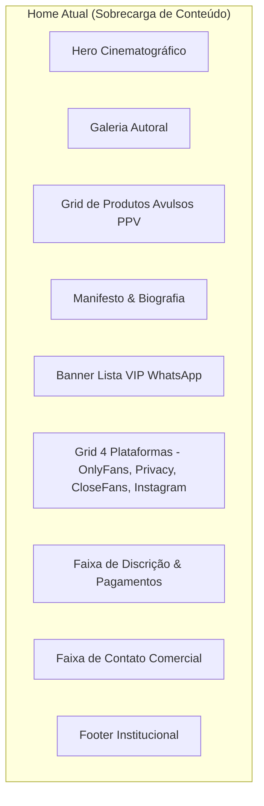
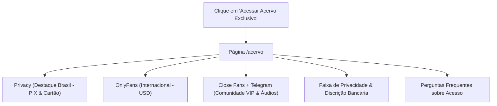

# Plano de Arquitetura de Informação & Experiência do Usuário (UX)
## Plataforma Oficial Nua Borges

---

### 1. Diagnóstico da Experiência Atual & Oportunidade

A estética e o design visual do **Nua Borges** são de alto padrão (paleta dark luxury, tipografia serifada editorial, acentos em rosa blush `#f4a7b9` e microinterações suaves). No entanto, a organização de conteúdo vinha acumulando todos os objetivos comerciais e institucionais na mesma página inicial (**Home One-Page**):



#### Problemas de UX identificados:
1. **Falta de foco do botão principal do Hero:** O botão `[ACESSAR ACERVO EXCLUSIVO →]` (segundo print) não tinha um destino claro. Se jogasse o usuário direto para o OnlyFans, ignorava quem quer pagar por PIX no Privacy ou entrar no Telegram. Se fizesse um scroll para baixo na mesma página, causava desorientação e quebra de fluxo.
2. **Concorrência de ofertas na Home:** O usuário visualizava ensaios gratuitos, ensaios pagos unitários (R$ 29 a R$ 69), assinaturas mensais recorrentes em dólar, assinaturas em real e formulário de WhatsApp, tudo num mesmo scroll linear.
3. **Quebra do encanto editorial:** Em vez de parecer uma galeria de arte intimista e sofisticada, a Home começava a parecer uma página de vendas abarrotada de caixas e opções.

---

### 2. A Nova Filosofia de Navegação: Cada Elemento com sua Função

A solução é adotar uma **estrutura multi-páginas elegante**, onde a Home funciona como a **Vitrine de Alta Costura (Flagship)**, e cada intenção do usuário ganha um ambiente dedicado, sem distrações:

| Página / Espaço | Rota | Função Primária de UX |
| :--- | :--- | :--- |
| **Home (Vitrine Editorial)** | `/` | Encantar, gerar desejo visual, transmitir autoridade artística e guiar para as páginas certas. |
| **Hub de Assinaturas (Acervo VIP)** | `/acervo` *(ou `/assine`)* | **Destino do botão do Hero.** Apresentar as plataformas de assinatura (Privacy, OnlyFans, Close Fans) com comparativo claro, métodos de pagamento (PIX vs Cartão) e garantia de discrição. |
| **Catálogo Sob Demanda (PPV)** | `/avulsos` | Permitir navegação calma e compra direta de fotos e vídeos avulsos, para quem não quer mensalidade. |
| **Assessoria & Contato** | `/contato` *(ou Modal)* | Atendimento a marcas, imprensa, dúvidas de clientes e parcerias comerciais. |

---

### 3. Detalhamento por Página

#### 3.1. HOME (`/`): A Vitrine Cinematográfica
A Home passa a ser limpa, respirada, impactante e magnética:

1. **Header Fixo Minimalista:**
   - Wordmark `NUA BORGES ♡`
   - Links essenciais: `Início` · `Galeria` · `Acervo Exclusivo` · `Avulsos` · `Sobre` · `Contato`
   - Botão de destaque no topo direito: `[ACESSAR ACERVO]` (leva a `/acervo`).
2. **Hero Cinematográfico:**
   - Mantém as fotografias autorais em tela cheia com tipografia editorial.
   - Chamada envolvente sobre arte, corpo e liberdade.
   - **Botão Hero:** `[ACESSAR ACERVO EXCLUSIVO →]` direcionando suavemente para a página `/acervo`.
3. **Galeria Autoral em Carrossel Contínuo:**
   - O consagrado carrossel infinito com luz natural, permitindo abrir o Lightbox em tela cheia.
4. **Manifesto / Biografia Compacta (Sobre Nua Borges):**
   - Posicionamento da Nua como educadora sexual e sexóloga em formação, gerando conexão humana e respeito pelo projeto.
5. **Teaser Duplo de Exploração (Curadoria):**
   - Dois blocos horizontais elegantes e equilibrados convidando para as duas experiências do site:
     - *Card Esquerdo:* **Acervo Completo & Assinaturas** ("Acesso irrestrito a fotos e vídeos diários sem censura") → Botão `Conhecer Planos →` (`/acervo`).
     - *Card Direito:* **Produções Avulsas Sob Demanda** ("Adquira ensaios e vídeos específicos sem mensalidade") → Botão `Ver Catálogo →` (`/avulsos`).
6. **Footer Editorial:**
   - Redes sociais, selos legais, links institucionais (Termos, Privacidade) e assinatura *"Deixa de vergonha ♡"*.

---

#### 3.2. PÁGINA DEDICADA: HUB DE ACESSO EXCLUSIVO (`/acervo` ou `/assine`)
Esta é a página mais estratégica do projeto. É onde o lead qualificado chega pronto para converter.



**Estrutura da Página `/acervo`:**
- **Cabeçalho da Página:**
  - Eyebrow: `EXPERIÊNCIA EXCLUSIVA`
  - Título em serif luxuoso: `Escolha como deseja se conectar`
  - Subtítulo: `Acesso a produções completas em alta definição, vídeos sem censura e intimidade autoral.`
- **Grid de Plataformas (3 Opções Claras e Bem Diferenciadas):**
  1. **Privacy (Recomendado para o Brasil):**
     - Selo: `MAIS POPULAR NO BRASIL`
     - Benefícios: Pagamento instantâneo via PIX ou Cartão nacional, extrato bancário 100% discreto, acesso imediato.
     - CTA: `[ASSINAR VIA PRIVACY (PIX) →]`
  2. **OnlyFans (Internacional):**
     - Selo: `INTERNACIONAL (USD)`
     - Benefícios: Acervo global consolidado, cobrança em moeda estrangeira, suporte internacional.
     - CTA: `[ASSINAR VIA ONLYFANS (USD) →]`
  3. **Close Fans + Telegram:**
     - Selo: `CANAL VIP TELEGRAM`
     - Benefícios: Canal secreto no Telegram, áudios diários, bastidores e interação mais próxima.
     - CTA: `[ENTRAR NO CLOSE FANS →]`
- **Bloco de Segurança & Discrição:**
  - Ícone de cadeado e escudo: *"Privacidade Absoluta: Nenhuma menção ao nome artístico ou conteúdo adulto na fatura do cartão ou comprovante bancário."*
- **Mini-FAQ de Conversão:**
  - Acordeão minimalista com 3 ou 4 respostas rápidas:
    - *Como funciona a cobrança no extrato?*
    - *Posso cancelar a qualquer momento?*
    - *O que está incluso na assinatura?*

---

#### 3.3. PÁGINA DEDICADA: CATÁLOGO DE CONTEÚDOS AVULSOS (`/avulsos`)
Para os visitantes que não querem compromisso de assinatura recorrente:

- **Cabeçalho da Página:**
  - Eyebrow: `ACERVO SOB DEMANDA`
  - Título: `Ensaios & Produções Unitárias`
  - Subtítulo: `Adquira conteúdos avulsos com acesso vitalício e pagamento único via PIX ou cartão.`
- **Grid do Catálogo:**
  - Cada item tem:
    - Imagem de preview de alta estética.
    - Tag do formato (ex: `35 Fotos 4K`, `Vídeo 12 Minutos`).
    - Selo de destaque (ex: `Mais Vendido`, `Exclusivo`).
    - Preço direto em destaque (`R$ 29,90`, `R$ 49,90`).
    - Botão `[QUERO VER AGORA →]` levando diretamente ao checkout do produto.
- **Barra de Upsell no Rodapé:**
  - *"Prefere acesso a todos os ensaios e vídeos sem pagar por item?"*
  - Link destacado para a página `/acervo` (`Ver Assinaturas Completas →`).

---

#### 3.4. ÁREA DE LISTA VIP & CONTATO
- **Lista VIP (WhatsApp / Prévias):**
  - Em vez de ocupar um bloco intrusivo na Home, a Lista VIP se transforma em um **Trigger Convidativo** no rodapé do Hub `/acervo` e no Footer da Home, abrindo o modal elegante já desenvolvido.
- **Contato Comercial & Assessoria:**
  - Link no Header e Footer que abre o modal direto ou uma página dedicada `/contato` para marcas e imprensa.

---

### 4. Estrutura de Rotas e Navegação

```
nuasite/
├── app/
│   ├── page.tsx            → HOME (Vitrine Editorial Limpa: Hero, Galeria, Sobre, Teasers)
│   ├── acervo/
│   │   └── page.tsx        → HUB DE ASSINATURAS (Privacy, OnlyFans, CloseFans, Garantias, FAQ)
│   ├── avulsos/
│   │   └── page.tsx        → CATÁLOGO PPV (Ensaios unitários, vídeos, checkout direto)
│   ├── termos/page.tsx     → Termos de Uso (já existente)
│   ├── privacidade/page.tsx→ Política de Privacidade (já existente)
│   └── admin/page.tsx      → Painel Administrativo atualizado
```

---

### 5. Benefícios Imediatos para a Experiência do Usuário (UX)

1. **Clareza Absoluta de Intenção:** Quem chega na Home é impactado pela arte e pela estética sem ser afogado por links concorrentes.
2. **O Clique do Hero Faz Sentido:** Ao clicar em `[ACESSAR ACERVO EXCLUSIVO]`, o usuário é levado para uma página dedicada onde ele entende as vantagens de cada plataforma antes de tomar a decisão de pagamento.
3. **Redução da Fricção de Compra:** O usuário que prefere pagar R$ 29,90 num ensaio avulso vai direto para `/avulsos` sem poluição; o usuário que quer assinar mensalidade vai para `/acervo`.
4. **Preservação Total do Design Luxuoso:** O site ganha porte de marca consolidada (como grandes grifes e criadoras de topo), com arquitetura pensada e páginas com propósitos definidos.
