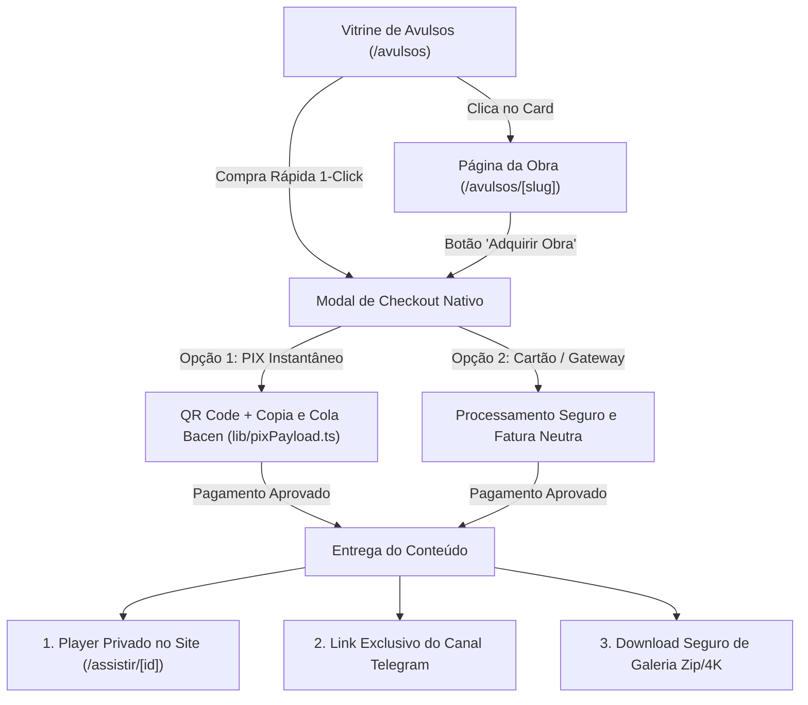

# 💎 Plano Estratégico: Checkout Próprio & Experiência de Conteúdos Avulsos (PPV)
**Plataforma Oficial Nua Borges**  
*Documento de Arquitetura, UX e Monetização sem dependência de plataformas terceiras (Close Fans)*

---

## 1. O Problema Atual do Close Fans
Atualmente, os cards de produções avulsas (ex: *Ensaio I — R$ 29,90*, *Vídeo Íntimo — R$ 49,90*, *Sessão Tântrica — R$ 69,90*) apontavam para URLs genéricas da plataforma `close.fans`.

### Por que eliminar o Close Fans é a decisão certa:
1. **Quebra de Imersão e Perda de Marca:** O visitante sai do ambiente de luxo e estética escura de `nuaborges.com.br` e cai em uma página genérica de terceiros, gerando desconfiança e atrito.
2. **Taxas Abusivas:** Plataformas como Close Fans retêm entre **15% a 20%** de todo o faturamento bruto das vendas.
3. **Falta de Controle sobre a Base de Clientes:** O lead fica retido no banco de dados da plataforma terceira em vez de pertencer ao ecossistema da Nua Borges.
4. **Experiência Engessada:** Não permite prévias cinematográficas com blur, trailers interativos, nem ofertas de upsell dinâmico para o Acervo VIP.

---

## 2. Visão do Novo Sistema: A Boutique Autoral Nua Borges

O objetivo é transformar os Conteúdos Avulsos em uma **Boutique Autoral de Luxo**, onde o cliente tem:
1. **Página de Detalhes / Sinopse de cada Obra** (com prévias, ficha técnica e trailer protegido);
2. **Checkout Nativo Próprio** (PIX Copia e Cola / QR Code instantâneo e Cartão, sem sair do site);
3. **Entrega Automática e Segura** (o cliente assiste/visualiza diretamente no site ou recebe acesso imediato com sigilo absoluto).

---

## 3. Os 3 Pilares da Nova Arquitetura

---

## 4. Detalhamento dos Componentes

### 🌟 Pilar 1: Páginas Individuais para Cada Produção (`/avulsos/[slug]`)
Em vez de apenas um card estático, cada grande ensaio ou vídeo ganha uma página com narrativa de arte e cinema:
* **Exemplo de Rotas:**
  * `/avulsos/ensaio-luz-natural`
  * `/avulsos/video-intimo-madrugada`
  * `/avulsos/sessao-tantrica`
* **Elementos da Página do Produto:**
  1. **Trailer / Teaser Sensorial:** 
     * Vídeo curto de 10–15 segundos (prévia sem nudez explícita total, estilo editorial fashion/sensual) ou carrossel de fotos com efeito *curadoria blur* (fotos com desfoque estético e ícone de cadeado que revelam o conceito).
  2. **Ficha Técnica Editorial:**
     * Formato (ex: *Vídeo 4K UHD, 60fps*, ou *35 Fotografias RAW/4K*);
     * Duração exata ou contagem de cliques;
     * Áudio (ex: *Áudio Original Estéreo / ASMR Binaural*);
     * Ambientação (iluminação natural, locação, conceito da sessão).
  3. **Texto Curatorial da Nua:**
     * Um parágrafo autoral e intimista sobre o que motivou aquela gravação ou ensaio, gerando conexão emocional muito superior ao pornô comum.
  4. **Oferta Inteligente de Upsell (Cross-sell):**
     * *"Quer esta obra e todas as outras sem pagar avulso? Assine o Acervo VIP por apenas R$ 49,90/mês"*.

---

### 💳 Pilar 2: Checkout Próprio no Site (Zero Intermediários)
O cliente clica em "QUERO VER AGORA" e um **Checkout Modal de Alto Padrão** abre na mesma tela (ou na página da obra), sem recarregar e sem mandar o usuário para outro site.

#### Opções de Mecanismo de Pagamento:
* **Opção 1 — PIX Direto Autônomo (Custo Zero de Plataforma):**
  * O projeto **já possui** o gerador oficial `lib/pixPayload.ts` (padrão EMVCo do Banco Central).
  * O checkout gera o QR Code e o código "Copia e Cola" instantaneamente na tela com o valor exato (R$ 29,90, R$ 49,90, etc.).
  * Nome do recebedor configurável (chave Pix da titular ou empresa, com descrição neutra no extrato).
* **Opção 2 — Gateway Transparente (Mercado Pago / Asaas / Kirvano):**
  * O projeto já possui a estrutura de webhook em `functions/api/finance/webhook.ts`.
  * Aceita tanto PIX com confirmação automática em tempo real (webhook que libera a tela em 3 segundos) quanto Cartão de Crédito parcelado.
  * O nome na fatura é 100% customizável e discreto (ex: *"NB CURADORIA"*, *"PAGTO DIGITAL"* ou *"TREINAMENTOS"*).

---

### 🔒 Pilar 3: Como o Cliente Consome o Conteúdo (Entrega)
Como entregar o vídeo ou as fotos após o pagamento? Analisamos 3 formatos viáveis:

#### Formato A: Player Privado no Próprio Site (`/assistir/[token]` ou Sala VIP) — *(Mais Sofisticado)*
* Ao confirmar o pagamento, a tela é desbloqueada imediatamente na mesma aba ou é fornecido um código de acesso seguro (token de 6 dígitos ou link privado).
* O usuário assiste ao vídeo em um player de vídeo com marca d'água discreta anti-vazamento, controles elegantes e design Nua Borges.
* Para ensaios fotográficos, abre uma galeria privativa em altíssima resolução.

#### Formato B: Entrega via Telegram VIP Automatizado — *(Mais Prático e Popular no Brasil)*
* Ao pagar, o cliente recebe na tela e no e-mail um link exclusivo de 1 único uso para entrar no canal privado do Telegram daquele conteúdo específico.
* As fotos/vídeos ficam disponíveis no Telegram em alta qualidade sem pesar no servidor.

#### Formato C: Híbrido (Assista no Site + Link de Backup) — *(Recomendado)*
* O cliente tem acesso imediato na tela do site para assistir na hora, e também tem a opção de receber o link de acesso direto via Telegram ou e-mail seguro para rever quando quiser.

---

## 5. Comparativo dos Modelos de Implementação

| Critério | Close Fans (Atual) | Checkout Próprio no Site | Gateway Especializado (Kirvano / Kiwify) |
| :--- | :---: | :---: | :---: |
| **Taxa sobre as vendas** | 15% a 20% | **0% a 3,9%** | 7% a 9% |
| **Identidade Visual** | Perde a identidade | **100% Nua Borges (Luxo)** | Intermediária |
| **Fatura Discreta** | "Close Fans" | **100% Customizável** | Discreta da plataforma |
| **Retenção de Clientes** | Fica com o Close Fans | **Base própria da Nua** | Compartilhada |
| **Upsell pro VIP** | Inexistente | **Nativo em toda etapa** | Limitado |

---

## 6. Proposta de Fases de Execução

1. **Fase 1 (Design & Páginas de Conteúdo):**
   * Criar o template de página de produto dinâmico: `/avulsos/[slug]`.
   * Montar as páginas para os 3 itens atuais (*Ensaio I*, *Vídeo Íntimo*, *Sessão Tântrica*), com sinopses atraentes, prévias e ficha técnica.
2. **Fase 2 (Modal de Checkout Nativo):**
   * Criar o componente `CheckoutModal.tsx` integrado aos cards de `/avulsos` e às páginas internas.
   * Apresentar o PIX Copia e Cola / QR Code com temporizador de 15 minutos e botão "Copiar Chave".
3. **Fase 3 (Player / Tela de Entrega):**
   * Criar a página de visualização privada do conteúdo adquirido com proteção de reprodução e discrição.
