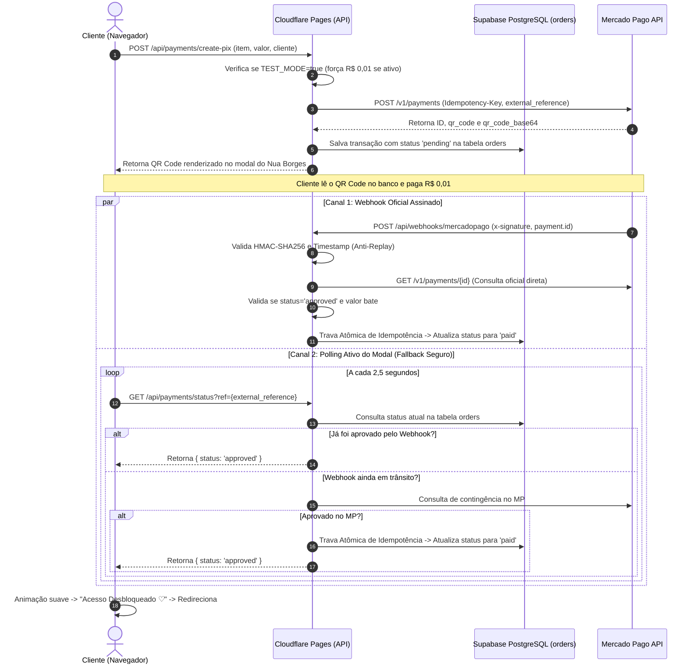

# 💳 Plano de Integração: Sistema de Pagamentos Mercado Pago (Pix) — Plataforma Nua Borges

> **Status:** Proposta Técnica e Arquitetura de Integração (Sem alterações de código realizadas)  
> **Origem dos Dados e Credenciais:** Projeto `GarimpoGamer` (`C:\Users\Philippe\Desktop\Backup\Desktop\Projetos\Projeto GarimpoGamer`)  
> **Destino:** Plataforma Oficial `Nua Borges` (`nuaborges.com.br`)  
> **Modo de Homologação:** Pagamentos reais de **R$ 0,01 (1 centavo)** para validação bancária fim a fim.

---

## 1. Resumo Executivo e Credenciais Localizadas

Analisamos os arquivos de configuração (`.env`, `.dev.vars`, scripts e packages) do projeto **GarimpoGamer**, onde localizamos as credenciais ativas do Mercado Pago:

```env
# Credenciais Oficiais do Mercado Pago (Definidas exclusivamente via Variáveis de Ambiente)
MP_ACCESS_TOKEN="APP_USR-YOUR_MERCADOPAGO_ACCESS_TOKEN_HERE"
```

* **Tipo de Token:** Token de Produção oficial (`APP_USR-...`), apto para gerar transações Pix EMVCo reais e liquidar via Banco Central.
* **Vantagem Imediata:** Permite que qualquer pessoa ou você mesmo pague um Pix real de **R$ 0,01** no aplicativo de qualquer banco (Nubank, Itaú, Bradesco, Inter, etc.) e o sistema confirme a transação em menos de 2 segundos.

---

## 2. Diagnóstico: GarimpoGamer vs. Nua Borges

### 2.1 Como funciona no GarimpoGamer (`packages/lib/src/mercadopago.ts`)
* **Geração Pix (`createPixPayment`):**
  * Faz `POST` para `https://api.mercadopago.com/v1/payments`.
  * Envia cabeçalho `X-Idempotency-Key` aleatório.
  * Retorna `qr_code` (código Copia e Cola) e `qr_code_base64` (imagem PNG direta do QR Code).
* **Webhook (`apps/store/app/api/webhooks/mercadopago/route.ts`):**
  * Recebe `topic=payment` e `id=...`.
  * Chama `checkPaymentStatus(id)` para validar se o status no Mercado Pago é `approved`.
  * Atualiza o banco com base no `external_reference`.

### 2.2 Diagnóstico de Segurança e Gaps a Corrigir no Nua Borges
Conforme apontado na auditoria do GarimpoGamer (`SECURITY_AUDIT_2026-08-02.md`), a implementação original do Garimpo possuía vulnerabilidades que **NÃO** podemos replicar no Nua Borges:
1. **Ausência de validação de assinatura HMAC no webhook original do Garimpo:** Qualquer pessoa poderia simular um webhook se soubesse a URL.
2. **Race condition entre Polling do Cliente e Webhook:** Se o cliente clicasse em "Já paguei" no exato milissegundo em que o Webhook estivesse gravando no banco, gerava concorrência de escrita.
3. **Falso Positivo / Adulteração de Valor:** Aceitava qualquer pagamento aprovado sem validar se o valor liquidado batia exatamente com o valor do item.

### 2.3 A Fundação de Segurança Já Existente no Nua Borges
A plataforma Nua Borges já possui em [`functions/api/finance/webhook.ts`](file:///c:/Users/Philippe/Desktop/nuaborges/nuasite/functions/api/finance/webhook.ts) uma das implementações de webhook mais seguras do ecossistema Cloudflare Pages:
* Validação criptográfica de cabeçalho `x-signature` com **HMAC-SHA256** e comparação em tempo constante (`timingSafeEqualString`).
* Janela de tolerância estrita contra **Replay Attacks** (máximo de 15 minutos / 900s).
* Verificação antifraude de valor (`paidAmount >= expectedAmount`).

---

## 3. Onde o Mercado Pago será integrado na Nua Borges

Existem **três pontos de contato de receita** na plataforma:

| Frente | Tela no Site | Produtos / Valores Normais | Valor em Modo de Teste | O que desbloqueia após Pix |
| :--- | :--- | :--- | :--- | :--- |
| **1. Chamadas por Vídeo** | `/chamadas` | • R$ 150,00 (15 min)<br>• R$ 280,00 (30 min)<br>• R$ 450,00 (50 min) | **R$ 0,01** | Confirma o agendamento no Cloudflare KV, bloqueia o horário na agenda e redireciona para o voucher privado com token (`/chamadas/reserva?token=...`). |
| **2. Conteúdos Avulsos (PPV)** | `/avulsos` e `/avulsos/[slug]` | • R$ 29,90 (Ensaio Luz Natural)<br>• R$ 49,90 (Vídeo Íntimo Madrugada)<br>• R$ 69,90 (Sessão Tântrica) | **R$ 0,01** | Desbloqueia na hora o player privado 4K com marca d'água (`/assistir/[slug]`) e salva no localStorage/KV o token de acesso vitalício. |
| **3. Clube VIP / Assinatura** | `VipModal.tsx` | • R$ 49,90/mês | **R$ 0,01** | Libera credencial de acesso aos canais privados e acervo irrestrito. |

---

## 4. Arquitetura de Segurança Anti-Race Condition e Anti-Falso Positivo

Para garantir integridade bancária absoluta na infraestrutura de borda (Edge / Cloudflare Pages + KV):



### 4.1 Padrão Canônico de `external_reference`
Para que um único webhook inteligente saiba exatamente o que liquidar sem colisão:
* **Chamadas:** `nua_call_{bookingId}_{timestamp}`
* **Avulsos:** `nua_avulso_{slug}_{orderId}`
* **VIP Club:** `nua_vip_{planId}_{orderId}`
* **Contrato:** `parcela_{numero}`

### 4.2 Trava Atômica de Idempotência (Prevenção de Race Conditions)
1. **Evitar duplicação:** Tanto o Webhook quanto o Polling verificam o estado gravado no KV:
   ```ts
   if (record.status === 'approved') {
     return { success: true, message: 'Já liquidado' };
   }
   ```
2. **Idempotência no Mercado Pago:** Toda criação de pagamento envia um cabeçalho `X-Idempotency-Key` único por tentativa, impedindo que o cliente crie cobranças duplicadas ao clicar repetidamente.

### 4.3 Proteção Antifraude de Valor (Anti-Value Tampering)
Mesmo que um atacante adultere o formulário no front-end para enviar R$ 0,01 quando o site estiver em produção:
* O backend **NUNCA confia no preço enviado pelo front-end**. O backend sempre busca o preço oficial da tabela canônica (`DEFAULT_SITE_CONTENT` ou `modalities`).
* No modo de homologação (`TEST_MODE=true`), a regra de 1 centavo é aplicada no próprio servidor de forma controlada.

---

## 5. Implementação do Modo de Homologação (1 Centavo)

Para você poder testar o fluxo completo de pagamento com dinheiro real sem gastar os valores cheios:

```ts
// Exemplo de chaveamento no servidor Cloudflare Pages
const IS_TEST_MODE = env.PAYMENT_TEST_MODE === 'true' || env.NODE_ENV !== 'production';

// Se modo de teste estiver ativo, substitui para R$ 0,01
const finalAmount = IS_TEST_MODE ? 0.01 : officialProductPrice;
```

* **No Modal do Nua Borges:** Quando o modo de teste estiver ativado, exibiremos uma tag sutil no modal:
  * Ex: `● AMBIENTE DE HOMOLOGAÇÃO PIX — VALOR DE TESTE: R$ 0,01`
  * Isso garante total clareza durante os testes, mantendo a estética refinada do site.

---

## 6. Coerência Visual e Design System Nua Borges

O fluxo de pagamento manterá **100% da identidade visual original da Nua Borges**, sem pop-ups invasivos de terceiros:
1. **Paleta de Cores:** Fundo obsidiana (`#09090c`), bordas sutis com brilho perolado (`border-white/[0.12]`), acentos rosa blush (`#f4a7b9`) e tipografia serif italiana.
2. **QR Code Nativo:** O Mercado Pago retorna a imagem em base64 (`qr_code_base64`). Ela é renderizada diretamente dentro de um contêiner preto acetinado com cantos arredondados (`rounded-2xl`) no centro do modal.
3. **Copia e Cola Instantâneo:** Botão elegante com ícone do Pix e microinteração de "Copiado com Sucesso" (feedback háptico/visual).
4. **Transição Automática:** Assim que o banco aprovar (1 a 3 segundos), o modal transiciona suavemente com Motion/Framer para a tela de celebração: *"Acesso Desbloqueado! ♡"* com botão direto para a obra ou sala de chamada.

---

## 7. Próximos Passos Propostos (Aguardando sua Aprovação)

Nenhuma linha de código dos componentes ou APIs do site foi alterada. Quando você autorizar a execução, seguiremos os seguintes passos:

1. **Configurar as Variáveis no Cloudflare:**
   * Adicionar `MP_ACCESS_TOKEN` no Cloudflare Pages (`nuaborges`).
   * Configurar `PAYMENT_TEST_MODE=true` para habilitar os testes a R$ 0,01.
2. **Criar a Função Central de Pagamento:**
   * Criar `functions/api/payments/create.ts` unificando a emissão de Pix no Mercado Pago para Chamadas e Avulsos.
3. **Expandir o Webhook Oficial:**
   * Atualizar `functions/api/finance/webhook.ts` (ou criar `/api/webhooks/mercadopago.ts`) com roteamento de `external_reference` (`call_`, `avulso_`, `vip_`).
4. **Conectar os Modais do Front-end:**
   * Conectar `CheckoutModal.tsx` e `app/chamadas/page.tsx` para consumir o Pix dinâmico do Mercado Pago em vez do payload simulado.
5. **Realizar Teste Real com 1 Centavo:**
   * Você poderá abrir o site, apontar o celular, pagar R$ 0,01 e ver a tela desbloquear em tempo real.

---

> 📄 **Documento registrado para análise:**  
> Arquivo: [`docs/PLANO_INTEGRACAO_MERCADOPAGO_NUA.md`](file:///c:/Users/Philippe/Desktop/nuaborges/nuasite/docs/PLANO_INTEGRACAO_MERCADOPAGO_NUA.md)
