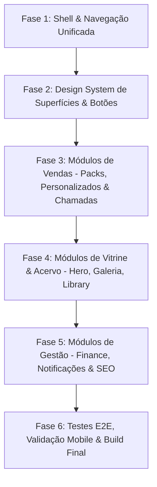

# PLANO MESTRE DE REDESIGN UX/UI — PAINEL ADMINISTRATIVO NUA BORGES
> **Status:** Proposta de Arquitetura & Design System para Avaliação e Feedback  
> **Documento de Auditoria e Especificação Visual**  
> **Diretriz:** Refinamento visual profundo, ergonomia editorial de luxo e zero regressão técnica.

---

## SUMÁRIO EXECUTIVO

Este documento consolida a **Auditoria Completa (Etapa 1)** e a **Proposta de Reorganização e Design System (Etapa 2)** para o Painel Administrativo da **NUA Borges**.

O objetivo não é aplicar um "template genérico de dashboard" nem alterar a paleta de cores ou a alma autoral do projeto. Pelo contrário: a meta é elevar a interface ao nível de um **software de luxo sob medida** (alta agência, tipografia editorial impecável, ritmo espacial calibrado, eliminação de caixas e cards redundantes, navegação inteligente em 1 clique e ergonomia operacional de alta produtividade para a criadora).

> [!IMPORTANT]
> **Nenhum arquivo de código foi alterado nesta etapa.** Conforme solicitado, este documento serve como base estratégica para alinhamento antes do início de qualquer edição de código.

---

## 1. PREMISSAS E IDENTIDADE VISUAL INEGIOCIÁVEL

### 1.1. Linguagem de Marca — Luxo Sensual & Editorial
* **Superfície Base:** `#09090c` (OLED profundo com leve aquecimento) e `#000000` (preto absoluto nas bordas externas de contraste).
* **Camada de Destaque / Acento:** `#f4a7b9` (rosa suave editorial, elegante e dessaturado) com toques eventuais de ouro champanhe para itens VIP/Exclusivos.
* **Bordas & Hairlines:** Micro-bordas em `border-white/[0.07]` ou `border-zinc-800/80` com refração física suave. Nunca usar cinza chapado ou bordas opacas agressivas.
* **Tipografia Canônica:**
  * **Headings de Destaque & Títulos de Seção:** `font-serif` (Playfair Display) — trazendo imponência e sofisticação de revista de alta moda.
  * **Interface, Rótulos, Controles e Dados Operacionais:** `font-sans` (Plus Jakarta Sans) — legibilidade técnica cristalina, sem ruído.
  * **Valores, Slugs e IDs:** `font-mono` sutil para leitura rápida de moedas, prazos e códigos de pedidos.
* **Proibição Estrita Inegociável:**
  * **Ícone `Sparkles` BANIDO:** Conforme regras canônicas do projeto (`GEMINI.md`, `AGENTS.md` e `.agents/rules/no_sparkles.md`), é terminantemente proibido qualquer uso do ícone `Sparkles`. Ícones devem ser contextualizados: `Camera`, `Film`, `Sliders`, `Crown`, `Gem`, `Flame`, `Zap`, `CheckCircle2`.
  * **Sem Gráficos ou Widgets Falsos:** Nada de gráficos de pizza ou barras decorativas sem utilidade real. O painel deve ser uma ferramenta de trabalho de verdade.

---

## 2. ETAPA 1 — AUDITORIA VISUAL E FUNCIONAL DO PAINEL ATUAL

Examinamos detalhadamente todos os arquivos de layout, páginas, abas e modais (`app/admin/page.tsx`, `AdminHeader.tsx`, `HeroEditor.tsx`, `GalleryEditor.tsx`, `AboutEditor.tsx`, `ChannelsEditor.tsx`, `ContactEditor.tsx`, `LibraryEditor.tsx`, `AvulsosEditor.tsx`, `AppointmentsEditor.tsx`, `PersonalizadosEditor.tsx`, `FinanceEditor.tsx`, `SeoEditor.tsx`, `InstitutionalEditor.tsx`, `NotificationSettingsEditor.tsx`, modais e componentes auxiliares).

Abaixo estão os problemas reais mapeados, categorizados por impacto e severidade:

### 2.1. Navegação & Shell Principal (`app/admin/page.tsx` + `AdminHeader.tsx`)
| ID | Problema Identificado | Severidade | Impacto na Experiência |
| :--- | :--- | :--- | :--- |
| **AUD-01** | **Tag cloud de 14 abas desordenadas:** As abas estão soltas em um `flex-wrap gap-2`. No desktop médio e notebook, elas quebram em 2 ou 3 linhas assimétricas, parecendo uma nuvem de palavras sem hierarquia. | **ALTA** | Cansaço visual imediato; a criadora precisa varrer visualmente 14 botões iguais para achar o que quer. |
| **AUD-02** | **Agrupamentos ignorados na renderização:** O código possui o array `ADMIN_TABS` com grupos lógicos (`Vitrine`, `Acervo & Vendas`, `Gestão`), mas a interface ignora isso e renderiza tudo junto em um único bloco misturado. | **ALTA** | Não há distinção entre configurar a biografia pública do site e atender um pedido urgente de cliente. |
| **AUD-03** | **Banner descritivo redundante que empurra a tela:** Abaixo das abas há uma caixa cinza (`bg-zinc-900/40`) apenas repetindo a descrição da aba atual com uma bolinha rosa. | **MÉDIA** | Rouba cerca de 60px preciosos acima da dobra sem acrescentar nenhuma ação. |
| **AUD-04** | **Header com ações espalhadas e duplicadas:** No mobile, há um botão "Publicar no Site" no header superior e outro gigante fixo na barra inferior do celular, gerando conflito visual. | **MÉDIA** | Desconforto tátil e sensação de software repetitivo. |
| **AUD-05** | **Boas-vindas excessivamente altas:** O bloco "Olá, Nua Borges" ocupa mais de 130px de altura com textos longos que já não trazem novidade após o primeiro uso, empurrando o formulário real para fora da primeira rolagem. | **MÉDIA** | Obriga a rolar a página toda vez que o painel é acessado. |

---

### 2.2. As 3 Áreas Operacionais Independentes (Núcleo do Negócio)
A criadora possui 3 fontes de receita e atendimento muito diferentes, que hoje sofrem de inconsistências de UX:

#### A. Conteúdos & Packs (`AvulsosEditor.tsx` — 2.203 linhas)
| ID | Problema Identificado | Severidade | Impacto na Experiência |
| :--- | :--- | :--- | :--- |
| **AUD-06** | **Mistura de Configuração da Página com Gestão de Itens:** No topo da aba de packs há um formulário para editar título e subtítulo da página pública de avulsos, ocupando espaço enorme antes da lista dos packs reais. | **ALTA** | Distrai a criadora da tarefa principal (criar e gerenciar produtos). |
| **AUD-07** | **Modal de Edição de Pack Gigantesco e Labiríntico:** O modal de criação/edição de pack possui 3 sub-abas internas, caixas de fotos de prévia, caixas de fotos de cofre e cartões de vídeo que se expandem indefinidamente. | **CRÍTICA** | Em notebooks e tablets, o modal tem rolagem dupla interna, tornando fácil perder o botão de "Salvar". |
| **AUD-08** | **Confusão entre Fotos de Vitrine (Previews) e Fotos do Cofre (Exclusive):** A distinção entre o que o cliente vê de graça antes de comprar e o que é entregue pago não fica visualmente intuitiva no layout. | **ALTA** | Risco de a criadora colocar mídias sensíveis sem querer nas prévias públicas gratuitas. |

#### B. Personalizados (`PersonalizadosEditor.tsx` — 860 linhas)
| ID | Problema Identificado | Severidade | Impacto na Experiência |
| :--- | :--- | :--- | :--- |
| **AUD-09** | **Cards de Pedidos com ações dispersas:** O card do pedido mistura briefing longo, dados do cliente e botões de mudança de status (`Em Produção`, `Pronto`, `Entregue`), sem uma linha do tempo clara de entrega. | **ALTA** | Dificulta saber instantaneamente quais pedidos estão atrasados ou com entrega pendente para hoje. |
| **AUD-10** | **Anexo ao Cofre do Cliente em formulário inline escondido:** O botão de anexar arquivos para entrega abre um mini formulário solto dentro do card que quebra a altura do grid. | **MÉDIA** | Falta de feedback táctil sobre quais arquivos já foram confirmados e quais ainda faltam enviar. |
| **AUD-11** | **Aba de Configuração da Calculadora densa demais:** Um bloco contínuo de campos com dezenas de inputs de preços (fotos, vídeos, adicionais) sem separação visual por tipo de mídia. | **MÉDIA** | Risco de editar o preço errado por falta de âncoras visuais. |

#### C. Chamadas de Vídeo (`AppointmentsEditor.tsx` — 1.298 linhas)
| ID | Problema Identificado | Severidade | Impacto na Experiência |
| :--- | :--- | :--- | :--- |
| **AUD-12** | **Fila de Chamadas com baixa densidade de leitura:** Cada agendamento ocupa um card vertical muito alto, exigindo rolagem extensa quando há 5 ou mais agendamentos no dia. | **ALTA** | Não permite uma visão "painel de bordo" rápida das próximas chamadas da tarde/noite. |
| **AUD-13** | **Ações de Enviar Link da Chamada e Confirmar Pagamento com pesos visuais confusos:** Botões com cores e tamanhos variados sem convenção primária/secundária padronizada. | **ALTA** | Risco de clicar em cancelar ou marcar ausente por engano. |

---

### 2.3. Módulos de Vitrine & Acervo (`Hero`, `Gallery`, `About`, `Channels`, `Library`, etc.)
| ID | Problema Identificado | Severidade | Impacto na Experiência |
| :--- | :--- | :--- | :--- |
| **AUD-14** | **Reordenação manual primitiva por setinhas (Hero e Galeria):** A reordenação de imagens depende de botões "Subir" e "Descer". Quando há mais de 10 fotos, mover a foto #12 para o topo exige 11 cliques repetitivos com recarregamento visual. | **ALTA** | Ineficiência operacional severa ao atualizar ensaios semanais. |
| **AUD-15** | **Falta de prévia contextual integrada no Hero:** O formulário de texto do topo fica à esquerda ou em cima sem uma prévia realista de como a tipografia se sobrepõe à imagem na versão pública. | **MÉDIA** | A criadora só descobre o resultado real abrindo o site em outra aba após publicar. |
| **AUD-16** | **Redes & Plataformas (`ChannelsEditor`) repetitivo ao extremo:** 4 cards enormes que repetem os mesmos campos de formulário verticalmente ao longo de 740 linhas de código, tornando a página um túnel de rolagem desnecessário. | **MÉDIA** | Poderia ser organizado em cards de perfil elegantes lado a lado com toggles instantâneos. |
| **AUD-17** | **Cofre de Mídias (`LibraryEditor`) — Conflito de Modais:** O modal de detalhes da mídia, o modal de seleção para álbum e o modal de criação de álbum abrem sobreposições sucessivas que causam bloqueio de rolagem e confusão de contexto. | **ALTA** | A navegação entre álbuns e mídias avulsas fica pesada em telas menores. |

---

### 2.4. Design System, Consistência e Ergonomia Mobile
| ID | Problema Identificado | Severidade | Impacto na Experiência |
| :--- | :--- | :--- | :--- |
| **AUD-18** | **Síndrome do "Card dentro de Card":** Conforme alertado na skill `design-taste-frontend`, quase toda tela coloca títulos dentro de um card, que fica dentro de outro card, com botões dentro de caixas cinzas. O design fica "empacotado" e pesado. | **ALTA** | Falta de ar visual; o painel perde a elegância que o site público possui. |
| **AUD-19** | **Inconsistência de raios (`border-radius`) e alturas táteis:** Há componentes com `rounded-lg`, outros com `rounded-xl`, outros com `rounded-2xl`, `rounded-3xl` e `rounded-full` sem critério geométrico concêntrico. Alturas de botões oscilam entre 36px, 38px, 42px e 48px. | **MÉDIA** | Visual pouco refinado; sensação de que partes do painel foram feitas por equipes diferentes. |
| **AUD-20** | **Feedback e Toasts descentralizados:** Existem notificações inline no topo da tela, toasts fixos no canto inferior direito (`bottom-6 right-6`), toasts no `bottom-20` para não sobrepor o botão mobile e avisos de erro nativos no header. | **MÉDIA** | O usuário nunca sabe com certeza para onde olhar após realizar uma ação. |

---

## 3. ETAPA 2 — PROPOSTA DE REORGANIZAÇÃO ARQUITETURAL E VISUAL

A reorganização preserva **100% dos dados, rotas, tipos e contratos existentes**, transformando a experiência através de 6 pilares de design:

```
┌─────────────────────────────────────────────────────────────────────────────┐
│                    NOVA ARQUITETURA DE EXPERIÊNCIA                          │
├─────────────────────────────────────────────────────────────────────────────┤
│  1. TOP SHELL MINIMALISTA         Header compacto + Status de Publicação   │
│  2. NAVEGAÇÃO SEGMENTADA (1-CLIQUE) Vitrine | 3 Áreas de Vendas | Gestão    │
│  3. ÁREA DE TRABALHO EDITORIAL    Ritmo espacial, menos cards, mais foco    │
│  4. AS 3 ÁREAS INDEPENDENTES      Packs vs Personalizados vs Chamadas       │
│  5. FEEDBACK TÁTIL UNIFICADO      Toasts no mesmo quadrante, zero conflito  │
│  6. MODAIS ERGONÔMICOS            Sheets laterais e modais com footer fixo  │
└─────────────────────────────────────────────────────────────────────────────┘
```

---

### 3.1. Reestruturação da Navegação Principal (Fim da "Tag Cloud")

Em vez de 14 abas espalhadas aleatoriamente em várias linhas, a navegação é organizada em **3 Setores Operacionais Bem Demarcados**, mantendo o acesso instantâneo em **1 único clique**:

```
 ┌───────────────────────────────────────────────────────────────────────────────────────────────────────────┐
 │ [NB Nua Borges]  ● Rascunho Salvo     (1) VITRINE (5)  |  (2) ACERVO & VENDAS (4)  |  (3) GESTÃO (5)    [Pub] │
 └───────────────────────────────────────────────────────────────────────────────────────────────────────────┘
```

#### A. Setor 1: Vitrine do Site (Apresentação Pública)
* **Início & Capa** (`hero`)
* **Galeria do Site** (`gallery`)
* **Sobre Mim** (`about`)
* **Redes & Links** (`channels`)
* **Contato** (`contact`)

#### B. Setor 2: Acervo & Vendas (Atendimento e Monetização — ESTREITAMENTE DESACOPLADAS)
* **Cofre de Mídias (Backblaze B2)** (`library`) — Arquivo mestre de fotos e vídeos em alta resolução.
* **Conteúdos & Packs** (`avulsos`) — Catálogo de ensaios e vídeos à venda por item avulso.
* **Personalizados** (`personalizados`) — Fila de encomendas de fotos/vídeos sob medida e calculadora de prazos.
* **Chamadas de Vídeo** (`appointments`) — Agenda de sessões privadas ao vivo, slots e links de atendimento.

> [!CAUTION]
> **Regra de Ouro:** Estes 3 módulos de vendas continuam totalmente independentes, com suas próprias métricas, fluxos de status, ações específicas e sem contaminação mútua.

#### C. Setor 3: Gestão & Plataforma (Infraestrutura)
* **Divulgação & Google** (`seo`)
* **Páginas Legais** (`institutional`)
* **Mensalidades do Site** (`finance`)
* **Configuração de Alertas** (`notifications`)

#### Melhoria de UX na Barra de Navegação:
* **Segmentação Visual com Abas de Dois Níveis Integradas:**
  * O seletor superior permite alternar ou enxergar os três universos sem cliques adicionais.
  * O botão ativo ganha a tonalidade canônica `#f4a7b9` com texto escuro de alto contraste, e os inativos recebem fundo escuro suave com hover sutil `border-white/10`.
* **Remoção do card descritivo isolado:** O resumo da aba agora é integrado diretamente no cabeçalho da própria seção aberta, eliminando o espaçamento morto.

---

### 3.2. Design System do Painel: Padrões Compartilhados

Para resolver as discrepâncias visuais sem criar complexidade técnica excessiva, estabelecemos o seguinte conjunto de padrões:

#### A. Superfícies & Molduras (Nested Architecture / Doppelrand)
Aplicando as diretrizes da skill `high-end-visual-design`:
* **Container Mestre da Seção:** Fundo `#09090c` com borda ultra-sutil `border-white/[0.07]`, raio de curvatura `rounded-2xl` a `rounded-3xl`, e sombra interna translúcida suave (`shadow-[inset_0_1px_1px_rgba(255,255,255,0.05)]`).
* **Sub-elementos e Entradas:** Fundo `bg-black/50` ou `bg-zinc-900/60` com borda `border-white/[0.08]`, proporcionando leitura limpa e focada.
* **Fim dos Cards Empilhados sem Necessidade:** Informações simples são separadas por linhas refinadas (`divide-y divide-white/[0.06]` ou `border-b border-white/[0.06]`) em vez de múltiplos cards fechados.

#### B. Hierarquia de Ações (Botões Padronizados)
* **Ação Primária (CTA Principal):** Fundo `#f4a7b9`, texto `text-zinc-950 font-bold`, raio `rounded-full`, altura mínima `44px` (touch-friendly), sombra suave `shadow-[0_2px_14px_rgba(244,167,185,0.22)]`. Ao clicar, leve compressão tátil (`active:scale-[0.98]`).
* **Ação Secundária (Navegação/Filtros/Edição):** Fundo `bg-white/[0.05] hover:bg-white/[0.1]`, borda `border-white/[0.08]`, texto `text-zinc-200`, raio `rounded-full` ou `rounded-xl`.
* **Ação Destrutiva / Perigosa (Excluir/Bloquear):** Fundo transparente ou `bg-rose-950/20`, borda `border-rose-900/40`, texto `text-rose-400 hover:text-rose-200`. Sempre protegida por confirmação com contexto claro.

#### C. Badges de Status Semânticos & Consistentes
Padronização de cores e ícones em todos os módulos:
* **No Ar / Publicado / Concluído:** `text-emerald-400 bg-emerald-500/10 border-emerald-500/25` com ícone `CheckCircle2`.
* **Rascunho / Em Andamento / Aguardando:** `text-amber-300 bg-amber-500/10 border-amber-500/25` com ícone `Clock`.
* **Urgente / Pendência Crítica:** `text-rose-400 bg-rose-500/15 border-rose-500/30` com ícone `AlertCircle`.
* **Exclusivo / VIP / Sob Medida:** `text-[#f4a7b9] bg-[#f4a7b9]/15 border-[#f4a7b9]/30` com ícone `Crown` ou `Gem`.

#### D. Padrão Unificado de Formulários
* **Label:** Sempre acima do input, em caixa-alta reduzida (`text-[11px] font-semibold tracking-wider text-zinc-400`).
* **Campo de Entrada:** Altura de `44px` a `48px`, texto claro `text-sm`, preenchimento confortável, anel de foco refinado `focus:border-[#f4a7b9] focus:ring-1 focus:ring-[#f4a7b9]/30`.
* **Feedback de Validação:** Mensagem inline logo abaixo do campo, nunca em alert avulso desconectado.

#### E. Modais & Gavetas (Ergonomia de Salvamento)
* **Header Fixo:** Título claro em Playfair Display, identificador do item e botão de fechar acessível com teclado (ESC) e toque.
* **Área Central Rolável Única:** Nunca permitir rolagens múltiplas competindo dentro do mesmo modal.
* **Footer Fixo com Ações Previsíveis:** Botões "Cancelar" (à esquerda) e "Salvar Alterações" (à direita) sempre visíveis na tela, sem exigir que o usuário role até o fim de formulários compridos.

---

## 4. PROPOSTA DETALHADA DE REDESIGN POR MÓDULO

### 4.1. Início & Capa (`HeroEditor.tsx`)
* **Problema Atual:** Rótulos e textos desconectados da foto de capa.
* **Nova Proposta (Split View Inteligente):**
  * **Painel Esquerdo (Controles Estruturados):** Campos de texto organizados em 2 grupos claros: *Identidade & Títulos* (Nome, Frase de Acesso, Botão) e *Chamada de Ação* (Link e Destino).
  * **Painel Direito (Simulador em Tempo Real da Capa):** Um card imersivo no formato 16:9 / 9:16 com a imagem selecionada e os textos digitados sobrepostos instantaneamente com a tipografia real do site, permitindo à criadora ver o impacto estético antes de publicar.
  * **Gerenciador de Slides:** Miniaturas em carrossel horizontal com indicador numérico e atalho direto para trocar a foto em 1 clique.

### 4.2. Galeria do Site (`GalleryEditor.tsx`)
* **Problema Atual:** Reordenação por setinhas que cansa e listas compridas.
* **Nova Proposta:**
  * **Grid Visual Editorial:** Exibição em grade de 3 a 4 colunas com visual idêntico ao da galeria pública.
  * **Controles Rápidos por Card:** Hover elegante com botão direto para "Destacar na Capa da Galeria", "Ocultar/Exibir", "Mudar Link" e "Substituir Imagem".
  * **Reordenação com Botão de Subida Direta:** Opção de "Trazer para o Início da Fila" em 1 toque, evitando dezenas de cliques em setinhas.

### 4.3. Sobre Mim (`AboutEditor.tsx`)
* **Problema Atual:** Parágrafos da biografia fragmentados em caixas soltas.
* **Nova Proposta:**
  * **Disposição Editorial 2 Colunas:** À esquerda, o retrato oficial com proporção 3:4 e badge de alta resolução; à direita, os títulos profissionais e a frase marcante com destaque tipográfico em Playfair Display.
  * **Editor de Manifesto Fluído:** Um bloco de texto unificado ou parágrafos claramente sequenciados, facilitando a leitura contínua e a edição da sua história.

### 4.4. Redes & Plataformas (`ChannelsEditor.tsx`)
* **Problema Atual:** 740 linhas de código com cards compridos empilhados verticalmente.
* **Nova Proposta:**
  * **Grid de Cartões de Canais (2x2 no Desktop, 1 Coluna no Mobile):** Cartões dedicados para OnlyFans, Privacy, Close Fans / VIP e Instagram.
  * **Ações Visíveis na Cabeça do Card:** Toggle "Ativo no Site", indicador de moeda (USD / BRL) e link direto para teste em nova aba.
  * **Edição dos Textos Auxiliares:** Campos colapsáveis para descrições longas, mantendo o painel compacto e agradável.

### 4.5. Contato por E-mail (`ContactEditor.tsx`)
* **Problema Atual:** Espaço mal aproveitado para uma configuração simples.
* **Nova Proposta:**
  * **Layout Limpo em 2 Seções:** Configuração do E-mail Oficial de Recebimento de Propostas + Gerenciador Compacto de Assuntos Selecionáveis do Formulário.
  * **Simulador do Formulário:** Miniatura visual demonstrando como o visitante do site enxerga o formulário de contato.

### 4.6. Cofre de Mídias (`LibraryEditor.tsx`)
* **Problema Atual:** Upload e gerenciamento de álbuns competindo com a lista geral.
* **Nova Proposta:**
  * **Barra de Pastas & Álbuns em Pílulas Horizontais Elegantes:** Visualização fluída dos álbuns (ex: "Ensaios 2026", "Vídeos 4K", "Bastidores") com contador de mídias.
  * **Barra de Ações Rápidas:** Botão de Upload com Drag & Drop integrado no topo, busca por nome e filtro direto por tipo (Fotos, Vídeos, Favoritos).
  * **Visualizador de Mídia (MediaViewer):** Modal refinado com inspeção de resolução, URL assinada, opções de download e indicador de em quais áreas do site aquela mídia está sendo utilizada.

### 4.7. Conteúdos & Packs (`AvulsosEditor.tsx`)
* **Problema Atual:** Modal interno gigante com rolagem tripla e mistura de cabeçalho da página com produtos.
* **Nova Proposta:**
  * **Cabeçalho de Catálogo Limpo:** Métricas financeiras e de catálogo no topo (Total de Packs, Média de Preço, Packs Ativos no Ar) com botão de criação em destaque.
  * **Listagem dos Packs em Cartões Horizontais Compactos:** Thumbnail de alta qualidade, título, preço em destaque (`text-white font-mono`), badges de conteúdo (ex: "8 Fotos + 2 Vídeos"), slug da página e botão direto de "Editar no Modal".
  * **Modal de Edição de Pack Reestruturado:**
    * **Aba 1 (Essencial & Venda):** Título, Preço, Descrição, Capa do Pack e Link de Checkout.
    * **Aba 2 (Amostras da Vitrine):** Fotos e teasers de vídeo que o visitante assiste antes de comprar.
    * **Aba 3 (Cofre Secreto do Cliente):** Fotos em alta resolução e vídeos completos que só são liberados após o pagamento.

### 4.8. Personalizados (`PersonalizadosEditor.tsx`)
* **Problema Atual:** Pedidos misturados sem linha de tempo de produção.
* **Nova Proposta:**
  * **Quadro de Gestão de Produção (Pipeline Inteligente):** Filtros rápidos com contadores dinâmicos: *Aguardando Gravação* (Amarelo), *Em Edição* (Azul/Rosa), *Pronto para Entrega* (Esmeralda), *Finalizados* (Cinza).
  * **Card de Pedido Focado no Atendimento:**
    * Identificação do cliente e data do pedido no topo.
    * Caixa de destaque para o **Briefing do Cliente** (o que ele pediu, preferências, detalhes do ensaio).
    * Botão de "Anexar Entrega no Cofre" com feedback de arquivos enviados.
    * Ação rápida de envio via Telegram em 1 clique com mensagem pronta.
  * **Sub-aba da Calculadora:** Seções agrupadas com títulos claros: Preço Base, Tabela de Fotos Adicionais, Tabela de Duração de Vídeos e Prazos de Entrega.

### 4.9. Chamadas de Vídeo (`AppointmentsEditor.tsx`)
* **Problema Atual:** Baixa densidade de leitura e dificuldade de visualização do dia.
* **Nova Proposta:**
  * **Radar de Próximas Sessões:** Destaque para as chamadas de hoje e de amanhã com horário, cliente e status de pagamento.
  * **Tabela de Atendimento Ergonômica:** Linhas limpas e espaçadas no desktop (compactas no mobile), permitindo verificar status, valor, link da sala e WhatsApp em poucos segundos.
  * **Modal de Inserção de Link da Sala:** Interface simplificada para colar o link da sala segura e instruções de acesso sem fricção.

### 4.10. Divulgação & Google (`SeoEditor.tsx`)
* **Problema Atual:** Simulações visuais rudimentares.
* **Nova Proposta:**
  * **Simulador Hiper-Realista:** Card de prévia que reproduz fielmente a aparência de um link compartilhado no WhatsApp (título, foto e domínio) e um resultado de busca orgânica no Google.
  * **Indicadores de Comprimento Recomendado:** Barras de progresso sutis que avisam quando o título ou a descrição ultrapassam os limites de corte dos motores de busca.

### 4.11. Páginas Legais (`InstitutionalEditor.tsx`)
* **Problema Atual:** Formulário de adição que empurra a lista de termos existentes.
* **Nova Proposta:**
  * **Lista Organizada dos Documentos Jurídicos:** Termos de Uso, Política de Privacidade e Aviso de Maioridade 18+ com ícones representativos (`Scale`, `Shield`, `FileText`).
  * **Gaveta / Modal de Adição/Edição:** O formulário abre em foco sem desorganizar a lista de leitura.

### 4.12. Mensalidades do Site (`FinanceEditor.tsx`)
* **Problema Atual:** Tabela com largura fixa e repetição de dados.
* **Nova Proposta:**
  * **Placar Financeiro Consolidado:** 4 métricas limpas (Total Contratado, Parcelas Pagas, Próximo Vencimento, Status da Hospedagem/Domínio).
  * **Linha do Tempo das Parcelas:** Grade organizada das 12 mensalidades, destacando a parcela atual, com botão direto de "Pagar com Pix" e "Baixar Recibo em PDF".

### 4.13. Configurações de Alertas (`NotificationSettingsEditor.tsx`)
* **Problema Atual:** Cartões isolados com pouca interação direta.
* **Nova Proposta:**
  * **Central de Notificações Unificada:** 3 interruptores com micro-interações fluidas (Sino Sonoro, Alerta Piscante na Aba do Navegador, Notificação Nativa do Windows).
  * **Botão "Testar Tudo em 1 Clique":** Permite à criadora verificar de imediato som, aba e alerta na sua máquina.

---

## 5. ERGONOMIA MOBILE E RESPONSIVIDADE (320px a 1440px)

Seguindo os princípios da skill `mobile-design`:
1. **Viewport e Áreas de Toque:**
   - Todos os botões e seletores terão altura mínima de `44px` a `48px`, garantindo conforto para o polegar no smartphone sem toques falsos.
   - Eliminação de qualquer `h-screen` que cause saltos na barra de navegação do iOS Safari; adoção estrita de `min-h-[100dvh]`.
2. **Estratégia de Navegação Mobile:**
   - No celular, as abas são organizadas em um seletor deslizante com `snap-x` e rolagem horizontal suave sem scrollbar feia, com indicador claro de aba ativa.
3. **Tabelas e Listas no Mobile:**
   - No mobile, tabelas largas convertem-se automaticamente em **Cards de Resumo Vertical** (empilhados, com bordas sutis e tipografia calibrada), eliminando rolagem horizontal desconfortável.
4. **Modais no Mobile:**
   - Em telas menores que 768px, modais complexos comportam-se como **Bottom Sheets** (deslizam da base da tela com puxador tátil) ou tela cheia imersiva com botão de fechar fixo no topo.

---

## 6. ACESSIBILIDADE E CONFORTO VISUAL (WCAG 2.2 AA)

1. **Contraste de Cor Garantido:**
   - Todos os textos de leitura principal possuem contraste superior a 7:1 contra o fundo escuro (`#ffffff` e `#e4e4e7` sobre `#09090c`).
   - Textos secundários mantêm contraste mínimo de 4.5:1 (`#a1a1aa` sobre fundos pretos).
2. **Navegação por Teclado e Foco Visível:**
   - Anéis de foco elegantes com `focus-visible:ring-2 focus-visible:ring-[#f4a7b9]` em todos os botões, links e campos.
   - Suporte completo a `Escape` para fechar qualquer modal ou drawer aberto.
3. **Feedback Não Exclusivo por Cor:**
   - Todo status combina cor com ícone semântico explícito e rótulo textual legível.

---

## 7. ROTEIRO DE IMPLEMENTAÇÃO EM FASES ATÔMICAS

A execução será realizada em fases bem delimitadas, garantindo que o sistema continue funcionando e pronto para uso a cada passo:



### Detalhamento das Fases:
* **Fase 1 — Shell & Header:** Reorganizar a barra de navegação categorizada (Vitrine, Acervo & Vendas, Gestão), unificar o AdminHeader e otimizar o espaço do topo.
* **Fase 2 — Base de Componentes (Design System):** Criar os componentes reutilizáveis refinados (`AdminCard`, `AdminButton`, `AdminBadge`, `AdminModal`, `AdminSectionHeader`).
* **Fase 3 — Refatoração dos 3 Módulos de Vendas:**
  - Modernizar `AvulsosEditor` (catálogo limpo e modal de pack ergonômico).
  - Modernizar `PersonalizadosEditor` (pipeline de produção claro e calculadora visual).
  - Modernizar `AppointmentsEditor` (radar do dia e ações seguras).
* **Fase 4 — Refatoração dos Módulos de Vitrine & Mídias:**
  - Refinar `HeroEditor` (split view e prévia instantânea).
  - Refinar `GalleryEditor` (grid visual de alto impacto).
  - Refinar `AboutEditor` e `ChannelsEditor` (eliminação de caixas repetitivas).
  - Refinar `LibraryEditor` (pílulas de álbuns e visualizador de mídia).
* **Fase 5 — Módulos de Apoio & Notificações:**
  - Refinar `FinanceEditor`, `NotificationSettingsEditor`, `SeoEditor` e `InstitutionalEditor`.
* **Fase 6 — Verificação Completa:** Testes de build (`next build`), responsividade (320px a 1440px), validação anti-Sparkles e integridade de salvamento/publicação.

---

## 8. CONCLUSÃO E PRÓXIMOS PASSOS

Este plano respeita a essência visual e autoral construída para a marca **NUA Borges**, eliminando a desorganização acumulada e entregando um ambiente de trabalho digital prazeroso, rápido e sofisticado para a criadora.
