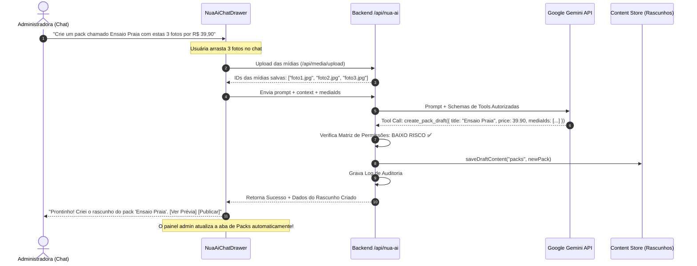

# PLANO DE EVOLUÇÃO TÉCNICA: NUA IA — OPERAÇÃO SEGURA DO ADMIN

> **Status:** AGUARDANDO APROVAÇÃO HUMANA DO USUÁRIO  
> **Data:** 13 de Outubro de 2026  
> **Escopo:** `nuaborges/nuasite` (Sem alterações em `admingeral` ou projetos externos)  
> **Diretriz Mandatória:** Zero alterações de código no momento. Análise profunda e planejamento de implementação modular com máxima economia de tokens e segurança no backend.

---

## 1. AUDITORIA DA IMPLEMENTAÇÃO ATUAL DA IA (14 PONTOS)

### 1.1 Onde a interface conversacional está implementada
- **Componente Principal:** [`components/nua/admin/NuaAiChatDrawer.tsx`](file:///c:/Users/Philippe/Desktop/nuaborges/nuasite/components/nua/admin/NuaAiChatDrawer.tsx).
- **Integração no Painel:** Invocada em [`app/admin/page.tsx`](file:///c:/Users/Philippe/Desktop/nuaborges/nuasite/app/admin/page.tsx) como um Drawer lateral acionado pelo botão flutuante e pelo topo do painel.
- **Cliente HTTP:** [`lib/nuaAi/client.ts`](file:///c:/Users/Philippe/Desktop/nuaborges/nuasite/lib/nuaAi/client.ts) (`sendNuaAiChat`).

### 1.2 Como as mensagens são enviadas, recebidas e formatadas
- O frontend envia um payload JSON para `/api/nua-ai/chat`:
  ```json
  {
    "message": "mensagem da usuária",
    "conversationId": "uuid",
    "history": [...],
    "uiContext": { "activeTab": "packs", "selectedPackId": null, ... }
  }
  ```
- A resposta atual retorna `reply` (texto formatado em markdown com parsing leve de blocos), `suggestions` (chips de resposta rápida) e metadados.

### 1.3 Qual modelo de IA ou serviço é utilizado atualmente
- **Provedor:** Google Gemini API (v1beta).
- **Modelos Configurados:** `gemini-3.5-flash` (padrão operacional), `gemini-3.1-flash-lite` (modo ultra-rápido/econômico) e `gemini-3.8-flash` (fallback).
- **Otimização de Custo:** Ativação de `thinkingBudget: 0` para eliminar overhead de tokens de raciocínio ocultos do Gemini 2.5/3.x, mantendo respostas ágeis e diretas.

### 1.4 Como o contexto da conversa é mantido
- **Histórico:** Mantido no estado do React (`messages`) e armazenado em `localStorage` no navegador sob a chave `nua_admin_ai_chat_history_v1`.
- **Servidor:** Em ambiente edge/local, o histórico recente (últimas 6 a 10 mensagens) é encaminhado no payload para manter o contexto sem inflar a janela de contexto.

### 1.5 Como a IA recebe informações sobre o admin e suas funcionalidades
- Recebe via `uiContext`:
  - Aba aberta (`packs`, `avulsos`, `midias`, `configuracoes`, `leads`, etc.).
  - IDs de itens selecionados e rascunhos em edição.
  - Conhecimento estruturado via System Prompt sobre as regras e entidades do painel Nua Borges.

### 1.6 Ferramentas, funções, endpoints e integrações existentes
- **Situação Atual:** A IA foi desenhada como estritamente consultiva: ela orientava a usuária e gerava "tickets/resumos" para o desenvolvedor Philippe.
- **Capacidade Real Existente no Sistema:**
  - `lib/contentStore.ts`: Funções prontas para `getDraftContent()`, `saveDraftContent()`, `publishDraftContent()`, `getPublishedContent()`.
  - `/api/content`: Endpoint REST com suporte a `GET`, `POST`, `PUT` para persistir dados.
  - `/api/media/upload`: Endpoint para upload de fotos/vídeos com processamento seguro.
- **Lacuna Identificada:** Falta uma camada de **Tool Calling (Function Calling)** com despacho no backend e sincronização em tempo real com o estado do painel.

### 1.7 Autenticação e verificação de permissões
- O painel admin utiliza autenticação via sessão/cookie de admin verificado no middleware e nos endpoints `/api/admin/*`.
- Qualquer ação executada pela IA precisa herdar obrigatoriamente essa sessão autenticada; nenhuma chave mestra ou bypass é exposto ao modelo.

### 1.8 Como a IA consulta dados e persistência de registros
- Os dados administrativos de rascunho ficam em `lib/contentStore.ts` com espelhamento em `nua_draft_content_v1` (localStorage) e persistência em `/data/content.json` ou Cloudflare KV.
- A IA atualmente não tinha permissão nem ferramentas para injetar mutações diretamente nesse store.

### 1.9 Como funcionam os uploads e a biblioteca de fotos e vídeos
- Arquivos de mídia residem em `/public/uploads/` (local) ou Backblaze B2 (produção).
- O catálogo de mídias é indexado pelo `mediaService` com validação de MIME type (JPEG, PNG, WebP, MP4, MOV) e limites de tamanho (ex: 50MB para vídeos, 10MB para fotos).

### 1.10 Persistência no banco ou armazenamento
- **Ambiente Local/Node:** Gravação via `fs/promises` em arquivos JSON estruturados em `data/content.json` e `data/vip_leads.json`.
- **Ambiente Produção (Cloudflare Pages):** Gravação em Cloudflare KV (`NUA_KV`) com chaves com versionamento atômico.

### 1.11 Como as alterações chegam ao site público
- O sistema opera com separação estrita de dois estados:
  1. **Rascunho (`draft`):** Visível apenas no `/admin`.
  2. **Publicado (`published`):** O site público consome exclusivamente o estado `published`.
- Portanto, criar ou editar rascunhos pela IA **nunca quebra ou altera o site público de surpresa**.

### 1.12 Ações reais vs Respostas simuladas
- **Simuladas (antes):** A IA afirmava "Criei o rascunho com sucesso" quando na verdade apenas sugeria o texto na conversa.
- **Reais (meta desta evolução):** A IA executará ferramentas validadas no backend que realmente criam e alteram os rascunhos no `contentStore`, disparando atualização no DOM do admin.

### 1.13 Regras de segurança, confirmações e auditoria atuais
- Não existia registro de auditoria (`audit log`) dedicado para ações de IA.
- Não existia barreira criptográfica/nonce para impedir que a IA executasse ações sensíveis sem clique humano explícito.

### 1.14 Falhas e inconsistências identificadas
- Dependência de prompt text para segurança (frágil contra injeção se não houver trava no backend).
- Falta de upload direto no chat drawer.
- Falta de cards interativos de aprovação humana com resumo "Antes vs Depois".

---

## 2. MATRIZ RIGOROSA DE PERMISSÕES E CLASSIFICAÇÃO DE RISCO

A separação é garantida por **código no backend** (validador de execução), e não apenas por instruções de linguagem.

```
                             [ SOLICITAÇÃO DA CLIENTE ]
                                         │
                                         ▼
                      [ CAMADA DE SEGURANÇA NO BACKEND ]
                                         │
        ┌────────────────────────────────┼────────────────────────────────┐
        │                                │                                │
 🟢 BAIXO RISCO (Direto)          🟡 SENSÍVEL (Aprovação)          🔴 PROIBIDO (Bloqueio)
  - Consultar dados                - Publicar no site público       - Deletar arquivos/DB
  - Criar rascunho de pack         - Alterar preço publicado        - Exclusão em massa
  - Adicionar mídias a rascunho    - Mudar chave Pix/Pagamento      - Alterar credenciais/tokens
  - Sugerir/editar textos          - Desativar itens públicos       - Código ou terminal
  - Organizar ordem e categorias   - Alterar visibilidade pública   - Mudar regras de segurança
        │                                │                                │
   [ Executa & Atualiza ]        [ Gera Card de Revisão ]         [ Recusa com Explicação ]
                                 [ Aguarda Clique Humano ]
```

### 2.1 Ações de Baixo Risco (Execução Direta Autorizada)
1. `list_content_summary`: Listar packs e avulsos existentes para a IA saber o que já existe.
2. `get_media_library`: Consultar mídias disponíveis na galeria.
3. `create_pack_draft`: Criar um novo rascunho de pack com nome, descrição sugerida, mídias selecionadas e preço inicial.
4. `create_avulso_draft`: Criar um novo rascunho de conteúdo avulso.
5. `update_draft_text`: Atualizar título, subtítulo, chamada comercial ou descrição de um rascunho existente.
6. `attach_media_to_draft`: Vincular fotos/vídeos da biblioteca ou recém-enviados a um rascunho específico.
7. `remove_media_from_draft`: Desvincular uma mídia do rascunho (sem apagar o arquivo da galeria).
8. `upload_chat_media`: Receber arquivo enviado no chat, validar e salvar na biblioteca.

### 2.2 Ações Sensíveis (Exigem Revisão e Aprovação Humana Explícita)
1. `publish_pack`: Mover pack de rascunho para publicado (visível para clientes reais).
2. `update_published_price`: Alterar preço de um item já publicado no site.
3. `change_payment_gateway_info`: Alterações em links de pagamento ou configurações de checkout.
4. `archive_content`: Arquivar ou desativar um conteúdo público.

**Mecanismo de Aprovação:**
- A IA **NÃO** executa a ação sensível.
- A IA emite uma proposta estruturada (`ActionProposal`) com um **Nonce/Token de Ação** criptograficamente seguro e temporário (válido por 10 minutos).
- A interface renderiza um **Card de Aprovação Visual** com:
  - 🔍 **O que vai mudar:** Tabela com valores *Antes* vs *Depois*.
  - ⚠️ **Impacto:** "O pack ficará visível publicamente com o valor de R$ X".
  - 🔘 **Botões de Ação:** `[Rejeitar]` ou `[Aprovar e Aplicar Agora]`.
- Apenas o clique físico do administrador no botão do card envia a requisição assinada para `/api/nua-ai/approve-action`, executando a mutação.

### 2.3 Ações Terminantemente Proibidas (Hardcoded Block no Backend)
- Exclusão física definitiva (`fs.unlink`, `DELETE FROM`, purga de bucket).
- Exclusão em lote de registros.
- Consulta ou alteração de variáveis de ambiente (`.dev.vars`, `.env`, API keys).
- Alteração de senhas, permissões ou tokens de admin.
- Execução de comandos no shell do sistema operacional.
- Se o modelo tentar chamar qualquer uma dessas ações, o backend intercepta, bloqueia com código `403 ACTION_PROHIBITED` e grava um alerta de segurança na auditoria.

---

## 3. ARQUITETURA PROPOSTA E FLUXO DE DADOS

### 3.1 Arquivos e Módulos a Serem Criados/Evoluídos

```
nuasite/
├── lib/
│   └── nuaAi/
│       ├── tools/
│       │   ├── schema.ts            <-- Definição Zod e schemas OpenAPI das ferramentas da IA
│       │   ├── registry.ts          <-- Registro central e despachante de funções
│       │   ├── draftOperations.ts   <-- Implementação segura de criação/edição de rascunhos
│       │   └── sensitiveActions.ts  <-- Gerador de propostas e validação de tokens de aprovação
│       ├── permissions.ts           <-- Matriz de permissões estritas
│       ├── audit.ts                 <-- Registro de auditoria protegido (JSON Lines append-only)
│       └── engine.ts                <-- Integração de Tool Calling com Gemini (3.1/3.5 Flash)
├── components/
│   └── nua/
│       └── admin/
│           ├── NuaAiChatDrawer.tsx  <-- Adição de upload no chat, renderização de cards de revisão
│           └── NuaAiApprovalCard.tsx<-- Componente visual para revisão humana de ações sensíveis
└── tools/
    └── localApiServer.mjs           <-- Roteamento seguro das chamadas de ferramentas e uploads locais
```

### 3.2 O Fluxo Exato: "Quero criar um pack novo"



---

## 4. ESTRATÉGIA DE ULTRA ECONOMIA DE TOKENS

Para manter a operação ultra-econômica conforme solicitado:

1. **System Prompt Enxuto e Modular:** Redução de textos prolixos no prompt base. Envio de documentação de contexto sob demanda apenas quando a usuária pergunta sobre tópicos específicos.
2. **Thinking Budget Zerado (`thinkingBudget: 0`):** Desativação completa do raciocínio oculto nos modelos Gemini 2.5/3.x, eliminando cobrança fantasma de milhares de tokens por mensagem.
3. **Poda Ativa de Histórico:** Manter apenas as últimas 6 interações no histórico ativo. Mensagens antigas são compactadas em um sumário de 2 linhas (`conversationSummary`).
4. **Schemas de Ferramentas Compactos:** Definições curtas de parâmetros com tipagem estrita para evitar payloads inflados na inicialização de cada chamada.
5. **Uso Prioritário do `gemini-3.1-flash-lite` / `gemini-3.5-flash`:** Modelos de altíssima velocidade e menor custo por milhão de tokens da Google, perfeitos para tarefas operacionais estruturadas.

---

## 5. SEGURANÇA E PROTEÇÃO CONTRA PROMPT INJECTION

1. **Validação Sanitizada de Entradas:** Todas as strings recebidas (títulos, descrições, tags) passam por sanitização contra tags `<script>` e injeções de template antes de tocar o storage.
2. **Imunidade de Permissões a Textos:** O modelo de IA nunca recebe privilégios no payload. A decisão de se uma ferramenta é de baixo risco, sensível ou proibida é **100% hardcoded no backend** em TypeScript.
3. **Isolamento de Segredos:** Nenhuma variável de ambiente, API Key ou token de servidor é exposto nas mensagens ou nos prompts da IA.

---

## 6. SISTEMA DE AUDITORIA (AUDIT TRAIL)

Todas as ações acionadas via IA serão registradas no arquivo append-only protegido:
`data/admin_audit_log.jsonl`

**Estrutura de cada registro:**
```json
{
  "timestamp": "2026-10-13T05:25:00.000Z",
  "auditId": "aud_9a8fbc71",
  "actor": "admin_session",
  "source": "nua_ai_assistant",
  "action": "create_pack_draft",
  "resourceType": "pack",
  "resourceId": "pack_ensaio_praia_1728800000",
  "status": "SUCCESS",
  "riskLevel": "LOW",
  "changes": {
    "title": "Ensaio Praia",
    "price": 39.9,
    "mediaCount": 3
  },
  "ip": "127.0.0.1"
}
```

---

## 7. PLANO DE IMPLEMENTAÇÃO EM FASES (APÓS APROVAÇÃO)

* **Fase 1: Motor de Ferramentas e Permissões no Backend (`lib/nuaAi/tools/`)**
  - Criação da matriz de permissões (`permissions.ts`).
  - Criação das funções de manipulação de rascunhos (`draftOperations.ts`).
  - Criação do gerador e validador de aprovação com Nonce (`sensitiveActions.ts`).
  - Criação do log de auditoria append-only (`audit.ts`).
* **Fase 2: Conexão do Tool Calling com a API do Gemini (`engine.ts` e `/api/nua-ai/chat`)**
  - Conexão do schema de ferramentas com o SDK Gemini.
  - Loop de despacho com verificação de segurança no backend.
* **Fase 3: Melhorias Visuais no Chat Drawer (`NuaAiChatDrawer.tsx`)**
  - Adição do botão de anexo de mídias (fotos/vídeos) diretamente no campo de texto do chat.
  - Renderização do Card de Prévia de Rascunho.
  - Renderização do Card de Aprovação Humana para ações sensíveis.
  - Disparo de evento customizado para o painel admin recarregar a lista quando um rascunho for salvo.
* **Fase 4: Validação e Testes Reais**
  - Teste de criação de rascunho com mídias reais.
  - Teste de bloqueio de ação proibida (tentativa de exclusão).
  - Teste de bloqueio de ação sensível sem clique humano.
  - Verificação da economia de tokens.

---

## 8. SOLICITAÇÃO DE APROVAÇÃO

Este plano atende integralmente a todas as diretrizes especificadas:
- ✅ Preserva a IA e a identidade visual existentes.
- ✅ Não cria chatbots paralelos.
- ✅ Conecta a IA a operações reais do admin (rascunhos, textos, mídias).
- ✅ Garante segurança rigorosa aplicada no backend.
- ✅ Impede exclusões e ações destrutivas.
- ✅ Exige aprovação humana para ações sensíveis.
- ✅ Implementa auditoria completa.
- ✅ Otimiza tokens ao máximo.

**Nenhum código foi modificado nesta etapa.**  
Por favor, revise este documento e informe se autoriza o início da implementação prática conforme o plano acima.
