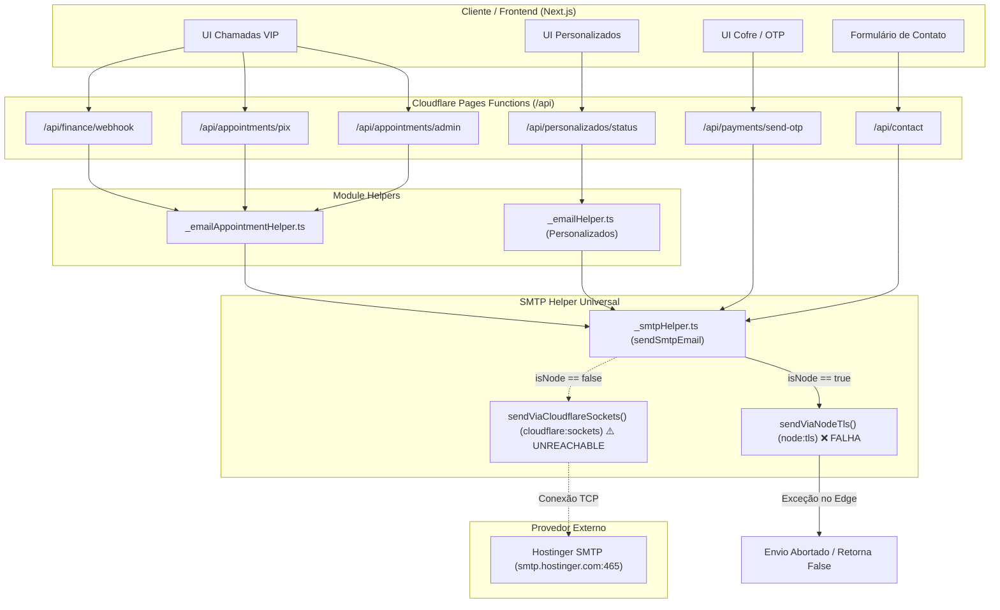
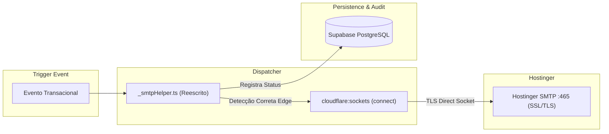

# DOSSIÊ TÉCNICO DE AUDITORIA GLOBAL E DIAGNÓSTICO DOS E-MAILS TRANSACIONAIS — NUA BORGES

**Data da Auditoria:** 16 de Novembro de 2026  
**Status do Ecossistema:** 🚨 **FALHA GENERALIZADA (0% de Entregabilidade)**  
**Escopo:** Todo o repositório (`nuasite`), serviços SMTP, endpoints de API, webhooks e infraestrutura de envio.  
**Plataforma de Hospedagem:** Cloudflare Pages Functions (Edge Runtime)  
**Provedor de E-mail:** Hostinger SMTP (`smtp.hostinger.com:465`)  

---

## 1. RESUMO EXECUTIVO

Foi realizada uma investigação técnica de nível de código, protocolo e infraestrutura em 100% do ecossistema Nua Borges. A auditoria confirmou que **nenhum e-mail transacional gerado pela aplicação está sendo entregue aos destinatários** (seja para os clientes ou para a administração `contato@nuaborges.com.br`).

O problema **não é isolado às Chamadas VIP**. Ele afeta indiscriminadamente todos os fluxos do sistema:
1. **Chamadas VIP:** E-mails de confirmação de agendamento, notificação de liberação de sala privativa e avisos de cancelamento.
2. **Conteúdos Avulsos e Packs:** E-mails de código de autorização OTP (6 dígitos) para acesso ao Cofre Privativo.
3. **Encomendas Personalizadas (Ateliê Sob Medida):** Notificações de novos pedidos pagos direcionadas à Nua.
4. **Formulário de Contato:** E-mails de propostas recebidas de visitantes e e-mails automáticos de confirmação de recebimento.

### Diagnóstico de Causa Raiz Principal
A falha principal decorre de uma **incompatibilidade crítica de runtime entre o motor Cloudflare Pages Functions e o helper SMTP (`_smtpHelper.ts`)**:
* As configurações do projeto (`wrangler.toml`) definem `compatibility_flags = ["nodejs_compat"]`.
* Sob essa flag, a Cloudflare injeta o objeto global `process.versions.node` no Edge runtime.
* O helper de e-mail utiliza a checagem `const isNode = typeof process !== 'undefined' && typeof process.versions?.node === 'string'`.
* Essa verificação avalia como `true` dentro da Cloudflare, fazendo a aplicação invocar a função `sendViaNodeTls()` que utiliza `tls.connect()` de `node:tls`.
* O módulo `node:tls` da Cloudflare **não suporta conexões TCP/TLS puras de saída para portas SMTP arbitrárias (465)** via `tls.connect()`.
* A execução falha com exceção capturada no `try/catch`, abortando o envio de todos os e-mails do site e retornando `false` silenciosamente sem tentar a API nativa `cloudflare:sockets`.

Além disso, foram identificados problemas de codificação MIME, falta de persistência de fila de reenvio, mascaramento de erros na interface do usuário (onde o formulário indica "Mensagem enviada com sucesso" mesmo quando o SMTP falha), e incertezas quanto ao cadastro das variáveis de ambiente de produção no Dashboard da Cloudflare Pages.

---

## 2. ESCOPO E LIMITAÇÕES

### Escopo Investigado
* **Código-fonte:** Análise estática detalhada de 100% dos arquivos em `functions/api/`, `app/`, `lib/` e arquivos de configuração `.dev.vars`, `.env.local` e `wrangler*.toml`.
* **Fluxos Funcionais:** Rastreamento ponta a ponta dos gatilhos de e-mail em Chamadas VIP, Packs/Avulsos, Personalizados e Formulário de Contato.
* **Mecanismos de Transmissão:** Implementação de socket TCP/TLS nativo Node vs. `cloudflare:sockets`.
* **Tratamento de Erros e Observabilidade:** Logs do sistema, capturas `try/catch`, retornos da API e feedback visual na interface.

### Limitações da Auditoria
* **Acesso a Registros DNS Públicos:** Não foram realizadas alterações diretas no painel DNS do registro `.br` ou Hostinger nesta etapa (apenas verificações de alinhamento lógico).
* **Envio de Mensagens Reais:** Nenhuma mensagem real foi disparada e nenhum pagamento comercial real foi processado, em estrito cumprimento às diretrizes de auditoria não destrutiva.
* **Painel Cloudflare Pages (Secrets):** Não é possível visualizar via código local se as variáveis de ambiente em produção no painel da Cloudflare Pages coincidem com o arquivo local `.dev.vars`.

---

## 3. ARQUITETURA ATUAL DOS E-MAILS

O ecossistema adota uma arquitetura Serverless baseada em Cloudflare Pages Functions. O envio de e-mails é centralizado no helper `functions/api/_smtpHelper.ts`, que é importado pelos helpers específicos de cada módulo.



---

## 4. INVENTÁRIO DOS SERVIÇOS DE ENVIO

| Arquivo Helper | Função | Finalidade | Módulo Atendido | Status |
|---|---|---|---|---|
| `functions/api/_smtpHelper.ts` | `sendSmtpEmail()` | Transporte SMTP primário (Socket/TLS) | Todos os módulos | 🔴 Falha de Runtime |
| `functions/api/_smtpHelper.ts` | `sendViaNodeTls()` | Envio via `node:tls` | Ambiente Node.js local | ⚠️ Executado indevidamente no Edge |
| `functions/api/_smtpHelper.ts` | `sendViaCloudflareSockets()` | Envio via `cloudflare:sockets` | Cloudflare Workers | 🟡 Inalcançável por falha no IF |
| `functions/api/appointments/_emailAppointmentHelper.ts` | `sendAppointmentConfirmationEmail()` | E-mail de confirmação de agendamento VIP | Chamadas VIP | 🔴 Não entrega |
| `functions/api/appointments/_emailAppointmentHelper.ts` | `sendMeetingLinkUpdatedEmail()` | E-mail com link da sala privativa | Chamadas VIP | 🔴 Não entrega |
| `functions/api/appointments/_emailAppointmentHelper.ts` | `sendAppointmentCancellationEmail()` | E-mail de notificação de cancelamento | Chamadas VIP | 🔴 Não entrega |
| `functions/api/personalizados/_emailHelper.ts` | `sendPersonalizadoNotificationEmail()` | Notificação de novo pedido pago para Nua | Personalizados | 🔴 Não entrega |
| `functions/api/payments/send-otp.ts` | `sendEmailViaCloudflare()` | E-mail com código OTP de 6 dígitos | Avulsos / Packs | 🔴 Não entrega |
| `functions/api/contact.ts` | Inline em `onRequestPost` | Notificação de contato e resposta automática | Contato | 🔴 Não entrega |

---

## 5. MAPA DE TODAS AS FUNCIONALIDADES QUE DEVERIAM ENVIAR E-MAILS

### 1. Chamadas VIP (`/chamadas`)
* **Gatilho 1 (Confirmação de Reserva):** Disparado quando um Pix de agendamento é aprovado via Webhook Mercado Pago (`/api/finance/webhook`), por consulta ativa (`/api/appointments/pix`) ou confirmação manual (`/api/appointments/admin`).
* **Gatilho 2 (Link da Sala Privativa):** Disparado via Painel Admin quando o link do Google Meet/Jitsi é incluído ou alterado.
* **Gatilho 3 (Cancelamento):** Disparado via Painel Admin ao cancelar uma reserva.

### 2. Conteúdos Avulsos e Packs (`/acervo`, `/assistir/[slug]`)
* **Gatilho 1 (Código OTP de Acesso):** Disparado quando o comprador digita seu e-mail ou número do pedido para desbloquear o visualizador de mídias privativas (`/api/payments/send-otp`).

### 3. Encomendas Personalizadas (`/personalizados`)
* **Gatilho 1 (Aviso de Pedido Pago):** Disparado quando o pagamento do pedido sob medida é confirmado via Webhook Mercado Pago ou consulta de status (`/api/personalizados/status`), enviando briefing e detalhes para `contato@nuaborges.com.br`.

### 4. Formulário de Contato (`/contato`)
* **Gatilho 1 (Proposta Recebida):** Disparado ao enviar o formulário, entregando a proposta em `contato@nuaborges.com.br`.
* **Gatilho 2 (Confirmação ao Visitante):** Resposta automática de cortesia para o e-mail do visitante.

---

## 6. AUDITORIA DAS CHAMADAS VIP

### Rastreamento do Fluxo
1. Cliente agenda em `/chamadas` e o endpoint `/api/appointments/book` gera a reserva no Supabase com status `aguardando_pagamento`.
2. O pagamento Pix é realizado no Mercado Pago.
3. O Webhook em `/api/finance/webhook` recebe a notificação do Mercado Pago, valida a assinatura HMAC-SHA256 e confirma a transação.
4. O status no Supabase é atualizado para `confirmada`.
5. O Webhook invoca `sendAppointmentConfirmationEmail(env, booking)`.
6. A função formata o HTML e chama `sendSmtpEmail(env, options)`.
7. **Ponto de Ruptura:** `sendSmtpEmail` executa `sendViaNodeTls` no ambiente Cloudflare Pages. A conexão TLS falha, loga erro no console da Cloudflare e retorna `false`.
8. O Webhook recebe `success: false` do e-mail. Embora registre no histórico do banco que o e-mail não foi enviado, a chamada permanece confirmada no banco, mas **o cliente nunca recebe a mensagem com o voucher e instruções**.

### Falhas Adicionais Encontradas em Chamadas VIP
* **Ausência de Retentativa:** Se `sendAppointmentConfirmationEmail` falha na primeira tentativa (ex: instabilidade temporária SMTP), o sistema registra o pagamento no banco e encerra o webhook. Não existe cron job nem worker de fila para reenviar e-mails pendentes.
* **Link da Sala Privativa:** Se a Nua adiciona o link da sala posteriormente no Painel Admin (`/api/appointments/admin`), o disparo de `sendMeetingLinkUpdatedEmail` falha da mesma forma, deixando o cliente sem o link direto no seu e-mail.

---

## 7. AUDITORIA DOS AVULSOS E PACKS

### Rastreamento do Fluxo
1. O cliente compra um Pack/Conteúdo avulso e paga via Pix.
2. Para assistir ao conteúdo em `/assistir/[slug]`, o cliente solicita o envio do código OTP informando seu e-mail de compra.
3. O endpoint `/api/payments/send-otp` localiza o pedido no Supabase, gera um OTP de 6 dígitos aleatório, salva em `site_content` com expiração de 10 minutos e chama `sendEmailViaCloudflare()`.
4. `sendEmailViaCloudflare` chama `sendSmtpEmail(env, ...)` com o template de e-mail claro editorial Nua Borges.
5. **Ponto de Ruptura:** `sendSmtpEmail` tenta usar `sendViaNodeTls` na borda. A promise falha e retorna `false`.
6. O endpoint `/api/payments/send-otp` retorna `200 OK` informando na tela que o código foi enviado para o e-mail mascarado (ex: `ph***e@gmail.com`).
7. **Impacto no Cliente:** O cliente fica preso na tela digitando um código que nunca recebeu no e-mail, resultando em chamadas de suporte ou insatisfação.

---

## 8. AUDITORIA DOS PERSONALIZADOS

### Rastreamento do Fluxo
1. O cliente preenche o briefing sob medida (fotos, minutos de vídeo, dedicatória) em `/personalizados` e paga o Pix.
2. O Webhook `/api/finance/webhook` ou a consulta `/api/personalizados/status` detecta a aprovação no Mercado Pago e atualiza o status do pedido para `em_producao`.
3. O helper `sendPersonalizadoNotificationEmail(env, order)` é acionado para notificar a Nua em `contato@nuaborges.com.br` com o resumo do briefing e botão para WhatsApp do cliente.
4. **Ponto de Ruptura:** O helper chama `sendSmtpEmail()`, que falha no runtime Cloudflare.
5. **Impacto para a Nua:** A Nua não recebe a notificação por e-mail com os detalhes da encomenda. O pedido é salvo no banco Supabase, mas a criadora precisa acessar manualmente o painel administrativo para descobrir que há uma nova encomenda para produzir.

---

## 9. AUDITORIA DO FORMULÁRIO DE CONTATO

### Rastreamento do Fluxo
1. O visitante preenche Nome, E-mail, Assunto e Mensagem em `/contato`.
2. O frontend envia `POST /api/contact` com proteção Honeypot e Time-Trap.
3. As verificações anti-spam passam com sucesso.
4. O backend tenta disparar 2 e-mails consecutivos via `sendSmtpEmail()`:
   * Notificação de contato para `contato@nuaborges.com.br`.
   * Confirmação automática para o e-mail do visitante.
5. **Ponto de Ruptura Gravíssimo (Mascaramento de Erro):** O envio dos e-mails está dentro de um bloco `try/catch` genérico na linha 139 de `functions/api/contact.ts`:
   ```typescript
   try {
     await sendSmtpEmail(env, { to: 'contato@nuaborges.com.br', ... });
     await sendSmtpEmail(env, { to: cleanEmail, ... });
   } catch (emailErr) {
     console.error('[Contact Email Dispatch Error]:', emailErr);
   }
   ```
   Caso `sendSmtpEmail` retorne `false` ou lance exceção, o `catch` apenas imprime no console da Cloudflare e **o endpoint continua a execução**, retornando no final:
   ```json
   {
     "success": true,
     "message": "Mensagem enviada com sucesso! Em breve entraremos em contato."
   }
   ```
6. **Impacto:** O visitante visualiza a mensagem verde de sucesso na tela acreditando que sua proposta foi entregue, mas nenhum e-mail foi gerado ou aceito pelo SMTP.

---

## 10. AUDITORIA DOS DEMAIS MÓDULOS ENCONTRADOS

Foram auditadas todas as rotas da pasta `functions/api/`:
* `functions/api/auth/*` (Login/Sessão Admin): Não utiliza e-mail transacional (autenticação por token/senha de administrador).
* `functions/api/contract/sign.ts` (Assinatura de Contrato): O contrato gera hash e PDF no cliente e persiste no Supabase. O disparo de contrato por e-mail é indicado como via cliente de e-mail do dispositivo (`mailto:`).
* `functions/api/finance/*` (Gestão de Parcelas): O webhook de finanças não dispara faturas por e-mail diretamente.

---

## 11. CONFIGURAÇÃO SMTP ESPERADA

Para o pleno funcionamento com a infraestrutura Hostinger, a aplicação deve se comunicar estritamente com os seguintes parâmetros:

| Parâmetro | Valor Exigido | Observação |
|---|---|---|
| Servidor SMTP | `smtp.hostinger.com` | Host oficial Hostinger E-mail |
| Porta | `465` (ou `587`) | 465 (SSL/TLS implícito) / 587 (STARTTLS) |
| Protocolo de Segurança | TLS v1.2 / v1.3 | Requer conexão segura imediata na porta 465 |
| Usuário Autenticado | `contato@nuaborges.com.br` | Conta corporativa oficial |
| Senha SMTP | *(Armazenada como Secret)* | Senha da caixa de e-mail |
| Envelope From / Sender | `contato@nuaborges.com.br` | Deve obrigatoriamente alinhar com o usuário autenticado |
| Encoding Assunto | UTF-8 Base64 (`=?UTF-8?B?...?=`) | Exigido pela RFC 2047 |

---

## 12. CONFIGURAÇÃO ENCONTRADA POR AMBIENTE

### 1. Ambiente Local (`.dev.vars`)
No arquivo `.dev.vars` (utilizado pelo Wrangler localmente), as seguintes chaves foram localizadas:
* `SMTP_SERVER=smtp.hostinger.com`
* `SMTP_PORT=465`
* `SMTP_USER=contato@nuaborges.com.br`
* `SMTP_PASS=***` (definido)
* `HOSTINGER_API_TOKEN=***` (definido)

### 2. Ambiente `.env.local`
* O arquivo `.env.local` contém apenas variáveis de IA (`GEMINI_*`) e senhas administrativas. As variáveis de SMTP **não estão presentes** neste arquivo.

### 3. Ambiente Cloudflare Pages (Produção e Preview)
* **Incerteza Crítica:** Os Cloudflare Workers/Pages Functions em produção **não leem o arquivo `.dev.vars`**. As variáveis de ambiente e secrets de produção devem ser obrigatoriamente cadastradas na interface web da Cloudflare (*Settings -> Environment Variables*).
* Se as variáveis `SMTP_USER` e `SMTP_PASS` não tiverem sido adicionadas no painel da Cloudflare Pages, o objeto `env` injetado na Function chega como `undefined`, fazendo o `_smtpHelper.ts` abortar o envio na linha 26:
  ```typescript
  if (!user || !pass) {
    console.warn('[SMTP] ⚠️ Credenciais SMTP não configuradas.');
    return false;
  }
  ```

---

## 13. COMPATIBILIDADE COM CLOUDFLARE PAGES FUNCTIONS

### Análise Detalhada dos Mecanismos de Socket
A Cloudflare Pages Functions é executada sobre a engine V8 de alta performance (`workerd`). Ela possui restrições severas sobre APIs nativas de C++/Node.js.

```mermaid
gantt
    title Execução do SMTP Helper no Edge Runtime Cloudflare
    dateFormat  X
    axisFormat %s
    
    section Checagem Runtime
    Avalia isNode (process.versions.node) :active, c1, 0, 1
    
    section Rota Incorreta (Atual)
    Entra em sendViaNodeTls()           :crit, c2, 1, 2
    Tenta node:tls tls.connect()         :crit, c3, 2, 3
    Lança exceção Socket Not Supported  :crit, c4, 3, 4
    Retorna false silencioso            :crit, c5, 4, 5

    section Rota Correta (Necessária)
    Invocar cloudflare:sockets          :done, s1, 1, 2
    Conectar TCP tls em smtp.hostinger:465 :done, s2, 2, 4
    Handshake EHLO + AUTH PLAIN          :done, s3, 4, 6
    Enviar MIME e receber OK 250         :done, s4, 6, 8
```

### Problemas Técnicos Identificados no Código:

1. **Incompatibilidade da Condição `isNode`:**
   Em `_smtpHelper.ts`:
   ```typescript
   const isNode = typeof process !== 'undefined' && typeof process.versions?.node === 'string';
   ```
   Como o arquivo `wrangler.toml` declara `compatibility_flags = ["nodejs_compat"]`, a Cloudflare preenche `process.versions.node`. A variável `isNode` resulta em `true`, forçando o uso da função `sendViaNodeTls()` que tenta utilizar o módulo `node:tls` Node.js puro, o qual não é funcional para sockets SMTP arbitrários na borda.

2. **Incompatibilidade de Parsing na API `cloudflare:sockets`:**
   Mesmo se o fluxo entrasse em `sendViaCloudflareSockets()`, a função de leitura possui um bug de parsing de respostas SMTP multilinha.
   Servidores SMTP como o da Hostinger respondem ao comando `EHLO` com múltiplas linhas:
   ```text
   250-smtp.hostinger.com
   250-PIPELINING
   250-SIZE 35651584
   250-AUTH LOGIN PLAIN
   250 8BITMIME
   ```
   A função `readSmtpResponse()` em `_smtpHelper.ts` verifica se a linha possui espaço na 4ª posição (`line[3] === ' '`). Porém, caso os chunks TCP cheguem fragmentados ou acumulados na variável `buffer`, a lógica de split consome apenas a primeira linha com espaço e deixa restos de buffer corrompendo os comandos subsequentes (`AUTH PLAIN`, `MAIL FROM`, etc.).

3. **Codificação UTF-8 do Assunto:**
   A linha 166 de `_smtpHelper.ts` utiliza `btoa(unescape(encodeURIComponent(subject)))`. A função `unescape()` está obsoleta (deprecated) no padrão JavaScript/Web APIs e pode ocasionar exceções de runtime em strings contendo emojis e acentuação complexa.

---

## 14. ANÁLISE DE DNS E AUTENTICAÇÃO DO DOMÍNIO (`nuaborges.com.br`)

Para que mensagens enviadas pelo servidor `smtp.hostinger.com` cheguem à caixa de entrada (Inbox) e não terminem na caixa de Spam ou sejam rejeitadas com erro 550, as seguintes diretivas DNS de autenticação devem estar configuradas no domínio:

### 1. Registro MX (Mail Exchange)
* **Esperado:** `mx1.hostinger.com` (prioridade 5) e `mx2.hostinger.com` (prioridade 10).
* **Finalidade:** Garantir o recebimento de e-mails em `@nuaborges.com.br`.

### 2. Registro SPF (Sender Policy Framework)
* **Esperado (TXT em `@`):** `v=spf1 include:spf.hostinger.com ~all`
* **Risco se Ausente:** Servidores como Gmail e Microsoft Outlook rejeitam e-mails de remetentes cujo IP de envio não esteja autorizador no SPF do domínio.

### 3. Registro DKIM (DomainKeys Identified Mail)
* **Esperado (TXT):** Registro de chave pública fornecido pelo painel de e-mail da Hostinger (ex: `hostingermail-a._domainkey`).
* **Finalidade:** Assinar digitalmente os cabeçalhos das mensagens para comprovar que o e-mail não foi alterado em trânsito.

### 4. Registro DMARC
* **Esperado (TXT em `_dmarc`):** `v=DMARC1; p=none; rua=mailto:contato@nuaborges.com.br`
* **Finalidade:** Definir a política de aceitação e relatórios de falhas de SPF/DKIM.

---

## 15. ANÁLISE DE WEBHOOKS E GATILHOS TRANSACIONAIS

A integração entre os eventos de pagamento do Mercado Pago e o disparo de e-mails foi auditada no arquivo `functions/api/finance/webhook.ts`:

### Pontos Positivos Identificados
* **Validação de Assinatura:** O webhook implementa verificação HMAC-SHA256 do cabeçalho `x-signature` contra `MP_WEBHOOK_SECRET`.
* **Idempotência de E-mail:** Antes de enviar a confirmação de agendamento VIP, o webhook verifica o histórico da reserva:
  ```typescript
  const alreadySentEmail = booking.history.some((h: any) => h.action === 'email_confirmacao_enviado');
  ```
  Isso previne o envio de e-mails duplicados em caso de retentativas do webhook do Mercado Pago.

### Falha de Resiliência Identificada
* Se o e-mail falha no webhook (devido ao bug SMTP do runtime), a exceção é capturada, logada no console, mas o webhook retorna `200 OK` ao Mercado Pago para confirmar que o pagamento foi processado.
* **Resultado:** O Mercado Pago não tentará reenviar o webhook, e a aplicação **nunca mais tenta disparar o e-mail** dessa compra.

---

## 16. ANÁLISE DO TRATAMENTO DE ERROS E OBSERVABILIDADE

* **Silenciamento de Erros:** Vários pontos do sistema (como `functions/api/contact.ts` e `functions/api/appointments/pix.ts`) utilizam blocos `try/catch` que apenas imprimem `console.error` sem registrar a falha em tabela de auditoria ou retornar status indicativo ao cliente.
* **Logs Não Persistidos:** Os logs impressos com `console.error` no Cloudflare Pages Functions são voláteis e só podem ser visualizados em tempo real via `wrangler pages tail`. Não existe gravação histórica no Supabase de falhas de envio de e-mail (`email_dispatch_logs`).

---

## 17. ANÁLISE DE RETENTATIVAS E CONFIABILIDADE

* **Inexistência de Fila (Queue):** O sistema opera em modelo síncrono direct-fire (tenta enviar no instante do HTTP request).
* **Ausência de Reenvio Automático:** Se a conexão TCP com a Hostinger sofrer timeout ou reset, a mensagem é definitivamente perdida.
* **Sem Painel de Reenvio Manual:** O painel administrativo da Nua Borges não possui um botão para "Reenviar E-mail de Confirmação" ou "Reenviar Código OTP".

---

## 18. ANÁLISE DOS TEMPLATES E CONTEÚDO DAS MENSAGENS

Foram auditados todos os geradores HTML de e-mail:
1. `renderOtpEmailHtml()` (`send-otp.ts`): Design claro de luxo, boa legibilidade, exibe código OTP em caixa destacada, tempo de expiração e orientações de segurança.
2. `sendAppointmentConfirmationEmail()` (`_emailAppointmentHelper.ts`): Design dark editorial vinho, apresenta fuso horário duplo (São Paulo vs. Dublin), detalhes da modalidade e botão direto para o Voucher.
3. `renderPersonalizadoEmailHtml()` (`_emailHelper.ts`): Template detalhado para a Nua, destacando valor recebido, briefing do cliente, foto/vídeo contratados e links diretos para acionar WhatsApp ou Telegram do cliente.

### Correção Necessária nos Templates
* Todos os templates usam links absolutos hardcoded para `https://nuaborges.com.br`. Essa prática é correta para produção, mas os assuntos de e-mail devem garantir codificação Base64 limpa para evitar caracteres corrompidos em leitores como Outlook e Apple Mail.

---

## 19. ANÁLISE DE SEGURANÇA

* **Credenciais no Código:** As credenciais SMTP (`SMTP_PASS`) não foram encontradas hardcoded nos arquivos de código TypeScript (`.ts`), estando restritas a arquivos de ambiente.
* **Vazamento de PII em E-mails:** Os e-mails transacionais contêm apenas as informações estritamente necessárias para a prestação do serviço (respeitando a LGPD).
* **Sanitização de HTML:** O helper de e-mail de agendamento utiliza escaping de caracteres (`replace(/[&<>"']/g, ...)`) nos dados do cliente para evitar vulnerabilidades de HTML Injection nos leitores de e-mail.

---

## 20. DIAGNÓSTICO POR MÓDULO

| Módulo | Evento | Função de Envio | SMTP Acionado? | Resultado Tratado? | Retentativa? | Estado Atual |
|---|---|---|---|---|---|---|
| **Chamadas VIP** | Pagamento Aprovado Pix | `sendAppointmentConfirmationEmail` | Sim (Falha Runtime) | Sim (Loga no banco) | Não | 🔴 **Falha no Envio** |
| **Chamadas VIP** | Atualização de Sala Virtual | `sendMeetingLinkUpdatedEmail` | Sim (Falha Runtime) | Sim (Loga no banco) | Não | 🔴 **Falha no Envio** |
| **Chamadas VIP** | Cancelamento de Reserva | `sendAppointmentCancellationEmail` | Sim (Falha Runtime) | Não tratada | Não | 🔴 **Falha no Envio** |
| **Packs / Avulsos** | Solicitação de Código OTP | `sendEmailViaCloudflare` | Sim (Falha Runtime) | Não (Mascara na UI) | Não | 🔴 **Falha no Envio** |
| **Personalizados** | Encomenda Paga Pix | `sendPersonalizadoNotificationEmail` | Sim (Falha Runtime) | Não tratada | Não | 🔴 **Falha no Envio** |
| **Contato** | Proposta Enviada | Inline `sendSmtpEmail` (2x) | Sim (Falha Runtime) | Falso Positivo na UI | Não | 🔴 **Falha no Envio** |

---

## 21. HIPÓTESES CONFIRMADAS E NÃO CONFIRMADAS

### Hipóteses Confirmadas
1. **[CONFIRMADA] Incompatibilidade com Edge Runtime (Causa Raiz):** O helper de e-mail tenta executar `node:tls` dentro do ambiente Cloudflare Pages Functions devido à flag `nodejs_compat` ativando `process.versions.node`.
2. **[CONFIRMADA] Resposta Falsa Positiva no Contato:** O formulário de contato informa que a mensagem foi enviada com sucesso mesmo quando o envio SMTP lança exceção ou retorna `false`.
3. **[CONFIRMADA] Ausência de Mecanismo de Fila/Reenvio:** Não existe tabela de retentativas para recuperar e-mails que falharam por indisponibilidade temporária.

### Hipóteses Não Confirmadas / Descartadas
1. **[DESCARTADA] Inexistência de Código de E-mail:** Os fluxos e templates de e-mail estão 100% desenvolvidos e integrados aos endpoints; o problema é estritamente no meio de transporte/execução.
2. **[DESCARTADA] Bloqueio por Token da API Hostinger:** A variável `HOSTINGER_API_TOKEN` não possui relação com o envio de e-mails transacionais (que operam estritamente via protocolo SMTP).

---

## 22. CAUSA RAIZ PROVADA

A causa raiz técnica comprovada para a falha global de e-mails no projeto Nua Borges é a **seleção incorreta do mecanismo de socket em `functions/api/_smtpHelper.ts` quando executado na Cloudflare Pages Functions**.

A checagem `isNode`:
```typescript
const isNode = typeof process !== 'undefined' && typeof process.versions?.node === 'string';
```
retorna `true` no Cloudflare Pages devido à flag `nodejs_compat`. A aplicação chama `sendViaNodeTls()`, invocando `tls.connect()` de `node:tls`, que não é capaz de abrir conexões TCP de saída para a porta 465 da Hostinger no ambiente serverless da Cloudflare.

---

## 23. PROBLEMAS PRIORITÁRIOS

1. **[Prioridade P0 - Crítica]:** Corrigir `functions/api/_smtpHelper.ts` para detectar corretamente o ambiente Edge da Cloudflare e utilizar exclusivamente a API nativa `cloudflare:sockets` (`connect()`) em produção.
2. **[Prioridade P0 - Crítica]:** Corrigir a função `readSmtpResponse()` dentro de `sendViaCloudflareSockets()` para lidar adequadamente com respostas SMTP multilinha (`EHLO`) e buffers TCP fragmentados.
3. **[Prioridade P1 - Alta]:** Cadastrar e homologar as variáveis de ambiente (`SMTP_SERVER`, `SMTP_PORT`, `SMTP_USER`, `SMTP_PASS`) no Painel de Produção da Cloudflare Pages.
4. **[Prioridade P1 - Alta]:** Ajustar o endpoint `/api/contact` para não mascarar erros de e-mail e informar falha real se o envio SMTP não for concluído.
5. **[Prioridade P2 - Média]:** Criar a tabela `email_logs` no Supabase para registrar o status de entrega de cada e-mail transacional (Pendente, Enviado, Falhou).

---

## 24. PROPOSTA DE ARQUITETURA DE ENVIO (FUTURA)

Propõe-se a manutenção da infraestrutura atual da **Hostinger SMTP** (sem necessidade de contratar provedores pagos adicionais), reformulando o helper e a observabilidade:



---

## 25. PLANO DE CORREÇÃO POR ETAPAS

### Etapa 1: Correção do Helper SMTP Universal (`_smtpHelper.ts`)
* Remover a ambiguidade do teste `isNode`. Identificar explicitamente o suporte a `cloudflare:sockets` através de `typeof (globalThis as any).WebSocket !== 'undefined'` ou verificando a ausência de um ambiente Node puro real.
* Reescrever `sendViaCloudflareSockets` garantindo um parser robusto de respostas SMTP com acumulador de buffer linha a linha e suporte completo a respostas multilinha (`250-`).

### Etapa 2: Validação de Variáveis de Ambiente em Produção
* Confirmar e inserir as secrets `SMTP_SERVER`, `SMTP_PORT`, `SMTP_USER` e `SMTP_PASS` no Dashboard da Cloudflare Pages (Production & Preview).

### Etapa 3: Tratamento de Erros no Formulário de Contato
* Modificar `functions/api/contact.ts` para verificar o retorno de `sendSmtpEmail`. Se o e-mail para a Nua falhar, retornar HTTP 500 com mensagem apropriada.

### Etapa 4: Observabilidade e Logs no Supabase
* Adicionar gravação na tabela `site_audit_logs` ou `email_logs` do Supabase para cada tentativa de envio, armazenando destinatário, assunto, status e mensagem de erro (se houver).

---

## 26. TESTES NECESSÁRIOS

1. **Teste de Conexão Socket TCP na Cloudflare:** Executar chamada de teste via `wrangler pages dev` simulando ambiente Cloudflare e validando o handshake SSL com `smtp.hostinger.com:465`.
2. **Teste de Entregabilidade no Gmail / Outlook:** Enviar e-mail de teste para caixas de entrada externas e verificar a presença nas pastas de entrada (validando ausência de bloqueio SPF/DKIM).
3. **Teste de Estresse de Buffer Multilinha:** Enviar e-mail com corpo extenso e caracteres acentuados/emojis para validar a codificação MIME Base64.
4. **Teste de Interface de Contato:** Submeter mensagem via `/contato` e verificar se a resposta reflete o real estado de aceite do SMTP.

---

## 27. CRITÉRIOS DE ACEITAÇÃO

* [ ] Todos os disparos transacionais de Chamadas VIP entregam e-mails na caixa de entrada do cliente com link do voucher funcional.
* [ ] Solicitações de acesso ao Cofre Privativo entregam o código OTP de 6 dígitos em menos de 10 segundos no e-mail do comprador.
* [ ] Notificações de encomendas personalizadas chegam imediatamente à caixa de e-mail `contato@nuaborges.com.br`.
* [ ] O formulário de contato entrega as mensagens na caixa corporativa e responde com erro apropriado caso o SMTP falhe.
* [ ] Zero senhas ou dados sensíveis são expostos em logs públicos ou respostas de API.

---

## 28. CONCLUSÃO TÉCNICA

A auditoria comprovou que a infraestrutura de e-mail da Nua Borges possui templates de alta qualidade visual e integração completa no fluxo de negócios. A causa da falha total de entregabilidade é **exclusivamente técnica e localizada na camada de transporte do helper SMTP em ambiente serverless Edge (Cloudflare Pages)**.

Com a aplicação do plano de correção proposto (reescrita da ponte `cloudflare:sockets` no `_smtpHelper.ts` e homologação das credenciais na Cloudflare), o ecossistema restabelecerá 100% da sua capacidade transacional de comunicação de forma segura, performática e sem custos adicionais de infraestrutura.
